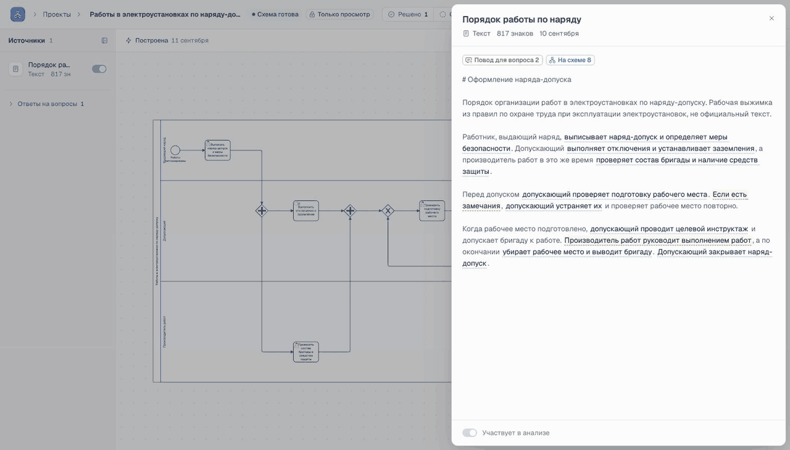

<p align="center">
  
</p>

<h1 align="center">BPMN.Space</h1>

<p align="center">От описания процесса до понятной BPMN-схемы.</p>

<p align="center">
  <a href="https://bpmn.space">Попробовать</a> ·
  <a href="docs/rfc/0001-architecture.md">Архитектура</a> ·
  <a href="examples">Примеры</a>
</p>

Регламент в PDF, заметки после встречи, голосовое объяснение коллеги —
соберите всё в одном проекте. BPMN.Space найдёт пробелы и противоречия,
задаст уточняющие вопросы и поможет превратить материалы в схему процесса.



*Настоящий учебный пример на bpmn.space: работы в электроустановках по наряду-допуску.*

## От материалов к процессу

1. **Добавьте источники.** Текст, документы или голосовые заметки.
2. **Разберите неясности.** Ассистент задаёт вопросы и показывает фрагменты,
   на которых они основаны. Ответьте и повторите анализ.
3. **Постройте схему.** Исполнители, действия, условия и развилки становятся
   редактируемой диаграммой BPMN 2.0.
4. **Пройдите по процессу.** Поправьте схему мышкой, запустите воспроизведение
   и выберите ветви на развилках.
5. **Передайте результат.** Скачайте BPMN, SVG или PNG либо пригласите коллег
   смотреть и редактировать проект.

«После проверки готовят договор и счёт» — кто именно выставляет счёт?
Такую недосказанность можно уточнить до построения схемы.
Если решения пока нет, оно останется явным допущением.

## Что внутри

- Текст, голос, DOCX, PDF с текстовым слоем, Markdown, TXT и CSV.
- Уточняющие вопросы с цитатами, проверка оснований и связь схемы с источниками.
- Редактор на bpmn-js, история версий, сохранение ручных правок
  при повторной генерации поддерживаемого графа.
- Проверка XML по официальной XSD BPMN 2.0, проверки графа и bpmnlint.
- Совместная работа: доступ на просмотр и редактирование, присутствие и курсоры.
- Пять учебных проектов и пошаговое знакомство с приложением.

Генератор умеет строить один пул с дорожками, задачами, XOR/AND-развилками
и циклами. Подробнее о поддержке и ограничениях —
в [правилах генерации](docs/backend/generation-quality.md).

**Как устроено:** React + TypeScript, FastAPI + PostgreSQL и отдельный Node-сервис
для размещения элементов и проверки схем. Модель возвращает JSON-граф;
BPMN XML собирает код. Воспроизведение работает в браузере.

## Запустить у себя

Нужны Docker Compose, Node.js ≥22.12, Python 3.13 и uv.

```bash
git clone https://github.com/MattoYuzuru/BPMN.Space.git
cd BPMN.Space
cp .env.example .env
make setup
make up
```

Откройте [localhost:8080](http://localhost:8080).
По умолчанию используются записанные ответы модели и примеры расшифровки —
API-ключи не нужны. Для работы со своими материалами подключите
[живые модели и распознавание речи](docs/backend/подключение-провайдеров.md).
Команды разработки и проверки — в [документации](docs/README.md).

## Авторы

Проект сделали вдвоём: [Матвей Рябушкин](https://github.com/MattoYuzuru)
и Тимофей Яковлев, команда «Подайте токенов пжпж».
Создан для хакатона [«ИИ-ассистенты для энергетики»](https://codenrock.com/contests/ii-assistenty)
от «Интер РАО» при поддержке «Яндекса», трек «Архитектор BPMN-диаграмм».

В [исходном GitLab](https://git.codenrock.com/codenrock/ii-assistenty/podayte-tokenov-pzhpzh/arkhitektor-bpmn-diagramm)
остались задачи и обсуждения разработки. История Git и ветки сохранены здесь.
