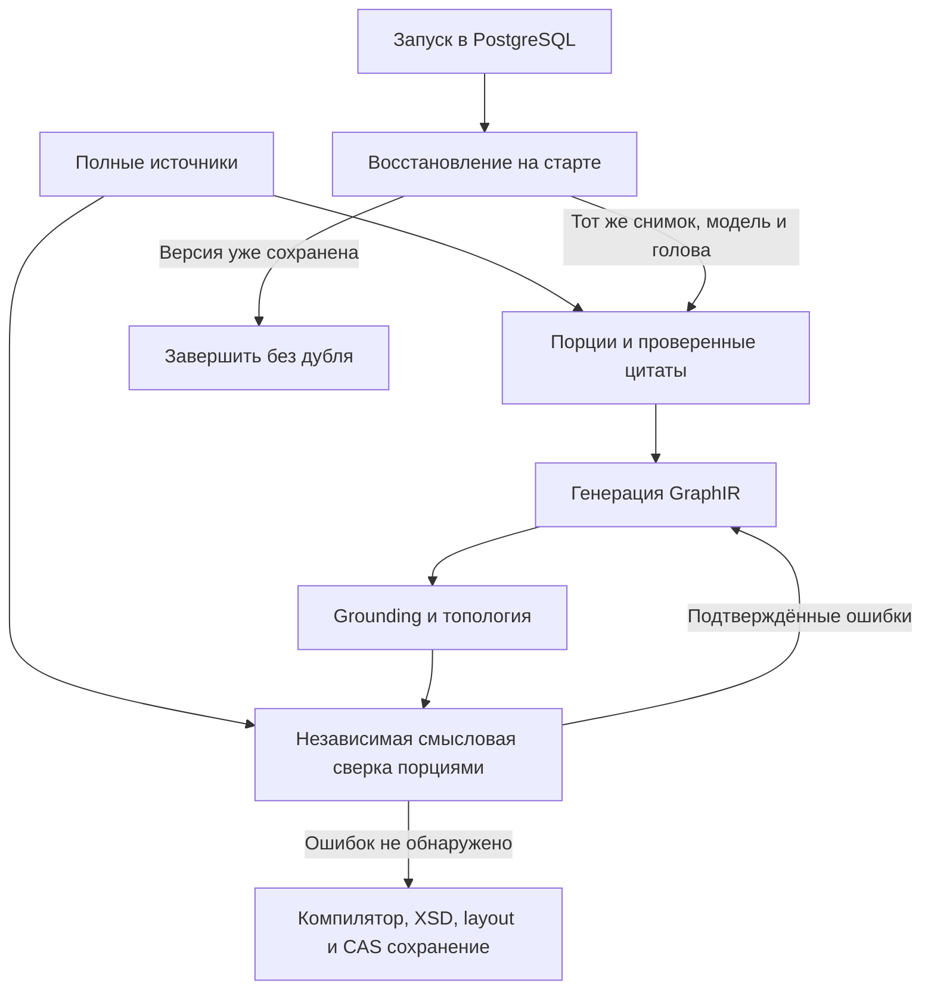

# ADR-0008. Полное чтение оснований, смысловая проверка и ограниченное восстановление

- Статус: принято в ветке; production ещё не обновлён
- Дата: 2026-10-07
- Связано: RFC-0001 §5.1–5.3, задачи #24 и #26

## Контекст

Структура получала только начало источников, хотя анализ вопросов читал весь доступный
текст. XSD проверяет формат, но не правильность процесса. При рестарте запуск терял
исполнителя и завершался ошибкой.

## Решение

1. OpenAI-совместимый пайплайн использует весь evidence snapshot, если он помещается
   в бюджет. При превышении читает каждый источник порциями с перекрытием 200 символов,
   извлекая дословные цитаты о процессе. Цитаты проверяются кодом в исходной порции.
   Переполнение совокупных оснований вызывает явный отказ без усечения.
2. `LLM_SEMANTIC_REVIEW=true` по умолчанию в конфигурации приложения. Независимый запрос
   проверяет ответственность, порядок, условия, параллельность, возвраты и пропуски.
   Проверяющий читает полный снимок порциями, а не только извлечённые основания.
   Ошибка обязана иметь существующий ID элемента (либо null для пропуска) и точную цитату.
   Проверенные ошибки входят в существующий цикл repair (максимум три исправления).
   Непроверяемый ответ проверяющего не считается успешной проверкой.
3. PDF с отсутствующим текстом хотя бы на одной странице не переходит в ready.
   Сообщение показывает номера страниц. Пустую страницу также нельзя автоматически
   отличить от скана: пользователь удаляет пустые страницы либо выполняет OCR.
4. PostgreSQL на старте возвращает незавершённые запуски с сохранённым хешем источников
   в queued; lifespan запускает их заново с тем же ID. После двух восстановлений — failed.
   Уже опубликованная версия завершает запуск без новой генерации. Смена материалов,
   головы диаграммы или модели приводит к явному отказу. Пользовательская отмена остаётся
   cancelled и не восстанавливается. При штатной остановке сервер сохраняет queued.

## Последствия и границы

- Это вероятностная смысловая сверка, а не доказательство полной правильности процесса.
  Одна модель в двух ролях может повторить ошибку. Межпорционные связи требуют оценки
  на живых примерах; перекрытие не гарантирует сохранения сколь угодно длинного условия.
- Дополнительные запросы увеличивают время и стоимость. Действует общий deadline прогона;
  общий объём токенов учитывается существующим механизмом usage. Кэш цитируемых дайджестов
  пока не добавлен; повторный запуск повторно читает большие источники.
- OCR не реализован: главное изменение — запрет незаметно использовать неполный PDF.
- Восстановление повторяет этапы с начала, а не продолжает HTTP-запрос модели. Незавершённый
  оплаченный запрос может оплачиваться снова. Анализ вопросов не имеет checkpoint исполнения.
- Поддерживается текущий deployment с одним backend-процессом. Это не распределённая очередь
  и не lease для нескольких workers. Журнал SSE после рестарта начинается заново; клиенту
  следует переподключиться и перечитать статус через существующий GET запуска.
- Разбор processing-файлов по-прежнему переводится в failed при перезапуске. Автовосстановление
  файлов и общего чата, ревизии доказательств (#34) остаются отдельной работой.
- Изменений публичных API и схемы БД нет: служебные параметры восстановления находятся в
  существующем `runs.ir.execution`. Старые запуски без хеша не восстанавливаются автоматически.
