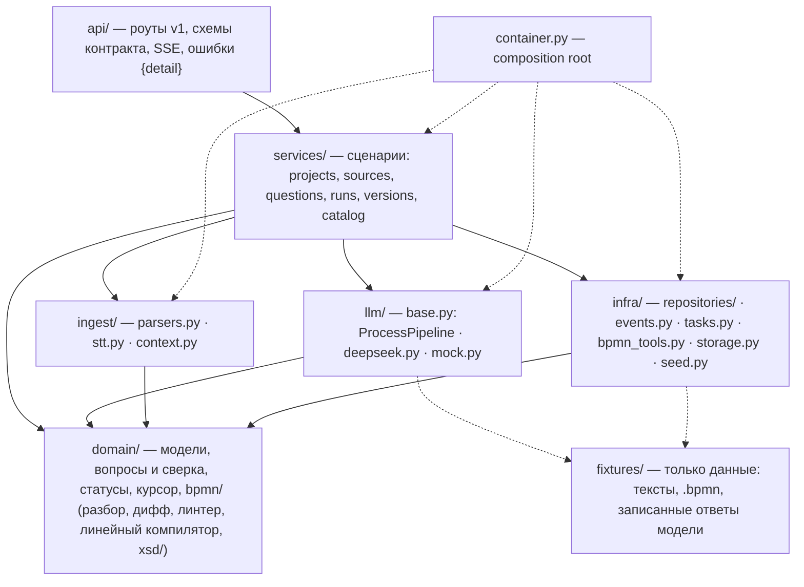

# Backend: что ещё заглушено и что нужно для настоящей реализации

Бэкенд в финальной структуре слоёв (RFC §5.6), контракт API настоящий: из Pydantic-схем
генерируются `docs/api/openapi.json` и `frontend/src/shared/api/schema.gen.ts`. Хранение,
аккаунты и общий доступ работают на Postgres (`persistence.md`, `auth-and-sharing.md`),
LLM-анализ и ответы помощника — на DeepSeek (`LLM_PROVIDER=deepseek`), расшифровка — на
Deepgram (`STT_PROVIDER=deepgram`). Заглушки стоят за интерфейсами (Protocol), реализации
выбирает `backend/app/container.py`.

Этот документ — честный список того, что ещё не сделано по-настоящему. Команда оставляет его
для следующих этапов: места в коде помечены `TODO(real)`
(`grep -rn "TODO(real)" backend/app`).

## Карта слоёв

Границы проверяет import-linter (`make lint`): слои `api → services → (llm | ingest | infra) → domain`,
`domain` без внешних зависимостей, `fixtures` не импортирует слои приложения.

## Что ещё заглушено

| Что | Как работает сейчас | Что нужно для настоящей реализации | RFC / issue |
|---|---|---|---|
| XSD-проверка (`domain/bpmn/xsd.py`) | Всегда возвращает `[]`: проверяется только корректность XML и корень `bpmn:definitions`. Поэтому `xsd_valid` в отчёте версии всегда `true`, в том числе у ручных правок. XSD-валидность схем-фикстур проверяют только тесты (lxml, dev-зависимость) | `lxml.etree.XMLSchema` по `domain/bpmn/xsd/BPMN20.xsd` с кэшем схемы, ошибки с номерами строк, lxml — в основные зависимости; ошибки идут в repair-цикл и в `422` при ручном сохранении | §5.5 · #5 |
| Раскладка и линтер (`infra/bpmn_tools.py`) | `layout` возвращает XML как есть (схемы уже с DI); `lint` — подмножество правил bpmnlint на Python (`domain/bpmn/lint.py`) | HTTP-клиент Node-сервиса bpmn-tools: `POST /layout` (bpmn-auto-layout 2.0.0-alpha.2, версия закреплена) и `POST /lint` (`bpmnlint:recommended`); таймауты, запасной раскладчик «ранг × полоса дорожки», сервис в Compose, URL в `config.py` | §4, §5.5, §11 · #6 |
| Импортёр XML → ProcessGraph (`domain/bpmn/document.py`) | Плоский разбор узлов, дорожек и потоков. Ручная правка схемы сохраняется версией `manual`, но следующий прогон её логику не учитывает: DeepSeek строит процесс заново из источников, mock возвращает схему аналитика как есть | `domain/importer.py` с подпроцессами, граничными событиями и message flow; ProcessGraph ручной правки — в контекст прогона с пометкой «правки аналитика приоритетнее» | §5.2, §5.3, §5.6 · #5 |
| Дифф версий (`domain/bpmn/diff.py`) | Сравнение узлов и дорожек по `id` | Дифф на уровне ProcessGraph: потоки и условия, сопоставление узлов без общих `id` (переименование против «удалить + добавить») | §5.6 · #5 |
| IR процесса со шлюзами (`llm/deepseek.py`, `domain/bpmn/linear.py`) | Модель отдаёт линейный список шагов с цитатами, код строит «старт → задачи → конец». Нет XOR/AND-шлюзов, циклов, условий, событий; `runs.ir` пустой. Repair — только по неподтверждённым цитатам (до 2 кругов) | JSON-схема IR (Pydantic), компилятор `domain/compiler.py` (IR → ProcessGraph → XML), валидатор с repair до 3 кругов, few-shot в `llm/prompts/`; Pydantic AI — вариант вместо ручного JSON-режима | §5.3–5.5 · #5 |
| Mock-пайплайн (`llm/mock.py`) | Записанные ответы по фразам-триггерам (`fixtures/playbook.py`); режим по умолчанию (`LLM_PROVIDER=mock`) | Остаётся фикстурой для тестов и демо без ключа; golden set и замеры качества — скилл `prompt-eval` | §9.1 · #5 |
| Бюджет контекста модели (`ingest/context.py`) | Лимит символов на все источники (`LLM_CONTEXT_BUDGET_CHARS`): лишнее обрезается поровну, самые старые источники сверх лимита пропускаются, обрезка видна в `warnings` прогона. Токенов не считаем, символы | Дайджест больших документов: строится один раз, кэшируется в `Source.digest` со ссылками на цитаты; бюджет в токенах модели | §5.2 п. 3 · #6 |
| Разбор документов (`ingest/parsers.py`) | `.docx` — только абзацы (без таблиц, колонтитулов, списков); PDF — pypdf, сканы без текстового слоя получают ошибку; `.csv` — построчно | python-docx; OCR сканов (Yandex Vision) — P2 | §5.2 · #6 |
| Распознавание речи (`ingest/stt.py`, `ingest/deepgram.py`) | По умолчанию mock (правдоподобная расшифровка); `STT_PROVIDER=deepgram` — один синхронный запрос без перепаковки | Yandex SpeechKit из RFC: ffmpeg → OGG_OPUS mono, клип ≤ 30 с — v1 синхронно, длиннее — v3 `recognizeFileAsync` + `getRecognition` | §5.2 · #6 |
| Задержки этапов (`container.py` → `mock_pace`) | Имитация работы модели из `MOCK_STAGE_DELAYS × MOCK_DELAY_SCALE`; действует при любом `LLM_PROVIDER`, поэтому с DeepSeek к реальному времени добавляется ≈ 7 с | Убрать, когда mock перестанет быть основным демо-режимом | §5.1 · #5 |
| Счётчики в списке проектов (`services/projects.py`) | На каждый проект несколько запросов (источники, вопросы, версии) | Один агрегирующий SQL-запрос на страницу | #6 |
| Фоновые задачи (`infra/tasks.py`) и SSE-журнал (`infra/events.py`) | `asyncio` внутри процесса. После перезапуска прогоны и разбор файлов в работе помечаются `failed` с понятной причиной, возобновления нет; журнал SSE живёт в памяти | Осознанно остаётся (один backend, RFC §6 — без Redis); при масштабировании — очередь и общий журнал | §5.1, §6 |
| Хранилище файлов (`infra/storage.py`) | `LocalFileStorage` на volume `/data/uploads` | S3-совместимое хранилище, если понадобится несколько узлов | §4 |

Не заглушено и остаётся: контракт API, сервисы, правила вопросов и сверки (`domain/questions.py`:
«решено» только с цитатой, найденной в источнике), статусы проекта, курсорная пагинация,
SSE, версии с допущениями, Postgres-репозитории с единицей работы (`Repositories.atomic()`),
аккаунты и общий доступ, повторы запросов к DeepSeek, срок прогона.

## Как устроен mock-прогон

`POST /projects/{id}/runs {mode}` → `202 Run` (`queued`), задача уходит в `AsyncioTaskSpawner`.
Одновременно выполняется не больше `MAX_CONCURRENT_RUNS` (семафор в `RunService`), второй прогон
того же проекта → `409`. Этапы (`domain/runs.py`):

| Этап | Анализ | Сборка | Что делает |
|---|---|---|---|
| `reading_sources` «Читаю источники» | да | да | `ingest/context.py`: активные готовые источники, вопросы, текущая схема |
| `extracting` «Ищу участников и шаги» | да | да | `pipeline.analyze` |
| `reconciling` «Сверяю вопросы» | да | да | `domain/questions.reconcile` → события `question`, `summary` |
| `structuring` «Строю структуру процесса» | — | да | `pipeline.structure` |
| `validating` «Проверяю схему» | — | да | `domain/bpmn/xsd.py` |
| `layout` «Раскладываю схему» | — | да | `bpmn_tools.layout` + `lint` → новая версия → событие `version` |

Последним всегда идёт `done {run}`; при ошибке перед ним — `error {message}`. `done` гарантирован:
даже если сохранить ошибку в БД не удалось, поток закрывается. Прогон ограничен сроком
`RUN_DEADLINE_SEC` (по истечении — `failed`), а пока он идёт, ручное сохранение схемы
(`PUT /projects/{id}/diagram`) отвечает `409`: версия прогона перекрыла бы правку. Подписчик SSE получает
историю прогона, затем новые события; `Last-Event-ID` продолжает поток. Для прогонов без журнала
(засеянных) поток состоит из одного `done`. Суммарно: анализ ≈ 5 с, сборка ≈ 7,5 с; в тестах
`Settings(mock_delay_scale=0)`.

Mock-модель (`llm/mock.py`) детерминирована и зависит от содержимого источников:

1. Отвеченный вопрос → `resolved` (цитата — первое предложение ответа); ответ короче 8 символов
   или «не знаю» → обратно `open`.
2. `ResolutionRule`: вопрос решается цитатой из источника, добавленного **после** вопроса.
3. `QuestionRule`: новый вопрос, если фраза-триггер есть в источниках (она же — цитата `about`).
4. Нет правил и вопросов → два типовых вопроса по шагам (`fixtures/generic.py`).
5. Схема: последняя из `DiagramRule`, чьи цитаты `requires` есть в источниках; иначе — линейная
   схема по шагам (`domain/bpmn/linear.py`); после ручной правки — схема аналитика.

### Управляемые режимы (маркеры в тексте источника)

Для e2e и тестов mock-модель понимает маркеры в тексте **любого** источника проекта (на
`LLM_PROVIDER=deepseek` они — обычный текст). Сами маркеры в шаги схемы не попадают.

| Маркер | Что делает mock-прогон |
|---|---|
| `[[mock:fail-early]]` | падает на этапе `extracting` (вопросов нет), `failed` |
| `[[mock:fail-structuring]]` | `build` падает на этапе `structuring` **после** сверки: вопросы уже созданы, схемы нет |
| `[[mock:no-questions]]` | новых вопросов нет, схема строится |

Материалы тура (документ «Записка со встречи» + текст-подсказка, `docs/backend/onboarding.md`)
дают под mock ровно 2 открытых вопроса и схему — их выбирают правила `TP_TERM` и `TP_ORDER`
из `fixtures/playbook.py`; проверяет тест и `scripts/tour_eval.py`.

### Демо-сценарий

Проект «Технологическое присоединение к электросетям», id стабилен:
`uuid5(6f0c2d4e-8a51-4c1e-9b7a-0d3e5f861000, "project/tp861")` (`DEMO_PROJECT_ID` в `infra/seed.py`).

- Источники: регламент (text), заметка со встречи (voice, противоречит регламенту по сроку),
  «Финансы проекта.docx» (file, загружен после последнего прогона), ответ на Q-5.
- Вопросы: Q-1 `resolved`, Q-2 `ignored`, Q-3, Q-4, Q-6 `open`, Q-5 `answered`. Версии v1 (с
  предупреждением `fake-join`) и v2.
- `analyze`: Q-5 → `resolved` (ответ), Q-3 → `resolved` (цитата из «Финансы проекта.docx»),
  новый Q-7 (`conflict`), Q-4 и Q-6 остаются. Итог: решено 2 · осталось 2 · новых 1.
- `build`: v3 с дорожкой «Финансовый отдел» (дифф: +3, изменено 2).

Тот же сценарий проходит проект из примера `tp861` (`POST /projects/from-example`) с загрузкой
`examples/tp861/input/project-finances.docx`.

## Как добавить фикстуру

1. Текст источника — `backend/app/fixtures/texts/<name>.md`.
2. Схема — описание в `backend/scripts/build_fixtures.py` (`DIAGRAMS`), затем
   `uv run --directory backend python scripts/build_fixtures.py` (нужен Node; раскладка
   bpmn-auto-layout 2.0.0-alpha.2, проверки XSD и bpmnlint `recommended`, копии в `examples/`).
   Поток, который раскладчик ведёт в обход дорожки, добавьте в `reroute`.
3. «Ответы модели» — `QuestionRule`, `ResolutionRule`, `DiagramRule` в `fixtures/playbook.py`.
   Все цитаты должны дословно встречаться в текстах — это проверяет `tests/test_fixtures_bpmn.py`.
4. Проект в списке — `infra/seed.py` (хронология: источники → прогоны → вопросы → версии) или
   тема в `fixtures/catalog.py` (регламент, вопросы и линейная схема сгенерируются).
5. Пример для `GET /examples` — `fixtures/examples.py`.

Осознанное предупреждение bpmnlint одно: `fake-join` в `tp861_v1` (ранняя версия возвращает цикл
прямо в задачу, v2 исправляет это шлюзом-слиянием). Остальные схемы — 0 ошибок и 0 предупреждений.

## Конфигурация

Всё задаётся в `backend/app/config.py` и `.env.example`. Для этого документа важны:
`LLM_PROVIDER`, `STT_PROVIDER`; mock — `MOCK_DELAY_SCALE` (0 — мгновенно), `MOCK_STAGE_DELAYS`,
`MOCK_TRANSCRIPTION_DELAY_SEC`, `MOCK_PARSE_DELAY_SEC`, `SEED_DEMO_DATA`; прогоны —
`MAX_CONCURRENT_RUNS`, `RUN_DEADLINE_SEC`, `LLM_CONTEXT_BUDGET_CHARS`; DeepSeek —
`DEEPSEEK_TIMEOUT_SEC`, `DEEPSEEK_MAX_RETRIES`, `DEEPSEEK_RETRY_BASE_SEC`,
`DEEPSEEK_RETRY_MAX_SEC`; загрузки — `MAX_UPLOAD_BYTES`, `MAX_AUDIO_BYTES`, `MAX_DIAGRAM_BYTES`,
`MAX_TEXT_CHARS`, `MAX_PDF_PAGES`, `PARSE_TIMEOUT_SEC`.
