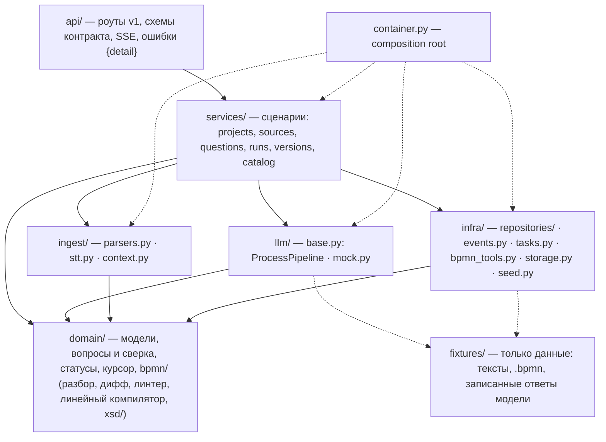

# Backend: что уже работает и что остаётся заменить

Бэкенд уже в финальной структуре слоёв (RFC §5.6), контракт API — настоящий: из Pydantic-схем
генерируются `docs/api/openapi.json` и `frontend/src/shared/api/schema.gen.ts`. Заглушки стоят
за интерфейсами (Protocol), а выбор реализаций сделан в одном месте — `backend/app/container.py`.
Хранение уже переведено на Postgres; ingest, STT, bpmn-tools и LLM-пайплайн остаются в работе.

Детали БД и миграций — в `docs/backend/persistence.md`.

## Карта слоёв

Границы проверяет import-linter (`make lint`): слои `api → services → (llm | ingest | infra) → domain`,
`domain` без внешних зависимостей, `fixtures` не импортирует слои приложения.

## Что заглушено

| Интерфейс | Где | Mock | Настоящая реализация |
|---|---|---|---|
| Репозитории проектов, источников, вопросов, прогонов, версий и вызовов модели | `infra/repositories/base.py` | `memory.py` — тестовый режим | `infra/repositories/sql.py`: SQLAlchemy 2 + Alembic, Postgres 16 |
| `ProcessPipeline` (анализ + структура) | `llm/base.py` | `llm/mock.py`: правила из `fixtures/playbook.py` срабатывают по цитатам в источниках | #5: Pydantic AI, IR → ProcessGraph → XML, repair |
| `SpeechToText` | `ingest/stt.py` | ждёт ~1 с, отдаёт правдоподобную расшифровку | #6: Yandex SpeechKit + ffmpeg |
| `DocumentParser` | `ingest/parsers.py` | `.txt`/`.md` — напрямую; `.csv` — построчно с сохранением ячеек, до 40 000 символов контекста; `.docx` — упрощённо (абзацы); `.pdf` — pypdf по страницам, сканы без текстового слоя получают ошибку | OCR через Yandex Vision — P2 |
| `BpmnTools` (layout, lint) | `infra/bpmn_tools.py` | раскладку не делает (схемы уже с DI), линтер — `domain/bpmn/lint.py` | #6: HTTP-клиент к Node-сервису bpmn-tools |
| XSD-проверка | `domain/bpmn/xsd.py` | только корректность XML и корень `bpmn:definitions` | #5: lxml + `domain/bpmn/xsd/*.xsd` |
| `RunEventBus` | `infra/events.py` | in-process журнал событий прогона | остаётся (один backend); итог завершённого прогона синтезируется из БД после рестарта |
| `TaskSpawner` | `infra/tasks.py` | `asyncio`-задачи | остаётся; при старте queued/running прогоны переводятся в `failed` |
| `FileStorage` | `infra/storage.py` | `InMemoryFileStorage` в тестах | `LocalFileStorage`: volume `/data/uploads`, позже S3 |
| Задержки этапов | `container.py` → `mock_pace` | из `MOCK_STAGE_DELAYS × MOCK_DELAY_SCALE` | #5: убрать — этапы занимают время сами |

Не заглушено и остаётся: контракт API, сервисы, правила вопросов и сверки (`domain/questions.py`:
«решено» только с цитатой, найденной в источнике), статусы проекта, курсорная пагинация,
дифф версий, отчёт с допущениями, SSE.

## Как устроен mock-прогон

`POST /projects/{id}/runs {mode}` → `202 Run` (`queued`), задача уходит в `AsyncioTaskSpawner`.
Одновременно выполняется не больше `MAX_CONCURRENT_RUNS` (семафор в `RunService`), второй прогон
того же проекта → `409`. Этапы (`domain/runs.py`):

| Этап | Анализ | Сборка | Что делает |
|---|---|---|---|
| `reading_sources` «Читаю источники» | да | да | `ingest/context.py`: активные готовые источники, вопросы, текущая схема |
| `extracting` «Ищу участников и шаги» | да | да | `pipeline.analyze` |
| `reconciling` «Сверяю вопросы» | да | да | `domain/questions.reconcile` → события `question`, `summary` |
| `structuring` «Строю структуру процесса» | — | да | `pipeline.structure` |
| `validating` «Проверяю схему» | — | да | `domain/bpmn/xsd.py` |
| `layout` «Раскладываю схему» | — | да | `bpmn_tools.layout` + `lint` → новая версия → событие `version` |

Последним всегда идёт `done {run}`; при ошибке перед ним — `error {message}`. Подписчик SSE получает
историю прогона, затем новые события; `Last-Event-ID` продолжает поток. Для прогонов без журнала
(засеянных) поток состоит из одного `done`. Суммарно: анализ ≈ 5 с, сборка ≈ 7,5 с; в тестах
`Settings(mock_delay_scale=0)`.

Mock-модель (`llm/mock.py`) детерминирована и зависит от содержимого источников:

1. Отвеченный вопрос → `resolved` (цитата — первое предложение ответа); ответ короче 8 символов
   или «не знаю» → обратно `open`.
2. `ResolutionRule`: вопрос решается цитатой из источника, добавленного **после** вопроса.
3. `QuestionRule`: новый вопрос, если фраза-триггер есть в источниках (она же — цитата `about`).
4. Нет правил и вопросов → два типовых вопроса по шагам (`fixtures/generic.py`).
5. Схема: последняя из `DiagramRule`, чьи цитаты `requires` есть в источниках; иначе — линейная
   схема по шагам (`domain/bpmn/linear.py`); после ручной правки — схема аналитика.

### Демо-сценарий

Проект «Технологическое присоединение к электросетям», id стабилен:
`uuid5(6f0c2d4e-8a51-4c1e-9b7a-0d3e5f861000, "project/tp861")` (`DEMO_PROJECT_ID` в `infra/seed.py`).

- Источники: регламент (text), заметка со встречи (voice, противоречит регламенту по сроку),
  «Финансы проекта.docx» (file, загружен после последнего прогона), ответ на Q-5.
- Вопросы: Q-1 `resolved`, Q-2 `ignored`, Q-3, Q-4, Q-6 `open`, Q-5 `answered`. Версии v1 (с
  предупреждением `fake-join`) и v2.
- `analyze`: Q-5 → `resolved` (ответ), Q-3 → `resolved` (цитата из «Финансы проекта.docx»),
  новый Q-7 (`conflict`), Q-4 и Q-6 остаются. Итог: решено 2 · осталось 2 · новых 1.
- `build`: v3 с дорожкой «Финансовый отдел» (дифф: +3, изменено 2).

Тот же сценарий проходит проект из примера `tp861` (`POST /projects/from-example`) с загрузкой
`examples/tp861/input/project-finances.docx`.

## Замена mock на реализацию

### #6 — хранение, ingest, bpmn-tools

1. `ingest/parsers.py`: добавить python-docx вместо упрощённого `_docx_text`; PDF уже извлекается через pypdf, лимит текста задаётся в config.
2. `ingest/stt.py`: класс `YandexSpeechToText` с тем же `transcribe`; ffmpeg в образе.
3. `infra/bpmn_tools.py`: `HttpBpmnTools` (`/layout`, `/lint`), URL — в `config.py`.
4. Результаты `analysis`, отчёт, модель и задержка прогона сохраняются в БД; вызовы этапов
   записываются в `llm_calls`. Токены пока неизвестны в общем формате и остаются `null`.
5. Добавить JSON IR, когда пайплайн будет возвращать промежуточное представление согласно RFC;
   сейчас структура возвращает готовый BPMN-черновик, поэтому `runs.ir` пустой.
6. API-контракт и роуты пока остаются прежними.

### #5 — LLM-пайплайн и domain

1. `llm/agents.py`, `llm/providers.py`, `llm/prompts/`: класс с методами `analyze` и `structure`
   из `llm/base.py`. `structure` получает IR от модели и вызывает `domain/compiler.py`
   (IR → ProcessGraph → XML) с repair-циклом по ошибкам валидатора.
2. `domain/bpmn/xsd.py`: настоящая проверка lxml по `xsd/BPMN20.xsd`; lxml — в основные зависимости.
3. `domain/importer.py`: XML → ProcessGraph, чтобы ручная правка (`PUT /projects/{id}/diagram`)
   учитывалась следующим прогоном; `domain/bpmn/diff.py` — дифф по ProcessGraph.
4. Убрать `mock_pace` из `container.py`.
5. `llm/mock.py` и `fixtures/playbook.py` остаются фикстурой для тестов сервисов.

## Как добавить фикстуру

1. Текст источника — `backend/app/fixtures/texts/<name>.md`.
2. Схема — описание в `backend/scripts/build_fixtures.py` (`DIAGRAMS`), затем
   `uv run --directory backend python scripts/build_fixtures.py` (нужен Node; раскладка
   bpmn-auto-layout 2.0.0-alpha.2, проверки XSD и bpmnlint `recommended`, копии в `examples/`).
   Поток, который раскладчик ведёт в обход дорожки, добавьте в `reroute`.
3. «Ответы модели» — `QuestionRule`, `ResolutionRule`, `DiagramRule` в `fixtures/playbook.py`.
   Все цитаты должны дословно встречаться в текстах — это проверяет `tests/test_fixtures_bpmn.py`.
4. Проект в списке — `infra/seed.py` (хронология: источники → прогоны → вопросы → версии) или
   тема в `fixtures/catalog.py` (регламент, вопросы и линейная схема сгенерируются).
5. Пример для `GET /examples` — `fixtures/examples.py`.

Осознанное предупреждение bpmnlint одно: `fake-join` в `tp861_v1` (ранняя версия возвращает цикл
прямо в задачу, v2 исправляет это шлюзом-слиянием). Остальные схемы — 0 ошибок и 0 предупреждений.

## Конфигурация

`backend/app/config.py`: `MOCK_DELAY_SCALE` (0 — мгновенно), `MOCK_STAGE_DELAYS`,
`MOCK_TRANSCRIPTION_DELAY_SEC`, `MOCK_PARSE_DELAY_SEC`, `SEED_DEMO_DATA`, `MAX_CONCURRENT_RUNS`,
`MAX_UPLOAD_BYTES`, `MAX_AUDIO_BYTES`, `MAX_DIAGRAM_BYTES`, `MAX_TEXT_CHARS`.
