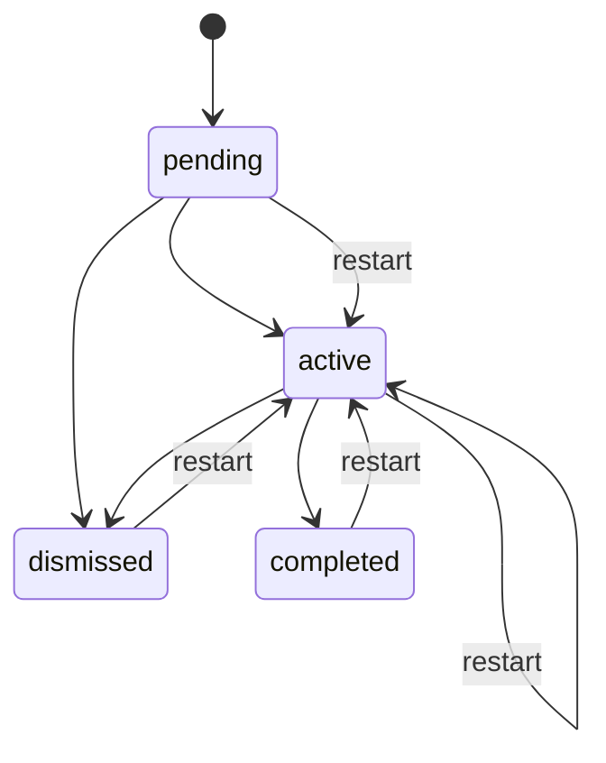

# Онбординг: бэкенд

Тур по продукту и чек-лист «Начало работы» (эпик #9). Бэкенд — источник правды о прогрессе:
хранит состояние тура, **сам отмечает** пункты чек-листа в момент серверного действия, принимает
от клиента отметки о действиях, которых не видит, подсказывает, куда вести по невыполненному
пункту, и раздаёт учебные материалы («Примеры»). Порядок и тексты шагов тура — на фронтенде.

Онбординг — надстройка: ни одно существующее действие не зависит от него (сбой учёта не ломает
действие), а при `ONBOARDING_ENABLED=false` продукт работает как раньше.

## Когда он включён

| Условие | Поведение |
|---|---|
| `AUTH_ENABLED=true` и `ONBOARDING_ENABLED=true` (по умолчанию) | Всё работает для вошедшего пользователя |
| `AUTH_ENABLED=false` или `ONBOARDING_ENABLED=false` | `GET /me/onboarding` → `200 {enabled: false}`, остальные `/me/onboarding*` → `404`, учёт ничего не делает |
| Нет сессии | `GET /me/onboarding` → `200 {enabled: false}`, остальные `/me/onboarding*` → `401` |

`GET /samples` и `POST /projects/{id}/sources/sample` от флага **не зависят**: это обычная функция
добавления источников.

## Данные

Миграция `0008_onboarding` (подробности и откат — в [persistence.md](persistence.md)).

```text
user_onboarding            одна строка на пользователя, создаётся лениво при первом GET
  user_id          PK, FK users ON DELETE CASCADE
  tour_status      pending | active | completed | dismissed   (CHECK)
  tour_step        ключ шага или NULL вне тура
  tour_project_id  FK projects ON DELETE SET NULL — учебный проект
  checklist_hidden скрыта ли плашка чек-листа
  created_at, updated_at

user_onboarding_items      отмеченные пункты
  (user_id FK users ON DELETE CASCADE, item_key)  PK
  completed_at, source (server | client)

runs.created_by            кто запустил прогон, FK users ON DELETE SET NULL
```

`item_key` — текстовое значение `ChecklistItem`: новые пункты добавляются без миграций, а
убранные из продукта пропускаются при чтении. Существующие пользователи начинают чек-лист с нуля —
разовой отметки по старым данным нет.

`runs.created_by` нужен, потому что прогон завершается в фоне, где текущего пользователя уже
нет: по нему отмечаются `diagram_built` и `diagram_rebuilt` тому, **кто запустил** прогон
(редактору по ссылке, а не владельцу проекта).

## Тур



Чистая функция `check_transition` (`domain/onboarding.py`) — таблица допустимых переходов;
всё остальное — `409`. `restart` допустим из любого статуса (в том числе из `active`: «Начать
заново», когда учебный проект удалён). Шаг при `completed` и `dismissed` обнуляется; для
`active` берётся переданный, иначе текущий, иначе `project.create`. Строка с неизвестным шагом (запись новее этого релиза) читается как шаг `null`, с неизвестным
статусом — как `dismissed`, с предупреждением в логе, а не `500`. Бэкенд проверяет только, что
ключ шага известен (11 значений `TourStepKey`, иначе `422`), но не порядок шагов.

`PATCH /me/onboarding/tour` с `project_id` принимает только **свой** проект (чужой, демо и
несуществующий — `404`); `project_id: null` снимает проект. Запись идёт условно:
`UPDATE … WHERE tour_status = <прочитанный>`, поэтому две вкладки не затирают друг друга
молча — проигравшая получает `409`.

## Учёт первых действий

`OnboardingService.record(user_id, item, source)` — вставка `INSERT … ON CONFLICT DO NOTHING`;
возвращает, был ли пункт отмечен впервые (повтор не меняет `completed_at`). При первой отметке
пишется лог `onboarding.item_completed`. Любое исключение ловится и логируется, **наружу не
выходит**: учёт — «лучшее усилие» и вызывается после успешного основного действия, вне его
транзакции. Без пользователя и при выключенном онбординге — ничего не делает.

| Пункт | Где отмечается |
|---|---|
| `project_created` | `POST /projects`, `POST /projects/from-example` |
| `text_source_added` | `POST /projects/{id}/sources/text`, `kind=text` |
| `voice_added` | `POST /projects/{id}/sources/text`, `kind=voice`; `POST /projects/{id}/sources/sample` для голосовой заметки |
| `document_uploaded` | `POST /projects/{id}/sources/file`; `POST /projects/{id}/sources/sample` для документа |
| `diagram_built` | `RunService`: прогон `build` завершился `succeeded` — автору прогона (`runs.created_by`) |
| `diagram_rebuilt` | там же, если до прогона у проекта уже была версия схемы и после неё появился источник `kind=answer` |
| `question_answered` | `POST /questions/{id}/answer` |
| `assumption_accepted` | `POST /questions/{id}/ignore` |
| `diagram_edited` | `PUT /projects/{id}/diagram` (версия `manual`) |
| `project_shared` | `POST /projects/{id}/share-links` |
| `simulation_run`, `diagram_exported` | `POST /me/onboarding/events` от клиента |

`POST /me/onboarding/events {item}` принимает только `CLIENT_REPORTABLE`
(`simulation_run`, `diagram_exported`), иначе `422`; ответ `204`, повтор безопасен. В отличие от
серверного учёта, ошибка записи здесь возвращается клиенту (`500`): отметку можно повторить.

### Слои

HTTP-ручки получают `OnboardingService` из контейнера и вызывают `record` с id текущего
пользователя (`api → services`). `RunService` зависит не от него, а от **порта**
`ProgressRecorder` (протокол в `services/runs.py`); реализацию подключает `container.py`.
Отметка делается после создания версии схемы и **до** статуса `succeeded`, поэтому тот, кто
увидел успех прогона (по SSE `done` или опросом `GET /runs/{id}`), уже видит пункт в чек-листе.
`diagram_rebuilt` засчитывается, только если ответ появился не позже старта прогона (`runs.started_at`). Сбой учёта прогон не проваливает. `import-linter`
остаётся зелёным.

## Куда вести по пункту

`GET /me/onboarding/items/{item}/target` → `{route, project_id?, question_id?, hint}`.
Факты по проектам собирает один SQL-запрос (`OnboardingRepository.project_facts`: подзапросы
по источникам, вопросам и версиям, без текстов и XML), кандидатов не больше 30.
Кандидаты — проекты, которые пользователь может **редактировать** (свои и где он редактор по
ссылке; демо `public_read_only` не считаются), по `updated_at` от свежих к старым (не больше 30
каждого вида). Выбор — чистая функция `resolve_target(item, projects)`.

| Пункт | Правило | Если подходящего нет |
|---|---|---|
| `project_created` | экран проектов | — |
| `text_source_added`, `document_uploaded`, `voice_added` | последний проект | экран проектов, `need_project` |
| `diagram_built` | последний проект с готовыми источниками и без схемы; иначе последний проект с источниками | последний проект, `need_source`; проектов нет — `need_project` |
| `question_answered`, `assumption_accepted` | последний проект с открытыми вопросами и id самого раннего открытого | проект с источниками, `need_questions`; иначе как у `diagram_built` |
| `diagram_rebuilt` | последний проект со схемой и ответом после последней версии | как у `question_answered` |
| `diagram_edited`, `simulation_run`, `diagram_exported` | последний проект со схемой | проект, где схему можно построить, `need_diagram`; иначе как у `diagram_built` |
| `project_shared` | последний **свой** проект | экран проектов, `need_project` |

`route` — `projects` или `workspace`; `hint` — `do_item`, `need_project`, `need_source`,
`need_diagram`, `need_questions`. Якорь и тексты подсказок выбирает фронтенд по `item` и `hint`.

## Учебные материалы («Примеры»)

Реестр — `app/fixtures/samples.py`, файлы — `app/fixtures/samples/`; всё собирает
`make fixtures` (`scripts/build_fixtures.py`, только материалы — `--samples`, без Node).

| id | Материал | Что это |
|---|---|---|
| `tp861-meeting-note` | «Записка со встречи — техприсоединение.docx» | **Документ тура** (`tour: true`): записка со встречи плюс дополнение с намеренными пробелами в процессе — кто готовит акт, что при неоплате счёта, сроки. `.docx` собирает `zipfile` + минимальный WordprocessingML, без зависимостей и без сжатия (`ZIP_STORED`): результат пересборки побайтно детерминирован, и `tests/test_sample_files.py` ловит забытый `make fixtures` |
| `repair-outage` | «Регламент вывода оборудования в ремонт.md» | копия `texts/repair_outage.md` |
| `work-permit` | «Работы по наряду-допуску.txt» | копия `texts/work_permit.md` |
| `voice-request-approval` | «Голосовая заметка — согласование заявки» | `kind=voice`, только расшифровка (≈ 550 символов разговорной речи) |

`GET /samples` → `[{id, title, kind: document | voice, format, size_bytes, tour}]` (доступ как
у `GET /examples`). `POST /projects/{id}/sources/sample {sample_id}` → `Source`, права и лимит —
как у `sources/file` (бакет «дорогих» запросов):

- документ — копия файла в хранилище и **тот же** путь разбора, что у `sources/file`
  (`SourceService.create_file`, `.docx` разбирается в фоне: `processing` → `ready`);
- голосовая заметка — `create_text(kind=voice, title, content=расшифровка)`, сразу `ready`,
  без аудио и распознавания.

Оркестрация — в `services/samples.py`: `ingest` и `infra` — независимые слои.

Текст-подсказка для шага тура «Опишите процесс» — `texts/tour_text_suggestion.txt`, отдаётся в
`GET /me/onboarding` как `tour_text_suggestion`.

### Проверка на модели

Под mock-моделью документ тура и текст-подсказка дают **ровно 2 открытых вопроса** и схему
(тест `test_tour_materials_give_exactly_two_open_questions_and_a_diagram`; те же два вопроса и с
голосовой заметкой). С настоящей моделью стабильность проверяет скрипт — критерий: схема во всех
5 прогонах и ≥ 2 открытых вопроса минимум в 4 из 5:

```sh
cd backend
# mock, бесплатно
MOCK_DELAY_SCALE=0 uv run python scripts/tour_eval.py --runs 5
# настоящая модель (тратит ключ DeepSeek)
LLM_PROVIDER=deepseek DEEPSEEK_API_KEY=… MOCK_DELAY_SCALE=0 \
  uv run python scripts/tour_eval.py --runs 5
```

Если вопросов меньше двух, правится только дополнение `texts/tour_note_addendum.txt` (больше
пробелов в процессе), после чего `make fixtures`.

## Управляемый mock модели

Маркеры в тексте любого источника (только mock, `docs/backend/mock.md`):
`[[mock:fail-early]]`, `[[mock:fail-structuring]]`, `[[mock:no-questions]]` — с их помощью e2e
проверяют ветвления тура (сбой прогона с вопросами и без них, «вопросов нет»).

## API

| Метод | Путь | Что |
|---|---|---|
| GET | `/me/onboarding` | `{enabled, tour: {status, step, project_id, updated_at}, checklist: {hidden, items: [{key, completed_at, source}]}, tour_text_suggestion}`; при `enabled=false` остальные поля `null` |
| PATCH | `/me/onboarding/tour` | `{status?, step?, project_id?}` → новое состояние; недопустимый переход `409`, чужой проект `404` |
| POST | `/me/onboarding/tour/restart` | `active`, `project.create`, без проекта |
| PATCH | `/me/onboarding/checklist` | `{hidden}` |
| POST | `/me/onboarding/events` | `{item}` из `CLIENT_REPORTABLE`, `204` |
| GET | `/me/onboarding/items/{item}/target` | куда вести |
| GET | `/samples` | учебные материалы |
| POST | `/projects/{id}/sources/sample` | добавить материал источником |

Лимиты — общие (ADR 0002, по IP): `sources/sample` — в бакете «дорогих» запросов; тур делает не
больше одного `PATCH` на шаг. Изменяющие запросы требуют CSRF-токен, как и остальные.

## Логи

Структурные записи `ключ=значение` в логгере `app.services.onboarding`, без персональных данных
кроме `user_id`:

| Запись | Поля |
|---|---|
| `onboarding.tour_started` | `user_id`, `restart` |
| `onboarding.step` | `user_id`, `step`, `previous_step`, `previous_step_sec` — сколько пользователь пробыл на прошлом шаге |
| `onboarding.tour_completed` | `user_id`, `last_step`, `last_step_sec` |
| `onboarding.tour_dismissed` | `user_id`, `step`, `step_sec` — на каком шаге отказался |
| `onboarding.item_completed` | `user_id`, `item`, `source`, `in_tour` — отмечен ли пункт во время тура |

## Тесты

- домен: `tests/test_onboarding_domain.py` — все пары статусов, `resolve_target` для каждого
  пункта и случая таблицы;
- in-memory: `tests/test_onboarding.py` — сервис, учёт, прогоны (автор, перестроение), мок-маркеры,
  материалы, выбор места по реальным проектам;
- PostgreSQL (`make test-postgres`): `tests/test_onboarding_http.py` — HTTP с аккаунтами, каждая
  точка учёта, права, сбой учёта, SQL-репозиторий и миграция `0008` (вверх и вниз).
