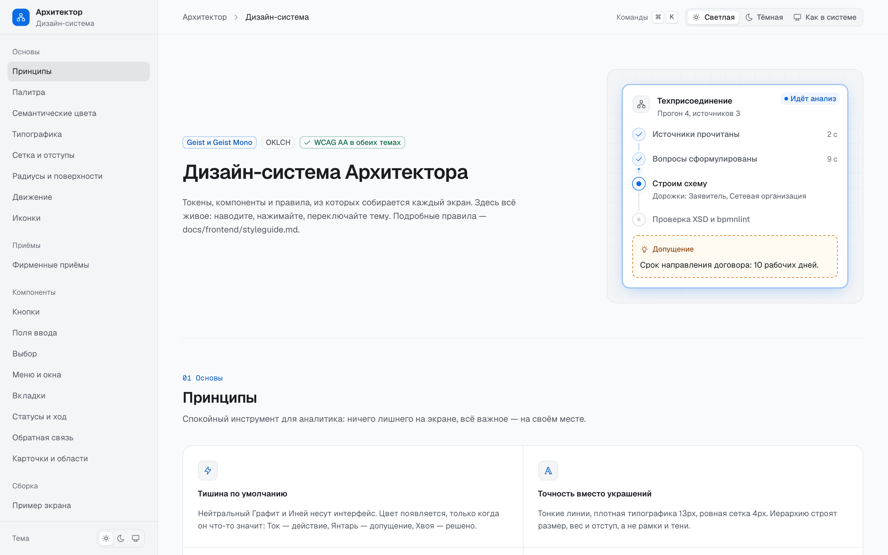
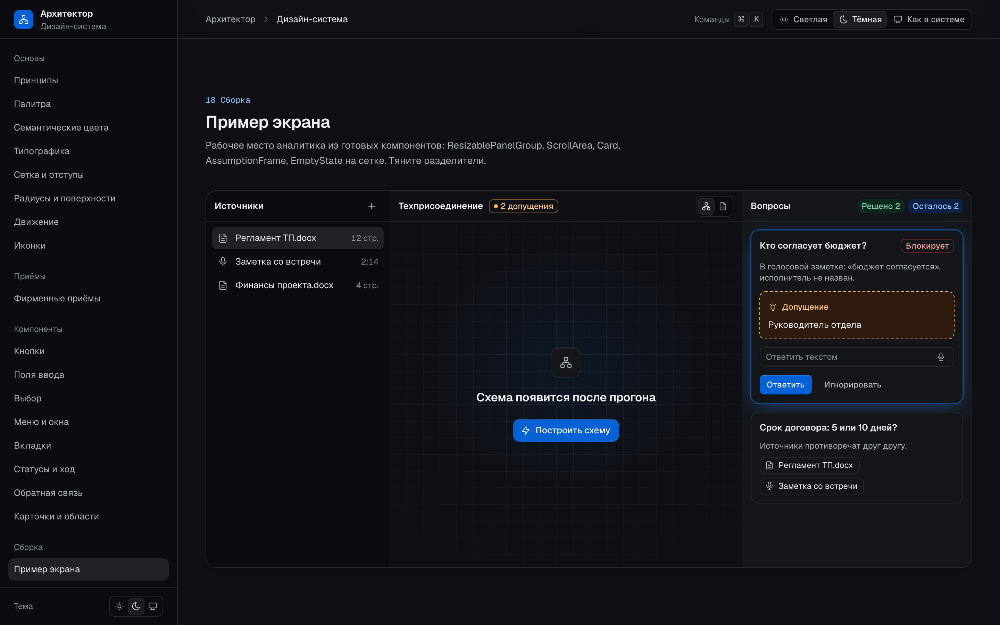
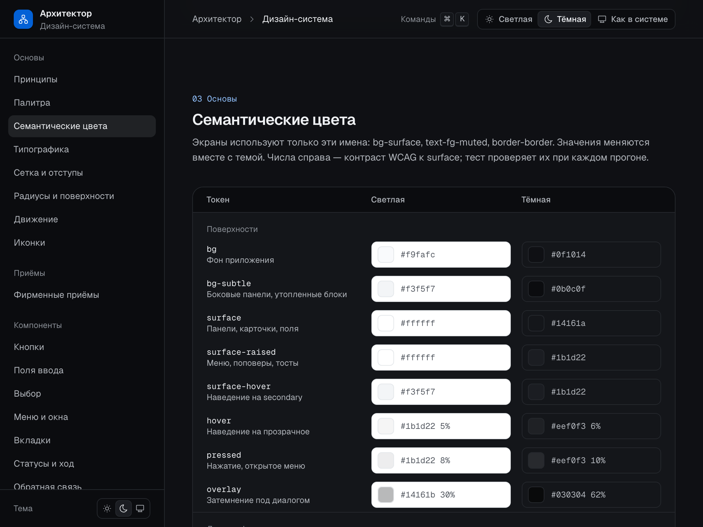

# Стайлгайд и гайдбук фронтенда

Документ, по которому собирается каждый экран «Архитектора BPMN». Живая версия со всеми компонентами, состояниями и обеими темами — маршрут [`/styleguide`](http://localhost:5173/styleguide) (`make dev-frontend`). Если документ и витрина расходятся, правда — в коде (`frontend/src/shared/styles/tokens.css`, `frontend/src/shared/ui/`), документ нужно поправить.



## Содержание

1. [Философия и принципы](#1-философия-и-принципы)
2. [Палитра](#2-палитра)
3. [Типографика](#3-типографика)
4. [Сетка, отступы, плотность](#4-сетка-отступы-плотность)
5. [Радиусы, тени, уровни поверхностей](#5-радиусы-тени-уровни-поверхностей)
6. [Движение](#6-движение)
7. [Иконография](#7-иконография)
8. [Фирменные приёмы](#8-фирменные-приёмы)
9. [Каталог компонентов](#9-каталог-компонентов)
10. [Паттерны](#10-паттерны)
11. [Десктоп и ширина окна](#11-десктоп-и-ширина-окна)
12. [Тексты интерфейса](#12-тексты-интерфейса)
13. [Переиспользование и новые компоненты](#13-переиспользование-и-новые-компоненты)
14. [Что ловит design-lint](#14-что-ловит-design-lint)
15. [Проверки](#15-проверки)
16. [Аккаунт и доступ](#16-аккаунт-и-доступ)

---

## 1. Философия и принципы

Аналитик проводит в продукте часы: читает регламенты, отвечает на вопросы, правит схему. Интерфейс должен быть спокойным фоном для этой работы, а не отвлекать от неё. Ориентир — современный SaaS-минимализм в духе Linear: тонкие линии, ровная типографика, мало цвета, плавное и короткое движение.

**Тишина по умолчанию.** Интерфейс несут нейтральные Графит и Иней. Цвет появляется, только когда что-то значит: Ток — действие и ход процесса, Янтарь — допущение и внимание, Хвоя — решено, Сурик — ошибка. Если цвет на экране ничего не сообщает, его там быть не должно.

**Точность вместо украшений.** Иерархию строят размер, вес шрифта и отступ. Рамки, заливки и тени — последнее средство. Линии тонкие (1px), текст плотный (13px), сетка ровная (шаг 4px).

**Один способ.** У каждой задачи — один компонент, у компонента — не больше трёх уровней важности. Новый экран собирается из `@/shared/ui`; если чего-то не хватает, компонент добавляется в дизайн-систему (раздел 13), а не рисуется на месте.

**Честное состояние.** Загрузка — скелетон в форме будущего содержимого, ход процесса — линия тока, предположения системы — янтарный пунктир. Никаких «Подождите…» и вечных спиннеров.

**Русский язык без шума.** Кнопка — глагол. Без подписей-пояснений под кнопками, восклицаний и эмодзи (раздел 12).

**Ничего браузерного по умолчанию.** Чекбоксы, радио, селекты, скроллбары, подсказки, диалоги подтверждения — наши. Системные `title`, `confirm`, `<select>` запрещены и ловятся линтером.

---

## 2. Палитра

Пять основных цветов и служебный Сурик. Шкалы построены в OKLCH: у ступеней одной светлоты разных цветов одинаковая воспринимаемая яркость, поэтому цвета не спорят между собой. Все ступени лежат в гамуте sRGB (проверяет тест).

| Цвет | Роль | Опорная ступень | Где применять | Где нельзя |
|---|---|---|---|---|
| **Графит** | Тёмная нейтральная база | 850 `oklch(0.232 0.01 265)` `#1b1d22` | Текст светлой темы, поверхности тёмной | Как «чёрный» для акцентов |
| **Иней** | Светлая нейтральная база | 50 `oklch(0.985 0.0025 250)` `#f9fafc` | Фон, поверхности и линии светлой темы, текст тёмной | — |
| **Ток** | Акцент. Мотив фирменного ярко-синего Интер РАО | 600 `oklch(0.555 0.2 258)` `#0a6ce5` | Primary-кнопка, выбранное, фокус, ход процесса, ссылки | Для декора, для статуса «успех», больше одной заливки на экран |
| **Янтарь** | Допущения и внимание. Между оранжевым Интер РАО и жёлтым Яндекса | 500 `oklch(0.76 0.155 66)` `#f29a2d` | Допущения (пунктир), предупреждения, «новые» вопросы | Для ошибок, для кнопок действия |
| **Хвоя** | Решено, успех, добавлено | 600 `oklch(0.545 0.115 160)` `#1a8458` | «Решено», успешный тост, добавленное в диффе | Для кнопок, для «в работе» |
| **Сурик** | Служебный: только ошибки и необратимые действия | 600 `oklch(0.57 0.195 28)` `#d2352d` | Ошибки валидации, `tone="danger"`, удалённое в диффе | Для украшения, для «важного», для заголовков |

### Шкалы (hex)

OKLCH-значения — в `tokens.css` (`--palette-<цвет>-<ступень>`). Экраны примитивы не используют: только семантику ниже. Hex — справочно, для презентаций и макетов.

| Ступень | Иней | Графит | Ток | Янтарь | Хвоя | Сурик |
|---|---|---|---|---|---|---|
| 0 | `#ffffff` | | | | | |
| 50 | `#f9fafc` | | `#f0f6fe` | `#fff9ec` | `#ecfbf4` | `#fef4f4` |
| 100 | `#f3f5f7` | | `#dfedff` | `#feefd3` | `#d6f6e6` | `#fee6e5` |
| 150 | `#eef0f3` | | | | | |
| 200 | `#e5e8eb` | | `#c1dcfe` | `#fedeaa` | `#aeebcd` | `#fdcdca` |
| 300 | `#d3d6db` | `#b2b6bc` | `#92c1fd` | `#fdc97c` | `#7ad7ab` | `#faa8a2` |
| 400 | | `#898e95` | `#5aa1fe` | `#fcb24a` | `#49bd8a` | `#f9786c` |
| 500 | | `#6c7079` | `#3185f4` | `#f29a2d` | `#2aa26f` | `#e95145` |
| 600 | | `#555a62` | `#0a6ce5` | `#d3751a` | `#1a8458` | `#d2352d` |
| 650 | | | `#0361d6` | | | |
| 700 | | `#3c4047` | `#0759c6` | `#b56116` | `#146f4b` | `#b12725` |
| 750 | | `#32353c` | | | | |
| 800 | | `#25282d` | `#0d459e` | `#904c1b` | `#11583c` | `#8f2121` |
| 850 | | `#1b1d22` | | | | |
| 900 | | `#14161a` | `#0e316f` | `#683515` | `#0e3f2c` | `#681b1b` |
| 925 | | `#0f1014` | | | | |
| 950 | | `#0b0c0f` | `#0d2146` | `#3b1e08` | `#0c281d` | `#401312` |

### Семантические токены

Имена — контракт между агентами и людьми, их не переименовываем. В Tailwind это классы `bg-*`, `text-*`, `border-*`, `ring-*`, `outline-*`, `from-/via-/to-*`, в CSS — `var(--color-<имя>)`. Стандартная палитра Tailwind сброшена: `bg-red-500`, `text-white` не существуют.

| Токен | Светлая | Тёмная | Контраст WCAG (светлая / тёмная) | Назначение |
|---|---|---|---|---|
| `bg` | `#f9fafc` | `#0f1014` | | Фон приложения |
| `bg-subtle` | `#f3f5f7` | `#0b0c0f` | | Боковые панели, утопленные блоки, трек |
| `surface` | `#ffffff` | `#14161a` | | Панели, карточки, поля ввода |
| `surface-raised` | `#ffffff` | `#1b1d22` | | Меню, поповеры, тосты, подсказки |
| `surface-hover` | `#f3f5f7` | `#1b1d22` | | Наведение на `secondary` |
| `overlay` | `#14161b` 30% | `#030304` 62% | | Затемнение под диалогом |
| `scrim` | `#14161b` 55% | `#030304` 72% | | Затемнение обучения (`Spotlight`): плотнее затемнения окон |
| `hover` | `#1b1d22` 5% | `#eef0f3` 6% | | Наведение на прозрачное (ghost, строки, пункты меню) |
| `pressed` | `#1b1d22` 8% | `#eef0f3` 10% | | Нажатие, открытое меню, выбранная строка |
| `border` | `#e5e8eb` | `#25282d` | | Разделители, рамки |
| `border-strong` | `#d3d6db` | `#32353c` | | Рамка при наведении, трек выключенного |
| `control` | `#898e95` | `#6c7079` | 3.3 / 3.7 | Рамка чекбокса и радио (графика ≥ 3:1) |
| `fg` | `#1b1d22` | `#eef0f3` | 16.8 / 15.9 | Основной текст |
| `fg-muted` | `#555a62` | `#b2b6bc` | 7.0 / 8.9 | Вторичный текст, описания |
| `fg-subtle` | `#6c7079` | `#898e95` | 5.0 / 5.5 | Метаданные, плейсхолдеры, подписи групп |
| `fg-on-accent` | `#ffffff` | `#ffffff` | 4.9 / 5.7 к `accent` | Текст на заливке Тока и Сурика |
| `accent` | `#0a6ce5` | `#0361d6` | 4.9 / 3.2 | Заливка primary, выбранное, линия тока |
| `accent-hover` | `#0759c6` | `#0a6ce5` | | Наведение на primary |
| `accent-subtle` | `#f0f6fe` | `#0d2146` | | Фон выбранного |
| `accent-fg` | `#0759c6` | `#92c1fd` | 6.5 / 9.7 | Текст и иконки акцентом |
| `amber` | `#d3751a` | `#fcb24a` | 3.3 / 10.0 | Пунктир допущения, иконка предупреждения |
| `amber-subtle` | `#fff9ec` | `#3b1e08` | | Фон допущения |
| `amber-fg` | `#904c1b` | `#fdc97c` | 6.5 / 11.9 | Текст допущения |
| `success` | `#1a8458` | `#2aa26f` | 4.7 / 5.6 | Иконка «решено» |
| `success-subtle` | `#ecfbf4` | `#0c281d` | | Фон «решено» |
| `success-fg` | `#146f4b` | `#7ad7ab` | 6.2 / 10.5 | Текст «решено» |
| `danger` | `#d2352d` | `#d2352d` | 4.9 / 3.7 | Заливка danger, рамка поля с ошибкой |
| `danger-hover` | `#b12725` | `#b12725` | | Наведение на danger |
| `danger-subtle` | `#fef4f4` | `#401312` | | Фон ошибки |
| `danger-fg` | `#b12725` | `#faa8a2` | 6.6 / 9.6 | Текст ошибки |
| `focus-ring` | `#3185f4` | `#5aa1fe` | 3.6 / 6.9 | Кольцо фокуса |

Контраст считается к `surface`; тест проверяет каждую пару текста (`fg*`, `*-fg`) на `bg`, `bg-subtle`, `surface`, `surface-raised` (≥ 4.5:1), текст на заливках `*-subtle` и на `accent`/`danger` (≥ 4.5:1) и графику `accent`, `amber`, `success`, `danger`, `control`, `focus-ring` на `bg` и `surface` (≥ 3:1).

`surface-hover`, `hover`, `pressed`, `control`, `danger-hover` — дополнения к контракту. Добавлять токены можно, переименовывать и удалять — нет.

### Правила цвета

- Только семантические классы. Нужен цвет, которого нет, — сначала спросите себя, какой смысл он несёт; если смысл новый, добавьте семантический токен в обе темы (и в `@theme reference`).
- Заливка `accent` — максимум одна главная кнопка на экран. Остальное — `secondary` и `ghost`.
- Тон всегда несёт смысл: Хвоя — «решено», Янтарь — «допущение/внимание», Сурик — «ошибка/удаление». Не используйте Хвою для «активно», а Сурик — для «важно».
- Прозрачность: `bg-accent/10`, `border-danger/40` допустимы — Tailwind смешивает в OKLab, обе темы работают.
- Тема — атрибут `data-theme` на `<html>`, но её можно задать и вложенному узлу (`<div data-theme="dark">`) — витрина так показывает обе темы рядом.

---

## 3. Типографика

Шрифты — **Geist** и **Geist Mono**, вариативные, из `@fontsource-variable` (локальные файлы, кириллица включена, без CDN; подключаются в `src/main.tsx`). В CSS: `font-sans`, `font-mono`.

Вместо произвольных размеров — девять ролей. Класс `type-*` задаёт кегль, интерлиньяж, вес и трекинг сразу; цвет задаётся отдельно (`text-fg-muted`).

| Роль | Кегль / интерлиньяж / вес | Где |
|---|---|---|
| `type-display` | 28–40px / 1.12 / 600, трекинг −0.022em | Пустой экран первого запуска, стайлгайд |
| `type-title` | 22–28px / 1.25 / 600, −0.022em | Заголовок страницы, название проекта |
| `type-heading` | 16–18px / 1.45 / 600, −0.011em | Раздел, заголовок диалога и панели |
| `type-subheading` | 13 / 20 / 600 | Заголовок карточки, группы, панели |
| `type-body` | 14 / 22 / 400 | Длинный текст: источники, вопросы, цитаты |
| `type-ui` | 13 / 20 / 400 | Основной текст интерфейса (по умолчанию у `body`) |
| `type-label` | 12 / 16 / 500 | Подписи полей, заголовки колонок |
| `type-caption` | 12 / 16 / 400 | Метаданные: время, автор, счётчики |
| `type-code` | 12 / 16, Geist Mono, табличные цифры | Идентификаторы, XML, пути |

Шкала размеров для редких случаев: `text-2xs` (11), `text-xs` (12), `text-sm` (13), `text-base` (14), `text-md` (15), `text-lg`/`xl`/`2xl`/`3xl` — жидкие (`clamp`), растут с шириной окна от 1024 до 2560px. Веса: только `font-normal`, `font-medium`, `font-semibold` (остальные сброшены).

**Числа.** В таблицах, счётчиках, прогрессе и времени цифры табличные: атрибут `data-numeric`, теги `<time>`/`<data>` (глобально) или класс `tabular-nums`. Тогда «1 111» и «8 808» одной ширины и ничего не прыгает.

**Длина строки.** Длинный текст держим в пределах ~72 знаков (`max-w-2xl` для `type-body`).

---

## 4. Сетка, отступы, плотность

- **Шаг 4px** (`--spacing: 0.25rem`): `p-1` = 4px, `p-4` = 16px. Используем ступени 1, 1.5, 2, 2.5, 3, 4, 5, 6, 8, 10, 12, 16.
- **Плотность рабочего инструмента:** строка списка и кнопка — 32px (`h-8`), малые — 28px (`h-7`), текст — 13px.
- Типовые отступы: иконка и подпись — 6–8px (`gap-1.5`–`gap-2`), поля формы — 16–20px (`gap-4`–`gap-5`), внутри карточки — 16px (`p-4`), внутри диалога и панели — 20px (`px-5`), между карточками — 12–24px, между разделами страницы — 48px+.
- Вложенный радиус = внешний минус отступ: меню `rounded-md` (8) с `p-1` → пункты `rounded-xs` (4).

---

## 5. Радиусы, тени, уровни поверхностей

| Радиус | Значение | Где |
|---|---|---|
| `rounded-xs` | 4px | Чекбокс, клавиша, пункт меню |
| `rounded-sm` | 6px | Малая кнопка, бейдж, тег, подсказка |
| `rounded-md` | 8px | Кнопка, поле, меню, селект, сегменты |
| `rounded-lg` | 12px | Карточка, поповер, диалог, панель, тост |
| `rounded-xl` | 16px | Крупные блоки (витрина, области-примеры) |

**Уровни поверхностей.** Чем выше слой, тем светлее (в обеих темах): `bg-subtle` → `bg` → `surface` → `surface-raised`. Тени:

| Тень | Где |
|---|---|
| `shadow-xs` | Кнопки secondary/primary, поля |
| `shadow-sm` | Карточка над фоном (`Card variant="elevated"`) |
| `shadow-md` | Меню, поповер, селект, подсказка |
| `shadow-lg` | Диалог, боковая панель, тост, палитра команд |
| `shadow-glow` | «Свечение тока» — одна активная вещь (раздел 8) |

В светлой теме тени тонированы Графитом (мягче чёрного), в тёмной — глубже, с едва заметной светлой кромкой сверху. Значения зависят от темы, поэтому в Tailwind они подключены через `var()`.

**Уровни по оси Z.** Один порядок на всё приложение:

| Слой | Класс | Что |
|---|---|---|
| Страница | `z-0`...`z-20` | Липкие шапки, панели, плашка «Начало работы» (`z-20`) |
| Всплывающие слои | `z-50` | Диалог, панель, меню, поповер, подсказка, селект |
| Подсказка-указатель | `z-55` | Кольцо `Beacon`: поверх окон и меню, но под затемнением обучения |
| Затемнение обучения | `z-60` | `Spotlight`: затемнение и перехватчик кликов |
| Карточка обучения | `z-70` | `CoachCard`, пилюля «Вернуться к обучению»; подтверждение завершения живёт внутри карточки |
| Уведомления | поверх всего | `sonner` |

Слой обучения помечен `data-tour-layer`: `Dialog`, `Sheet`, `DropdownMenu` и `Popover` не считают нажатие и `Esc` внутри такого слоя «кликом снаружи» и не закрываются. Когда подсвеченный элемент лежит внутри окна, карточка выводится внутрь самого окна, а затемнение тура не рисуется.

---

## 6. Движение

Движение объясняет, откуда пришёл слой и куда ушёл, — и ничего больше.

| Токен | Значение | Что |
|---|---|---|
| `ease-soft` | `cubic-bezier(0.22, 1, 0.36, 1)` | Вход и все переходы состояний (по умолчанию у `transition-*`) |
| `ease-in-soft` | `cubic-bezier(0.32, 0, 0.67, 0)` | Выход слоёв |
| `ease-in-out-soft` | `cubic-bezier(0.65, 0, 0.35, 1)` | Циклы: линия тока, шиммер, дыхание |
| `duration-fast` | 120ms | Подсветка пункта меню, исчезновение слоёв |
| `duration-base` | 200ms | Наведение, фокус, появление поповера (по умолчанию) |
| `duration-slow` | 320ms | Диалог, панель, бегунок вкладок, смена темы |

Классы: `transition-colors duration-base ease-soft` (длительности-токены — утилиты `duration-fast/base/slow`). Готовые анимации: `animate-fade-in`, `animate-pop-in`, `motion-pop` (поповеры и меню — выходят из своего элемента со сдвигом 4px), `motion-dialog`, `motion-sheet`, `motion-overlay`, `animate-beacon` (пульс подсказки-указателя), `animate-flow`, `skeleton-shimmer`.

**Анимируем:** цвет, фон, рамку, тень при наведении; появление слоёв (прозрачность, сдвиг 4–8px, масштаб 0.97); бегунок вкладок и сегментов; прорисовку галочки; ход процесса (линия тока, дыхание текущего этапа); смену темы (View Transitions, мягкое перетекание).

**Не анимируем:** размеры и положение раскладки, высоту списков; пружины, отскоки, вращения (кроме спиннера в кнопке), параллакс; бесконечные анимации вне хода процесса и скелетонов. Выход всегда короче входа.

**Исключение: следование за курсором у сетки-подложки.** Линза `GridBackdrop interactive` догоняет курсор экспоненциальным сглаживанием (`pos += (target − pos) · (1 − e^(−dt/τ))`, τ ≈ 80 мс), а её сила гаснет и нарастает за ≈ 220 мс. Это не пружина: перелёта, отскока и колебаний нет, а в покое кадры не рисуются вовсе (цикл `requestAnimationFrame` останавливается, когда сглаживание сошлось). Других мест со сглаживанием вслед за курсором нет.

**Сокращённое движение.** При `prefers-reduced-motion: reduce` все переходы и анимации мгновенны, циклы остановлены (линия тока показывается статичной заливкой), смена темы — без перетекания. Своих анимаций в обход токенов не пишем — тогда правило работает само.

**Исключение: прожектор обучения.** Вырез `Spotlight` при смене шага плавно переезжает и меняет размер за `duration-slow` по `ease-soft` — это «переводимый прожектор», объясняющий, куда смотреть дальше. Без пружин и отскоков; при `prefers-reduced-motion` смена мгновенная. Кольцо `Beacon` пульсирует три раза по 1,6 с и остаётся статичным.

---

## 7. Иконография

- Одна библиотека — **Tabler Icons** (`@tabler/icons-react`), обводка **1.5**, размеры **14 / 16 / 20 / 24**.
- Только через обёртку: `<Icon name="diagram" size={16} />` из `@/shared/ui`. Прямой импорт `@tabler/icons-react` запрещён biome-правилом, символы Unicode и эмодзи вместо иконок — design-lint.
- 14 — плотные строки, бейджи, теги; 16 — по умолчанию (кнопки, меню, поля); 20 — пустые состояния, крупные кнопки; 24 — редко.
- Иконка рядом с подписью — декоративная (скрыта от скринридера). Иконка без подписи — только в `IconButton` (подпись в `label`) или `<Icon label="Внимание" />`.
- Иконка наследует цвет текста (`currentColor`). Цвет задаём классом: `<Icon className="text-fg-muted" />`.

**Как добавить иконку.** Найдите её на tabler.io/icons → добавьте строку в `frontend/src/shared/ui/icon/registry.ts` (имя — kebab-case **по смыслу**: `assumption`, а не `bulb`; `diagram`, а не `sitemap`) → проверьте на `/styleguide#icons`. Импорт поштучный, в бандл попадают только зарегистрированные иконки.

---

## 8. Фирменные приёмы

Четыре приёма, по которым продукт узнаётся. Каждый — переиспользуемый примитив с одним смыслом. Их мало, они тихие; ставить все четыре в одно поле зрения не нужно.

### Сетка-подложка — `<GridBackdrop />`

Тонкая чертёжная сетка, как у холста BPMN, с мягким затуханием к краям. Под пустыми состояниями (`EmptyState` ставит её сам) и под холстом редактора. `pattern="dots"` — под плотным содержимым, `glow` — лёгкое свечение Тока в центре главного пустого экрана. Родитель — `relative isolate`.

```tsx
<div className="relative isolate h-full">
  <GridBackdrop pattern="grid" glow />
  …
</div>
```

Утилиты для своих мест: `pattern-grid`, `pattern-dots`, `mask-fade-radial`.

**Режим `interactive` — линза под курсором.** `<GridBackdrop pattern="grid" glow interactive />` лениво (отдельный чанк ≈ 3 КБ gzip, WebGL2 без библиотек) подгружает холст, на котором сетка вокруг курсора мягко «приподнимается»: радиус ≈ 180 px, увеличение до ≈ 1.2× в центре, линии чуть ярче и с примесью акцента «Ток». В покое линза неподвижна и не рисует кадры. Элементы с атрибутом `data-lens-block` (карточка формы) гасят линзу под собой, содержимое не искажается. Цвета берутся из `--grid-line` и `--color-accent`, при силе 0 холст совпадает с CSS-сеткой пиксель в пиксель, смена темы подхватывается на лету.

- **Можно:** только на первом экране с редкими крупными элементами — сейчас это `/login`. Остальные места (`EmptyState`, общий доступ, пустая диаграмма) остаются на статичной сетке.
- **Нельзя:** под плотным содержимым (списки, таблицы, холст редактора), на нескольких блоках одного экрана, вместе с `pattern="dots"` (проп игнорируется), без `data-lens-block` на интерактивных карточках поверх сетки.
- **Запасной вариант без изменений:** `prefers-reduced-motion`, устройство без мыши (`hover: none` или `pointer: coarse`), нет WebGL2 или потерян контекст — остаётся обычная CSS-сетка.

Живой пример — «Сетка-подложка: линза» в [`/styleguide`](http://localhost:5173/styleguide#brand).

### Свечение тока — `shadow-glow`, `<Card glow>`

Мягкий ореол акцента выделяет **одну** активную вещь: текущий прогон, выбранный вопрос. Больше одного свечения в поле зрения — шум.

### Линия тока — `<FlowLine state="idle | active | done" />`

Тонкая линия хода процесса. В `active` по ней спокойно бежит импульс Тока — видно, что система работает, без спиннера и процентов. `done` — пройдено, `idle` — впереди. Используется в `Stepper` (связи этапов) и `Progress` без значения.

### Янтарный пунктир — `<AssumptionFrame>`, `<Tag variant="assumption">`

Всё, что система предположила сама (ответ на проигнорированный вопрос, неуверенная роль), обведено янтарным пунктиром. При наведении пунктир медленно течёт — допущение «живое», его можно уточнить. На схеме bpmn-js элементы-допущения подсвечиваем тем же приёмом: `stroke: var(--color-amber); stroke-dasharray: 4 3`.

```tsx
<AssumptionFrame actions={<Button size="sm" variant="ghost">Уточнить</Button>}>
  Бюджет согласует руководитель отдела.
</AssumptionFrame>
```

---

## 9. Каталог компонентов

Всё импортируется из `@/shared/ui`. Варианты важности — не больше трёх; тоны (`tone`) — смысловая ось, не важность.

### Кнопки

| Компонент | Варианты | Когда |
|---|---|---|
| `Button` | `variant`: `primary` (одно главное действие экрана), `secondary` (по умолчанию), `ghost` (тулбары, строки); `tone="danger"` — необратимое; `size`: `sm` 28 / `md` 32 / `lg` 40; `leadingIcon`, `trailingIcon`, `loading`, `asChild` | Любое действие |
| `IconButton` | те же `variant`/`tone`/`size` (по умолчанию `ghost`); `label` обязателен — это aria-label и подсказка; `shortcut` | Действие без подписи в тулбаре |

```tsx
<Button variant="primary" leadingIcon="diagram" loading={isPending} onClick={build}>
  Построить схему
</Button>
<IconButton icon="microphone" label="Записать голос" shortcut={['mod', 'shift', 'm']} />
<Button asChild variant="ghost"><Link to="/">Проекты</Link></Button>
```

`loading`: подпись скрывается, в центре — спиннер, ширина не меняется, кнопка недоступна, `aria-busy`. Спиннер существует **только** в кнопках и наружу не экспортируется.

### Поля

| Компонент | Что |
|---|---|
| `Field` | Подпись, подсказка (`hint`), ошибка (`error`), `optional`, `aside` (счётчик). Связывает `id`, `aria-describedby`, `aria-invalid` с вложенным контролом |
| `Input` | `size` `sm`/`md`, `leadingIcon`, `trailing` (Kbd, IconButton), `invalid` |
| `Textarea` | Авто-рост между `minRows` и `maxRows`, дальше прокрутка |
| `Select` | `options: { value, label, icon?, disabled? }[]`, `placeholder`, `size`, `invalid` |
| `FileDrop` (`accept`, `onFiles`, `multiple`, `title`, `hint`, `size`) | Зона загрузки: перетаскивание и кнопка «Выбрать файл». При наведении файла — рамка и подложка Тока. `dragHasFiles(event)` — проверка, что тащат файлы, для своих оверлеев |
| `AudioLevel` (`levels` 0..1, `bars`, `active`, `label`) | Уровень сигнала при записи голоса: полосы масштабируются трансформацией, роль `meter`. Данные — из `AnalyserNode` (`features/voice-record`) |

```tsx
<Field label="Название проекта" error={errors.name}>
  <Input value={name} onChange={(e) => setName(e.target.value)} />
</Field>
<Field label="Модель">
  <Select options={models} value={model} onValueChange={setModel} />
</Field>
```

Фокус поля — акцентная рамка и мягкое кольцо; ошибка — рамка Сурика и сообщение с иконкой под полем.

### Выбор

| Компонент | Когда |
|---|---|
| `Checkbox` | Независимые пункты; `checked="indeterminate"` — частично; `label`, `description` |
| `RadioGroup` + `RadioGroupItem` | Один из 2–5 видимых вариантов |
| `Switch` | Настройка, которая применяется сразу |
| `SegmentedControl` | Режим отображения из 2–4 вариантов; `iconOnly` — подписи в подсказках |
| `Select` | Один из многих (больше 5) |

Все — с клавиатуры: пробел переключает, стрелки двигают выбор в группах.

### Меню, подсказки, окна

| Компонент | Что |
|---|---|
| `DropdownMenu` (+ `Trigger`, `Content`, `Item` c `icon`/`shortcut`/`tone`, `CheckboxItem`, `RadioGroup`/`RadioItem`, `Label`, `Separator`, `Sub`/`SubTrigger`/`SubContent`) | Список действий у элемента |
| `Tooltip` (`content`, `shortcut`, `side`) | Название действия при наведении и фокусе. `TooltipProvider` — в корне |
| `Popover` (+ `Trigger`, `Content`, `Close`, `Anchor`) | Панель у элемента: параметры, фильтры, детали цитаты |
| `Dialog` + `DialogContent` (`title`, `description`, `footer`, `size` `sm`/`md`/`lg`) | Модальная задача: создать, настроить |
| `ConfirmDialog` (`title`, `description`, `confirmLabel`, `tone`, `onConfirm` → Promise) | Подтверждение необратимого. Вместо `window.confirm` |
| `Sheet` + `SheetContent` (`title`, `description`, `footer`, `size`) | Боковая панель справа: детали, история, настройки |
| `CommandPalette` (`open`, `onOpenChange`, `groups`) | Палитра команд по ⌘K. Грузится лениво; `preloadCommandPalette()` — заранее |

```tsx
<ConfirmDialog
  trigger={<Button tone="danger" leadingIcon="trash">Удалить источник</Button>}
  title="Удалить источник?"
  description="Вопросы, закрытые по этому источнику, вернутся в открытые."
  confirmLabel="Удалить"
  tone="danger"
  onConfirm={() => deleteSource.mutateAsync(id)}
/>
```

### Обучение

| Компонент | Что |
|---|---|
| `Spotlight` (`target`, `pad`, `radius`, `dim`, `block`, `transitionKey`, `onBlockedClick`, `onFrame`) | Затемнение с вырезом вокруг элемента. Визуальный слой — SVG с `pointer-events: none` и маской; клики перехватывают четыре блока вокруг выреза, сам вырез свободен. `dim={false}` — только кольцо (у окна своё затемнение), `block={false}` — клики везде |
| `CoachCard` (`placement` `anchor`/`center`/`inline`, `anchorRef`, `side`, `portalContainer`, `eyebrow`, `title`, `text`, `pageCount`, `tone`, `actions`, `onBack`, `onNext`, `confirming`) | Карточка-подсказка 320 px: подпись «Глава · Шаг N из M», заголовок, текст с печатью, точки страниц, кнопки, крестик «Завершить обучение» с подтверждением внутри карточки |
| `Typewriter` (`text`, `cps`, `instant`, `skippable`) и `useTypewriter` (`text`, `cps`, `active`, `instant`, `punctuationPause`, `maxMs`) | Печать текста: ~45 символов/с для карточки, ~120 для заполнения поля ввода. Клик и любая клавиша допечатывают, невидимая копия держит высоту, скринридер получает весь текст сразу |
| `Beacon` (`target`) | Пульсирующее кольцо «Ток» для подсказки-указателя, без затемнения экрана |
| `SuggestedTextarea` (`value`, `onValueChange`, `suggestion`, `onInsert`, `onDismiss` + свойства `Textarea`) | Поле с подсказкой-автодополнением: в пустом поле — приглушённое начало подсказки (до ~140 символов и «…»), под полем «Вставить» и «Напишу сам». Печать в поле — `useTypewriter`, ~120 символов в секунду |
| `WelcomeDialog` (`open`, `onStart`, `onSkip`, `pending`; `features/onboarding`) | Приветствие после первого входа: «Пройти обучение» и «Я уже знаком». Без крестика |

Позиции для `Spotlight` и `Beacon` берёт хук `useElementRect` (`shared/hooks`): `ResizeObserver`, прокрутка и ресайз окна, троттлинг через `requestAnimationFrame`. Якоря — атрибут `data-tour` (`TOUR_ANCHORS`, `tourAnchor()` в `shared/lib/tour-anchors.ts`), сигналы приложения — `emitOnboardingSignal()` (`shared/lib/onboarding-signals.ts`).

### Навигация, статусы, данные

| Компонент | Что |
|---|---|
| `Tabs`, `TabsList`, `TabsTrigger` (`icon`, `count`), `TabsContent` | Разделы одной сущности; линия-бегунок под активной |
| `Badge` (`tone`, `variant` `subtle`/`outline`, `icon`, `dot`) | Неинтерактивная метка статуса или количества |
| `Tag` (`variant` `neutral`/`accent`/`assumption`, `icon`, `onRemove`, `removeLabel`) | Сущность: источник, роль, фильтр |
| `Kbd` (`keys={['mod','k']}`) | Клавиши; `mod` — ⌘ на macOS, Ctrl на остальных |
| `Avatar` (`name`, `src`, `size`) | Участник или роль; без картинки — инициалы |
| `Stepper` (`steps: { id, title, description?, meta?, status }[]`, `aria-label`) | Ход этапов: `complete`, `current`, `upcoming`, `error` |
| `Progress` (`value?`, `tone`, `size`, `label`) | Ход загрузки; без `value` — импульс тока |
| `ProgressRing` (`value`, `max`, `size`, `label?`) | Малое кольцо прогресса: дуга Тока по дорожке; `value >= max` — Хвоя с галочкой. Для чек-листа («5/12») |
| `DoneMark` (`done`) | Круглая отметка выполненного действия. **Не флажок**: не интерактивна, пустая — кольцо, выполненная — Хвоя с галочкой, смена за 320 мс |
| `Skeleton`, `SkeletonText` | Форма будущего содержимого |
| `EmptyState` (`icon`, `title`, `description?`, `action?`, `backdrop`, `size`) | Пустая область |
| `toast(title, { description, action })`, `toast.success/.error/.warning/.info/.dismiss` | Результат действия. `<Toaster />` — в корне |

### Раскладка

| Компонент | Что |
|---|---|
| `Card` (`variant` `outline`/`elevated`/`sunken`, `padding`, `interactive`, `glow`, `asChild`) + `CardHeader` (`title`, `description`, `icon`, `actions`) | Группа связанного содержимого. Карточки не вкладываем |
| `Divider` (`orientation`, `label`) | Линия между группами, когда отступа мало |
| `ScrollArea` (`orientation`, `viewportRef`) | Единственный способ прокрутки в экранах. Скроллбар проявляется при наведении |
| `ResizablePanelGroup`, `ResizablePanel`, `ResizableHandle` | Три панели рабочего места. Размеры: число — px, строка — % (`"25"`), `"20rem"`. `collapsible` + `collapsedSize` — сворачивание в полосу; `usePanelRef()` — `collapse()`/`expand()`; `useDefaultLayout({ id })` — раскладка запоминается между сессиями |
| `BrandMark` (`size` `sm`/`md`/`lg`) | Знак продукта: шапка, 404, пустые экраны |
| `EntryScene` (`header`, `children`) | Общий каркас входа и приглашения: компактная шапка и интерактивная сетка с линзой; карточки внутри помечаются `data-lens-block` |

```tsx
<ResizablePanelGroup orientation="horizontal">
  <ResizablePanel defaultSize="24" minSize="200px">…</ResizablePanel>
  <ResizableHandle />
  <ResizablePanel minSize="320px">…</ResizablePanel>
  <ResizableHandle />
  <ResizablePanel defaultSize="30" minSize="260px">
    <ScrollArea className="h-full">…</ScrollArea>
  </ResizablePanel>
</ResizablePanelGroup>
```

Тема: `useTheme()` из `@/shared/lib/theme` (`preference`, `resolved`, `setPreference`, `toggle`), готовый переключатель — `ThemeSwitch` из `@/features/theme-switch/theme-switch`. Горячие клавиши — `useHotkey(['mod', 'k'], handler)` из `@/shared/hooks/use-hotkey`. Форматирование — `@/shared/lib/format`.



---

## 10. Паттерны

### Пустые состояния

`EmptyState`: иконка, заголовок — что здесь будет («Источников пока нет»), одно действие. Описание — только если без него непонятно, что делать. Главная область экрана — на сетке с `glow`, мелкие панели — `size="sm"` и `backdrop="dots"` или `"none"`. Никаких «Здесь пока ничего нет!» и иллюстраций.

### Загрузка

- Области — **скелетоны** в форме будущего содержимого (`Skeleton`, `SkeletonText`), контейнер помечен `aria-busy="true"`. Спиннеры для областей запрещены.
- Действие кнопки — `Button loading`.
- Длинный процесс из этапов (прогон модели) — `Stepper` с линией тока; файл — `Progress` со значением; неизвестная длительность — `Progress` без значения.
- Данные обновляются сами (SSE, фокус окна) — кнопок «Обновить» нет.

### Ошибки

- Поле — `Field error="…"`: что не так и как исправить («Ссылка должна начинаться с https://»).
- Действие не удалось — `toast.error(заголовок, { description, action })`: что не получилось, что сделать, кнопка «Повторить», если повтор имеет смысл.
- Область не загрузилась — `EmptyState` с иконкой `alert-circle`, текстом причины и кнопкой «Повторить».
- Этап процесса упал — `Stepper` со `status: 'error'` и описанием.

### Подтверждения

Только для необратимого (удалить, перезаписать версию) — `ConfirmDialog`. Заголовок — вопрос, описание — последствия, кнопка — глагол («Удалить»), не «Да». Для обратимого — сделать сразу и предложить «Отменить» в тосте.

### Уведомления

`toast` — результат действия пользователя, в прошедшем времени: «Источник добавлен», «Схема сохранена». Одно действие максимум. Не для ошибок валидации (они у поля) и не для фоновых событий, о которых пользователь не просил.

### Формы

Одна колонка, подпись над полем, порядок — как человек думает. Обязательные не помечаем, необязательные — `optional`. Валидация — при отправке и при уходе из поля, не на каждый символ. Кнопка отправки — глагол действия («Создать проект»), справа внизу; рядом `ghost` «Отмена».

### Допущения

Всё, что система предположила, — `AssumptionFrame` / `Tag variant="assumption"` / `Badge tone="amber" icon="assumption"`, и янтарный пунктир на схеме.

### Обучение

Тур ведёт новичка по главному сценарию руками: затемнение, прожектор на одном элементе и рядом карточка. Правила:

- **Один активный элемент.** Подсвечен ровно один элемент; клик по затемнению не закрывает тур, а подсвечивает рамку карточки.
- **Шаг-рассказ** — «Назад» и «Далее», «Назад» только у рассказов. **Шаг-действие** — основной кнопки нет, продолжает сам пользователь на подсвеченном элементе; всегда есть «Пропустить шаг». **Ожидание** (ход прогона) — только текст и спиннер у счётчика.
- **Тексты**: заголовок — название шага, текст страницы до 160 символов, на «вы», без восклицаний. Счётчик «Глава · Шаг N из M».
- **Завершение** — крестик или `Esc`, подтверждение внутри самой карточки («Завершить обучение? Его можно пройти заново в меню аккаунта»). `ConfirmDialog` не используем: он лежит на `z-50` под затемнением.
- **Якорь внутри окна или панели**: затемнение тура не рисуется, карточка выводится внутрь окна. **Меню** тур не открывает; пока меню открыто, затемнение снимается.
- **Якорь не найден за 5 с**: шаг-рассказ — карточка по центру с «Далее»; шаг-действие — карточка по центру с текстом действия и «Пропустить шаг», ожидание действия продолжается.
- **Ушли с экрана шага** — тур на паузе: внизу по центру пилюля «Вернуться к обучению» и «Завершить».
- **Приветствие** — `Dialog` размера `sm` без крестика: заголовок «Добро пожаловать в Архитектор», одна фраза о том, что получится за пять минут, слева `secondary` «Я уже знаком», справа `primary` «Пройти обучение». `Esc` равен «Я уже знаком», клик по затемнению окно не закрывает: выбор делается кнопкой. Показывается один раз, с паузой ~400 мс после отрисовки экрана и не поверх другого окна; при отказе — тост «Обучение всегда можно пройти в меню аккаунта».
- **Подсказка-автодополнение** (`SuggestedTextarea`, шаг «Опишите процесс») — пустое поле показывает приглушённым цветом начало подсказки, под ним `primary` «Вставить» (то же — `Tab`) и `ghost` «Напишу сам». «Вставить» **впечатывает** текст в поле (~120 символов в секунду): человеку кажется, что за него пишут. Любая клавиша во время печати допечатывает остаток и отдаёт поле, собственный ввод убирает подсказку; при `prefers-reduced-motion` текст вставляется целиком. Подсказка включается только там, где фича получила `suggestion`; без неё поле обычное.
- **Esc при открытом окне** закрывает окно: карточка тура окном-слоем не является. Без окна `Esc` открывает в карточке подтверждение завершения.
- **Подсказка-указатель** (`showHint`) — без затемнения: кольцо `Beacon` и поповер с текстом и «Понятно». Закрывается кнопкой, нажатием на сам элемент, `Esc` и уходом с экрана; якорь не найден — обычное уведомление с тем же текстом.

Устройство движка и как добавить шаг — [onboarding.md](onboarding.md).

### Чек-лист «Начало работы»

Двенадцать первых действий в четырёх группах («Источники», «Анализ», «Схема», «Команда»). Живой образец — раздел «Начало работы» на `/styleguide`. Прогресс виден в трёх местах:

- **Пункт «Начало работы» в меню аккаунта** (§16): подпись, счётчик «5/12» и `ProgressRing`. Есть всегда, пока онбординг включён, — даже если чек-лист скрыт или завершён; при 12/12 кольцо зелёное с галочкой.
- **Плашка** (`widgets/onboarding-pill`): кнопка `Начало работы · 5/12` с кольцом, `fixed` внизу слева (`bottom/left 20px`, `z-20`). Только на экране проектов: в рабочем месте она закрыла бы зону перетаскивания документов под панелью «Источники». Видна, пока онбординг включён, тур не идёт, чек-лист не скрыт и не завершён и нет открытого окна или панели. Появляется мягко (прозрачность и сдвиг на 8 px), после финала тура — с задержкой в секунду.
- **Панель** (`SheetContent size="sm"`, `widgets/onboarding-checklist`): заголовок, `Progress` «5 из 12», группы со строками. Строка: слева `DoneMark`, название (выполненное — зачёркнуто, `text-fg-subtle`, не кликабельно). Невыполненная строка целиком кнопка, справа при наведении стрелка. Только что отмеченный пункт (5 с) проявляет галочку и зачёркивание за 320 мс; `prefers-reduced-motion` — сразу. Внизу «Пройти обучение заново» (при активном туре — «Продолжить обучение») и «Скрыть чек-лист» / «Показывать прогресс». Во время тура строки недоступны, подпись «Доступно после обучения».

Правила:

- **Пункт отмечает система**, а не пользователь: ни флажков, ни переключателей.
- **Клик по пункту** ведёт к месту действия и показывает подсказку-указатель (`showHint`) с текстом по пункту; если действие сначала требует другого шага — текст «Сначала постройте схему.» и т. п.
- **Уведомления**: новый пункт вне тура — `toast.success('Готово: …')` с описанием «Начало работы — N из 12» и действием «Открыть»; несколько сразу — «Готово: N шагов»; последний — «Вы освоили Архитектор» без действия. Во время тура уведомлений нет.

---

## 11. Десктоп и ширина окна

Только десктоп, мобильной вёрстки нет. Окно — **от 1024 до 2560px** без поломок; уже 1024px страница прокручивается по горизонтали (`min-width: 64rem` на `html`), а не ломается.

- Точки окна: база — от 1024px, `wide:` — от 1440px, `ultra:` — от 1920px (стандартные `sm/md/lg` сброшены).
- Внутри панелей — **контейнерные запросы**: `@container` на панели, `@3xl:grid-cols-2` у детей. Компонент подстраивается под ширину своей панели, а не окна. Не ставьте `@container` и `@…:` на один элемент — запрос смотрит на предка.
- Заголовки (`text-lg` и выше) жидкие — растут с окном; основной текст фиксирован.
- Длинный текст ограничиваем по ширине строки, холст и списки — тянутся.

---

## 12. Тексты интерфейса

- **Только русский.** Термины BPMN, которые аналитики говорят по-русски, — по-русски: дорожка, шлюз, задача. XSD, BPMN, bpmnlint — как есть.
- **Кнопка — глагол** в инфинитиве: «Построить схему», «Ответить», «Добавить источник». Не «ОК», не «Да», не «Отправить» там, где можно точнее.
- **Без подписей-пояснений под кнопками** и без подзаголовков, которые повторяют заголовок.
- **Без восклицаний, эмодзи и маркетинга.** «Проектов пока нет», а не «Создайте свой первый проект!».
- **Тосты — в прошедшем времени:** «Источник добавлен».
- **Ошибка — что случилось и что делать:** «Не удалось распознать голос. Проверьте микрофон и запишите ещё раз.»
- **Подсказка (Tooltip) — название действия**, а не инструкция: «Удалить источник».
- **Числа:** разряды через неразрывный пробел (`formatNumber` → «12 345»), единицы — через неразрывный пробел («12 с», «4 стр.»), согласование — `pluralRu(3, ['вопрос', 'вопроса', 'вопросов'])`, `formatCount`.
- **Даты:** «1 октября», для другого года — «1 октября 2025 г.» (`formatDate`), время — «14:05» (`formatTime`), недавнее — «5 минут назад» (`formatRelative`), длительность — «1 мин 05 с» (`formatDuration`).
- **Пустое значение** — не «—»: скройте поле или покажите осмысленное пустое состояние.
- Кавычки — «ёлочки», тире — «—» с пробелами, буква «ё» — пишем.

---

## 13. Переиспользование и новые компоненты

**Экран собирается только из `@/shared/ui`.** Нативные элементы, сырые цвета, свои анимации и SVG допустимы только внутри `src/shared/ui` и `src/shared/styles`.

Прежде чем добавить компонент, проверьте:

1. Нет ли его уже (каталог выше, `/styleguide`)? Не решает ли задачу вариант существующего?
2. Нужен ли он больше чем в одном месте? Одноразовая композиция — это виджет (`src/widgets/`), а не компонент дизайн-системы.

Как добавить:

1. Папка `src/shared/ui/<имя>/<имя>.tsx`; основа — Radix-примитив из пакета `radix-ui`, если он есть; варианты — `class-variance-authority`; классы — через `cn` из `@/shared/lib/cn`.
2. **Не больше трёх вариантов важности.** Тоны (`tone`) — смысловые, из палитры.
3. Все состояния: hover, active, focus-visible, disabled, loading (если применимо), ошибка. Переходы — `transition-* duration-base ease-soft`.
4. Доступность: роль, подпись (`aria-label`/`label`), клавиатура, связь с `Field`.
5. Только токены: семантические цвета, `rounded-*`, `shadow-*`, `type-*`/`text-*`, `duration-*`, `ease-*`.
6. Экспорт в `src/shared/ui/index.ts`; тяжёлое (внешние библиотеки больше ~10 КБ) — лениво, как `CommandPalette`.
7. Образец на `/styleguide` (`src/routes/-styleguide/`), строка в каталоге этого документа, тест поведения рядом (`*.test.tsx`).

---

## 14. Что ловит design-lint

`frontend/scripts/design-lint.mjs` — в pre-commit и `make check-fast`. Не действует в `src/shared/ui`, `src/shared/styles`, тестах и сгенерированных файлах. Исключение для строки — комментарий `design-lint-ignore` (с причиной; на ревью спросят).

| Правило | Что запрещено | Чем заменить |
|---|---|---|
| `native-control` | `<button>`, `<input>`, `<select>`, `<textarea>`, `<option>` | `Button`, `IconButton`, `Input`, `Textarea`, `Select`, `Checkbox`, `Switch` |
| `raw-color` | hex, `rgb()`, `hsl()`, `oklch()`, `color-mix()` вне токенов | Семантические классы, `var(--color-…)` |
| `pseudo-icon` | Стрелки, точки-маркеры, галочки, звёздочки и эмодзи в тексте | `<Icon name="…" />` |
| `dash-placeholder` | «—» как пустое значение | Скрыть поле или `EmptyState` |
| `inline-visual-style` | Цвет, фон, шрифт, тень, радиус, рамка в `style={{…}}` | Классы-токены |
| `raw-font` | `font-family`, `font-['…']` | `font-sans`, `font-mono` |
| `browser-dialog` | `alert`, `confirm`, `prompt` | `ConfirmDialog`, `toast` |
| `raw-scroll` | `overflow-auto`/`overflow-scroll` (и `-x/-y`) | `ScrollArea` |
| `native-title` | Атрибут `title` на HTML-элементе (браузерная подсказка) | `Tooltip` |
| `inline-svg` | `<svg>` в разметке экрана | `Icon` или компонент в `shared/ui` |
| `arbitrary-visual` | Произвольные значения цвета, шрифта, радиуса, тени, движения: `text-[13px]`, `bg-[var(--x)]`, `rounded-[3px]`, `duration-[400ms]` | `text-sm`, `bg-surface`, `rounded-md`, `duration-base` |

Плюс biome: импорт `@tabler/icons-react`, `lucide-react`, `@phosphor-icons/react` вне `shared/ui/icon` запрещён. Стандартные цвета Tailwind (`bg-red-500`) отдельно не запрещаем — после сброса палитры их просто нет.

---

## 15. Проверки

- `make check-fast` — biome, design-lint, типы.
- `npm run --workspace frontend test` — поведение компонентов (Checkbox, Select, Dialog/ConfirmDialog, Tabs, SegmentedControl, Toast, Button), тема, форматирование и **контраст токенов** (`src/shared/styles/tokens.test.ts`: каждая пара текста ≥ 4.5:1, графика ≥ 3:1 в обеих темах, полнота тёмной темы, контракт имён, гамут sRGB).
- `/styleguide` — визуальная проверка в обеих темах; контраст пересчитывается из токенов прямо на странице.



---

## 16. Аккаунт и доступ

Живой образец — раздел «Аккаунт и доступ» в [`/styleguide`](http://localhost:5173/styleguide#account).

### Экран входа

`/login` — публичный маршрут. Узкая карточка (`Card variant="elevated"`) на `GridBackdrop` под знаком `BrandMark size="lg"` и заголовком «Архитектор»; в углу — компактный переключатель темы. Внутри: `SegmentedControl` «Вход / Регистрация», поля «Почта» и «Пароль» (`Field` + `Input`, кнопка показать пароль — `IconButton`), одна главная кнопка во всю ширину («Войти» / «Создать аккаунт»). Enter отправляет форму, фокус стоит на почте, у полей верные `autocomplete`. Режим живёт в адресе: `/login?mode=register` открывает сразу «Регистрацию» (вместе с `redirect`), переключатель меняет адрес через `replace`, история не засоряется. Мостов к другим экранам нет: кто уже вошёл, на экран входа не попадает.

### Пароль при регистрации

В режиме «Регистрация» в поле пароля стоят две кнопки, порядок «ключ, глаз» (`IconButton size="sm"`, иконка `key`; в режиме «Вход» ключа нет). У ключа есть тултип «Сгенерировать надёжный пароль» — действие неочевидно; у глаза тултипа нет. По нажатию `generatePassword()` (`shared/lib/password.ts`) создаёт 20 символов, пароль записывается в поле, сбрасывает ошибку поля, становится видимым и копируется в буфер: `toast.success` «Пароль скопирован» («Сохраните его в менеджере паролей»), если буфер недоступен — `toast` «Пароль создан» («Скопируйте его из поля»). Фокус остаётся в поле. Перед отправкой поле снова `type="password"` (`flushSync`), чтобы менеджер паролей предложил сохранить. Пароль никуда не логируется и не уходит, кроме формы.

Алфавит: строчные, заглавные, цифры и символы `- _ . ! @ # % + =` без похожих `l I 1 O 0 o`; минимум по одному символу каждого класса; случайность — `crypto.getRandomValues` с отбраковкой. Длина 20 укладывается в правила сервера (8–128).

**Правила разметки для менеджеров паролей.** Имена полей `name="email"` и `name="password"`, явные `id` не ставим (их даёт `Field` через `useId`). Почта — `autocomplete="username"`; пароль — `current-password` на входе и `new-password` на регистрации; на регистрации ещё `passwordrules="minlength: 8; maxlength: 128; required: lower; required: upper; required: digit;"` для Safari (минимум берётся из `PASSWORD_MIN_LENGTH`). Поле пароля пересоздаётся при смене режима (`key={mode}`): Chrome ненадёжно замечает смену `autocomplete` у существующего элемента и остаётся при «форме входа», не предлагая надёжный пароль. Живой образец — «Пароль при регистрации» в `/styleguide#account`.

### Меню аккаунта

В `AppHeader` справа от темы: `Avatar` с инициалами из почты, по клику — `DropdownMenu`: почта (подпись), пункт «Начало работы» с кольцом прогресса и счётчиком «5/12» (открывает панель чек-листа, см. §10 «Чек-лист «Начало работы»») и «Выйти». Без аккаунтов и у гостя меню не показывается; на публичных страницах (просмотр по ссылке) пункта «Начало работы» нет — панель живёт только в закрытом разделе. После выхода — переход на `/login`.

### Гостевой редирект

Закрытые экраны лежат под pathless-маршрутом `_app`; его `beforeLoad` читает сессию и отправляет гостя на `/login?redirect=<адрес>`. Публичные: `/login`, `/styleguide`, `/dev/diagram`, `/share/$token` — вне `_app`. Адрес возврата проходит `sanitizeRedirect`: только путь этого же сайта, с `/`, но не `//`, без обратных косых и управляющих символов; иначе — главная. Если сессия закончилась посреди работы (401), клиент перечитывает сессию и ведёт на вход с возвратом на текущий адрес.

### Режим «только просмотр»

Права задаёт `access` проекта (`owner` / `editor` / `viewer`); пересчитывает их `projectCapabilities` в `entities/project` в флаги `canEdit`, `canManage` и `canShare` (второй аргумент — `session.auth_enabled`: без аккаунтов делиться нечем, хотя сервер считает всех владельцами), а компоненты читают только флаги (`useWorkspace()`), роль не сравнивают.

- Зритель: в шапке `Badge tone="neutral" variant="outline" icon="lock"` «Только просмотр»; нет «Анализ», «Построить схему», добавления источников, ответов и игнорирования вопросов, правки названия и текстов, удаления; схема открыта без редактирования; команды палитры, меняющие проект, скрыты. Просмотр, версии, отчёт и скачивание работают.
- Редактор: всё, кроме «Удалить проект» и управления доступом.
- В списке проектов зрительские карточки (примеры) помечены `Tag icon="lock"` «Пример»; меню действий у них скрыто.
- Недоступное действие скрываем, а не показываем неактивным. Исключение — переключатель участия источника в анализе: он виден, но выключен.

### Ошибки 401, 403, 429

- **401** — не показываем ошибку: уводим на вход с возвратом.
- **403** — текст сервера в обычном тосте действия; просроченный CSRF-токен клиент обновляет и повторяет запрос сам.
- **429** — спокойный `toast.warning` «Слишком много запросов» с фразой «Подождите немного и повторите.»; в форме входа — тот же текст общим уведомлением. Повторы запросов на 401, 403, 429 отключены.
- Ошибки полей формы входа показываются под полем: «Неверная почта или пароль» (под паролем), «Эта почта уже зарегистрирована…» (под почтой), «Пароль — от 8 символов».

### Тексты

Коротко и без технических слов: нет «сессия», «токен», «CSRF», «backend». Кнопки — «Войти», «Создать аккаунт», «Выйти». Заголовок экрана — «Архитектор», подписей под кнопками нет.

### Общий доступ

Живой образец — раздел «Общий доступ» в [`/styleguide`](http://localhost:5173/styleguide#sharing). Делиться проектом может только владелец при включённых аккаунтах (`canShare`): кнопка «Поделиться» (`Button size="sm"`, иконка `share`) стоит в шапке проекта справа от скачивания; у редактора и зрителя её нет.

#### Диалог «Поделиться проектом»

`Dialog size="md"`, заголовок без описания. Содержимое монтируется только на время показа, поэтому показанный адрес исчезает вместе с закрытием окна.

1. **Новая ссылка** (форма, Enter отправляет): `SegmentedControl` «Просмотр | Редактирование» с подсказкой роли под полем «Доступ»; `Select` «Срок действия» и главная кнопка «Создать ссылку» в одной строке.
2. **Ссылка создана** (заменяет форму): только для чтения `Input` с полным адресом (`origin` + `url_path`), в `trailing` — `IconButton` «Копировать ссылку» (после копирования значок меняется на галочку, `toast.success('Ссылка скопирована')`; отказ браузера — `toast.error` с просьбой скопировать вручную), под полем подсказка «Адрес показывается один раз.», ниже `Tag` роли, срок и `ghost` «Создать другую». Сервер отдаёт путь с секретом один раз; в списке и после закрытия окна адреса нет — ссылку можно только отозвать.
3. **Списки** под `Divider`: `Tabs` «Ссылки» и «Участники» со счётчиками. Строка — слева `Tag` роли (или `Avatar` участника), по центру строка «До 3 ноября» и подпись «Создана 1 октября», справа `IconButton` с корзиной и `ConfirmDialog`.

#### Жизненный цикл ссылки

| Состояние | Где видно | Что делает |
|---|---|---|
| только что создана | форма «Ссылка создана» | адрес и копирование |
| действует | строка в «Ссылках» | открывается; можно отозвать |
| истекла | не показывается (список — `activeLinks`) | сервер отвечает 410 |
| отозвана | пропадает из списка сразу (оптимистично), при ошибке возвращается | сервер отвечает 404 |

Принятый редактор остаётся участником после отзыва или истечения ссылки: его убирают отдельно во вкладке «Участники».

#### Роли и тексты

| Роль | Подпись | Подсказка в форме | Сроки (по умолчанию выделен) | Отзыв: текст подтверждения |
|---|---|---|---|---|
| `viewer` | Просмотр | «Откроется без входа, только чтение.» | 7 дней, **30 дней**, 3 месяца, год | «По ней больше нельзя будет открыть проект.» |
| `editor` | Редактирование | «Нужен аккаунт. Можно править, но не удалять.» | 1 день, **7 дней**, 30 дней | «Приглашение перестанет действовать. Уже принявшие останутся в проекте.» |

Обе роли предлагают одинаковые сроки: 7 дней, 30 дней, год и «Бессрочно». При смене роли срок сохраняется (`expiryForRole`). Подтверждения: «Отозвать ссылку?» с кнопкой «Отозвать» и «Убрать участника?» («Почта потеряет доступ к проекту.») с кнопкой «Убрать» — оба `tone="danger"`.

#### Состояния диалога

Загрузка списка — два скелетона (`aria-busy`). Пусто — `EmptyState size="sm" backdrop="none"`: «Ссылок пока нет», «Участников пока нет». Список не загрузился — `EmptyState` с иконкой `alert-circle`, текстом причины и «Повторить». Ошибки действий (создать, отозвать, убрать) — `toast.error` с текстом сервера: «Не удалось создать ссылку», «Не удалось отозвать ссылку», «Не удалось убрать участника».

#### Публичная страница `/share/$token`

Маршрут лежит вне `_app` и знает о сессии: гостя на вход не уводит, а ответ сервера по ссылке (`sharePageState` в `entities/share`) превращает в одно из состояний.

| Ответ | Посетитель | Экран |
|---|---|---|
| 200, ссылка на просмотр | гость или вошедший | просмотр проекта |
| 200, приглашение редактора | вошедший | карточка приглашения: «Принять приглашение» |
| 401, приглашение редактора | гость | карточка приглашения: «Войти, чтобы принять» |
| 404 | любой | «Ссылка недействительна» |
| 410 | любой | «Срок действия ссылки истёк» |
| другое | любой | «Не удалось открыть ссылку» и «Повторить» |

**Просмотр.** То же рабочее место, что у проекта (`WorkspaceView`), только чтение и узкая шапка `PublicHeader`: знак, название проекта, `Badge tone="neutral" variant="outline" icon="lock"` «Только просмотр»; справа скачивание схемы (`DownloadMenu`), тема и «Войти» для гостя либо меню аккаунта. Источники, вопросы и схема читаются, отчёт проверки открывается; нет запуска прогонов, правок, ответов, истории версий, палитры команд и «Поделиться». Если у вошедшего уже есть доступ владельца или редактора, в шапке появляется «Открыть проект» (`primary`, `trailingIcon="arrow-right"`). Выход из аккаунта на этой странице перезагружает её, а не уводит на вход.

**Приглашение.** Тот же язык, что у экрана входа: `GridBackdrop`, `BrandMark size="lg"`, заголовок «Приглашение в проект» и узкая `Card variant="elevated"` с одним действием во всю ширину. У вошедшего в карточке название проекта и `Tag` «Редактирование»; если доступ уже есть, вместо принятия — «Открыть проект». После принятия — переход в `/projects/$projectId` и `toast.success('Приглашение принято')`; если ссылку отозвали, пока страница была открыта, экран сам меняется на «Ссылка недействительна». Гость жмёт «Войти, чтобы принять» → `/login?redirect=/share/<токен>`; после входа или регистрации он возвращается на приглашение.

Вход и приглашение используют общую `EntryScene` из дизайн-системы: `GridBackdrop pattern="grid" glow interactive` с одинаковой линзой. Обе карточки помечены `data-lens-block`, чтобы эффект гасился под формой. При `prefers-reduced-motion`, отсутствии WebGL2 или мыши остаётся обычная сетка — это поведение самого `GridBackdrop`.

**Ожидание.** Пока ответ по ссылке не пришёл, роль неизвестна, поэтому показывается нейтральный `WorkspaceSkeleton`; карточка приглашения появляется только когда известно, что ссылка — приглашение (и сама показывает состояние проверки доступа). Так страница не прыгает из карточки в три панели.

**Недействительная ссылка.** `EmptyState` под `PublicHeader`, как у экрана ошибки маршрута: иконки `link` («Ссылка недействительна», «Её отозвали, или адрес скопирован не полностью.») и `clock` («Срок действия ссылки истёк», «Попросите владельца проекта создать новую.»); действие — «К проектам».

#### Секрет ссылки

Токен живёт только в адресе страницы и в пути запросов к API. Страница ставит `<meta name="referrer" content="no-referrer">` и `<meta name="robots" content="noindex">` (`useDocumentMeta`), ответы `/api/v1/shares/*` несут `Referrer-Policy: no-referrer` и `X-Robots-Tag: noindex`, а access-лог uvicorn маскирует токен (`/shares/***`, `app/log_filters.py`). Его нет в тостах, подписях, заголовке вкладки и текстах ошибок; слова «токен» в интерфейсе тоже нет. Адрес показывается в диалоге один раз и в браузере нигде не сохраняется.

#### Список проектов

В шапке экрана «Проекты» рядом с заголовком — компактный `SegmentedControl size="sm"` «Все | Мои | Общие | Примеры». Выбор хранится в адресе (`?scope=own|shared|examples`, «Все» параметр не пишет) и работает вместе с поиском и бесконечной прокруткой. Без аккаунтов переключателя нет. Принятые проекты с ролями viewer и editor помечены `Tag icon="users"` «Общий». Пустые области: «Своих проектов пока нет» (с действиями создания), «Общих проектов пока нет» («Здесь появятся проекты, которыми с вами поделились.») и «Примеров нет» — оба последних с кнопкой «Показать все».
