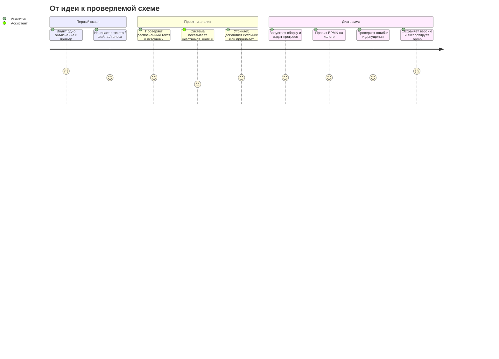

# Рынок и сценарий «Архитектора BPMN»

Дата проверки источников: 2 октября 2026. Это рабочая записка для продуктовых решений, а не исчерпывающий обзор всего рынка.

## Короткий вывод

На рынке уже есть и зрелые BPMN-моделеры, и продукты с генерацией процессов через ИИ. Одного «текст → диаграмма» для отличия недостаточно. Наш сильный сценарий — **источники → проверяемые вопросы и противоречия → редактируемая BPMN → проверка и экспорт**. Ключевой принцип интерфейса: аналитик должен увидеть, откуда взялся каждый важный шаг, и иметь возможность поправить результат до того, как доверится ему.

### Что следует показать в первом запуске

1. Коротко объяснить, что сюда можно вставить текст, загрузить документ или надиктовать процесс.
2. Дать выбрать: начать с пустого проекта или открыть отраслевой пример. Для первого знакомства — одна главная кнопка и один заметный пример.
3. Показать источники как отдельные карточки проекта; дать проверить распознанный текст до анализа.
4. Провести пользователя через этапы анализа, вопросов и сборки схемы, не скрывая неопределённость.
5. На схеме подсветить допущения, дать исправить BPMN мышью, сохранить версию и скачать `.bpmn`.

## Конкуренты и аналоги

| Продукт | За что выбирают | Что подсказало исследование | Вывод для нас |
|---|---|---|---|
| [SAP Signavio Process Manager](https://www.signavio.com/products/process-modeler/) | BPMN, корпоративное управление процессами, совместная работа; AI-assisted text-to-process и создание диаграммы по изображению | Генерация уже встроена в зрелый enterprise-продукт. Для включения AI нужны права администратора, лицензия Process Manager и AI Units ([документация](https://help.sap.com/docs/signavio-process-manager/user-guide/ai-assisted-process-modeler), [условия](https://help.sap.com/docs/SIGNAVIO_PROCESS_MANAGER/d4454b88dca847ab88d0f750bc053be3/provisioning-for-ai-assisted-process-modeler-text-to-process)). В отзывах хвалят визуализацию и совместную работу, но часть пользователей отмечает сложный первый запуск, обучение, цену и тяжеловесность на больших моделях ([G2](https://www.g2.com/products/sap-signavio/reviews)). | Не пытаться повторить весь enterprise-набор. Упростить первый результат и помочь проверить, что именно система поняла. |
| [Bizagi Modeler](https://www.bizagi.com/en/platform/modeler) | Зрелое BPMN-моделирование, документация и корпоративное совместное использование | На G2 — 4,6/5 на момент просмотра; пользователи отмечают drag-and-drop, ясность и быстрый обмен, а в недостатках — обучение продвинутым функциям и замедление больших моделей ([G2, 305 отзывов](https://www.g2.com/products/bizagi/reviews)). Совместная работа зависит от тарифа; документация описывает роли, комментарии и check-in/out ([официально](https://help.bizagi.com/platform/en/sharing_a_model_in_the_cloud.htm)). | Сохранить понятность ежедневных действий и экспорт. Не заставлять новичка сначала изучать всю нотацию. |
| [Camunda Modeler / Camunda Copilot](https://camunda.com/platform/modeler/) | BPMN/DMN для команд, которым важны исполнение процесса и связь с разработкой; desktop-моделер открыт, web-моделер сотрудничает в Camunda 8 | Camunda предлагает описать желаемый процесс обычным языком через Copilot и получить исполняемый процесс ([страница продукта](https://camunda.com/platform/modeler/)). Документация разделяет локальный desktop-режим и облачный web-моделер ([документация](https://docs.camunda.io/docs/components/modeler/about-modeler/)). Это сильная зрелая платформа; её ширина функций добавляет порог знакомства. | Наш первый релиз должен быть про анализ и документацию процесса, а не про выполнение/оркестрацию. Совместимость BPMN XML даёт переносимость. |
| [BA Copilot](https://ba-copilot.com/) | Прямой AI-first аналог для бизнес-аналитика: чат, текст/документы/изображения → BPMN, визуальная правка, версии и экспорт | Справка называет чат основным входом и описывает генерацию в редакторе ([чат](https://help.ba-copilot.com/articles/5585422-using-the-ai-chat-interface)); продукт заявляет BPMN XML, аудит версий, экспорт и импорт документов ([документация](https://help.ba-copilot.com/), [описание](https://ba-copilot.com/solutions/process-documentation)). Это наиболее близкий продукт по обещанию. | Принципиальная возможность — аккуратнее обрабатывать неоднозначность: источники с цитатами, конфликт регламента и устной заметки, управляемые допущения. Публичных независимых данных для вывода о масштабе внедрения мало; не называем продукт «неуспешным». |
| [BIC Process Design / Arty](https://www.gbtec.com/products/bic-process-design/) | Enterprise BPM и встроенный AI-помощник для моделирования и управления процессами | Документация описывает генерацию AI-модели по тексту, последующее редактирование и связывание с корпоративным словарём ([руководство](https://processdesign.bicplatform.de/help/portal/en/download/bicprocessdesign.pdf)). | Словарь и контроль качества полезны как направление для будущих корпоративных функций. Для хакатона важнее быстрый основной сценарий. |
| [BPMN Sketch Miner](https://www.bpmn-sketch-miner.ai/doc/) | Быстрый переход от текстового описания к схеме через специализированный DSL | Инструмент сознательно просит описывать истории процесса текстовым форматом, а не перетаскивать фигуры ([руководство](https://www.bpmn-sketch-miner.ai/doc/)). Это полезный аналог для этапа структурирования, но пользователю нужно освоить собственный синтаксис. | Брать идею компактного текстового входа, но принимать обычную речь и документы, не DSL. |
| [Lucidchart](https://www.lucidchart.com/pages/landing/bpmn) и [Miro](https://miro.com/diagramming/bpmn/) | Универсальные визуальные доски, шаблоны, командные сессии и лёгкая визуализация | Хороши как способы совместного обсуждения и набросков; сами по себе не закрывают специфические BPMN-валидацию, источник каждого утверждения, цикл уточнения и сборку валидного файла. | Не строить универсальную доску. Использовать BPMN-модель как редактируемый результат, а не картинку. |

### Что «выстрелило», а что осталось нишевым

- **Зрелые и массовые:** Camunda, Bizagi, SAP Signavio — живые продукты с развитой документацией и подтверждаемым присутствием в организациях. Это подтверждает устойчивый спрос на моделирование BPMN, но не доказывает востребованность конкретно генерации из текста.
- **Новый AI-сегмент:** SAP Signavio, BA Copilot, BIC Arty и малые генераторы уже проверяют text-to-process. Значит, «мы тоже генерируем схему» — не дифференциатор. Публичной, сопоставимой статистики внедрений AI-first продуктов я не нашёл; вывод о провале или успехе конкретного малого продукта был бы спекуляцией.
- **Постоянная UX-цена BPMN:** сложность нотации и масштабных моделей. Отзывы подтверждают необходимость лёгкого старта; в продукте должны быть видимы простые действия, а профессиональная глубина открываться по мере необходимости.

## Полезные открытые проекты

| Проект | Для чего подходит | Лицензия / ограничение | Решение |
|---|---|---|---|
| [bpmn-js](https://github.com/bpmn-io/bpmn-js) | Готовый браузерный просмотрщик и редактор BPMN 2.0, расширяемый модулями | Лицензия bpmn.io; проект уже установлен в `frontend` | Оставить основой редактора; не писать canvas с нуля. |
| [bpmn-auto-layout](https://github.com/bpmn-io/bpmn-auto-layout) | Генерирует BPMN DI и координаты, поддерживает процессы, пулы/дорожки, потоки и предупреждения | MIT; текущая основная ветка включает `2.0.0-alpha.2`, то есть перед фиксацией версии перепроверять стабильность ([алгоритм](https://github.com/bpmn-io/bpmn-auto-layout/blob/main/docs/LAYOUT.md)) | Использовать через уже предусмотренный Node `bpmn-tools`, зафиксировать версию и тестировать на наших сложных BPMN-фикстурах. |
| [bpmnlint](https://github.com/bpmn-io/bpmnlint) | Проверяет структуру и правила BPMN, отдаёт сообщения по конкретным элементам | MIT; рекомендуемые правила можно расширять своими | Оставить серверную проверку и показывать результат простым языком в UI. |
| [bpmn-moddle](https://github.com/bpmn-io/bpmn-moddle) и [diagram-js](https://github.com/bpmn-io/diagram-js) | Разбор/запись BPMN XML и основа графического редактора | Экосистема bpmn.io | Переиспользовать в сборщике/редакторе, LLM не поручать писать XML напрямую. |
| [Camunda Modeler](https://github.com/camunda/camunda-modeler) | Полноценный open-source desktop-моделер, референс шаблонов элементов и UX BPMN | MIT для desktop-репозитория; Camunda Cloud/Web — отдельный продукт и лицензирование | Исследовать как образец взаимодействий/расширений, не интегрировать весь продукт. |
| [BPMN Sketch Miner](https://www.bpmn-sketch-miner.ai/) | Референс для текстового описания процесса и перехода в BPMN | Публичные материалы показывают веб-инструмент; перед переносом исходного кода надо отдельно проверить лицензию | Использовать как UX-референс DSL, исходный код не копировать без лицензии. |

Архитектурная работа в [BPMN Assistant](https://arxiv.org/abs/2509.24592) использует JSON-представление вместо прямой генерации XML. Это согласуется с нашим RFC: модель возвращает ограниченную структуру, детерминированный код собирает BPMN и валидирует результат. Научная демонстрация полезна как подтверждение подхода, но не равна доказанному промышленному качеству.

## Наше положение

**Пользователь:** аналитик или архитектор процессов, которому надо свести регламент, интервью и заметку в согласованную схему.

**Обещание:** «Опишите процесс как знаете. Мы соберём редактируемый черновик BPMN и покажем, что ещё нужно уточнить».

**Почему стоит попробовать:**

1. Несколько видов входа в одном проекте: текст, расшифровка голоса, PDF/DOCX/MD/TXT.
2. Вопросы привязаны к подтверждающим цитатам; противоречия не замалчиваются.
3. Аналитик может отвечать, добавлять источник или оставить явное допущение; построение не блокируется.
4. Диаграмма настоящая BPMN 2.0: редактируется, валидируется и выгружается в `.bpmn`.
5. Российская локализация и сменные серверные провайдеры. Секреты хранятся на backend; браузер их не видит.

**Что не обещать сейчас:** автоматическое принятие решений без аналитика; гарантированно правильную трактовку любого регламента; совместное редактирование в реальном времени; промышленное хранение данных; настоящую генерацию LLM/STT в текущей mock-сборке. Ветка проекта сейчас имеет API и предсказуемый сценарный пайплайн; внешние провайдеры — следующий backend-шаг.

## Внешние модели и голосовой ввод

В ветке подготовлены серверные адаптеры DeepSeek и Deepgram. DeepSeek получает источники и возвращает ограниченный JSON: backend проверяет цитаты и сам строит BPMN XML. Для нового API используется `deepseek-flash`; прежние имена `deepseek-chat` и `deepseek-reasoner` отключены с 24 июля 2026 ([список моделей и обновления DeepSeek](https://api-docs.deepseek.com/updates/)). Deepgram принимает аудиофайл на `/v1/listen` с русским языком и возвращает расшифровку. Этот подход соответствует документированным JSON-ответам DeepSeek и поддержке русского в Nova-3 ([DeepSeek JSON mode](https://api-docs.deepseek.com/guides/json_mode/), [Deepgram Nova-3](https://developers.deepgram.com/docs/models-languages-overview), [Deepgram prerecorded audio](https://developers.deepgram.com/docs/pre-recorded-audio)).

Провайдеры выключены по умолчанию: интерфейс запускается локально без платных внешних вызовов. После отзыва раскрытых в переписке ключей новые ключи можно задать в локальном корневом `.env`; `compose.yaml` передаст их только backend. В браузер ключи не попадают. API уже содержит endpoint расшифровки аудиофайла; загрузка аудио и запись с микрофона в интерфейсе ещё не подключены.

## Карта пути пользователя

### Метрики для проверки на первых пользователях

- время до первого открытого черновика (цель для примера — меньше 1 минуты);
- доля пользователей, дошедших от текста/примера до редактора;
- доля вопросов, на которые удалось ответить новым источником;
- число ручных исправлений шага/дорожки/ветки перед экспортом;
- число ошибок BPMN до и после автоматического исправления;
- субъективная оценка «могу ли объяснить, почему шаг оказался на схеме?».

## Ссылки на ключевые источники

- [SAP: AI-Assisted Process Modeler](https://help.sap.com/docs/signavio-process-manager/user-guide/ai-assisted-process-modeler)
- [SAP News: запуск text-to-process](https://news.sap.com/2025/03/sap-signavio-launches-ai-process-modeler-text-to-process/)
- [G2: Bizagi reviews](https://www.g2.com/products/bizagi/reviews)
- [G2: SAP Signavio reviews](https://www.g2.com/products/sap-signavio/reviews)
- [BA Copilot: AI chat](https://help.ba-copilot.com/articles/5585422-using-the-ai-chat-interface)
- [BA Copilot: обзор справки](https://help.ba-copilot.com/)
- [Camunda: модельеры](https://docs.camunda.io/docs/components/modeler/about-modeler/)
- [bpmn-js](https://bpmn.io/toolkit/bpmn-js/)
- [bpmnlint](https://github.com/bpmn-io/bpmnlint)
- [bpmn-auto-layout](https://github.com/bpmn-io/bpmn-auto-layout)
- [BPMN Assistant, 2025](https://arxiv.org/abs/2509.24592)
