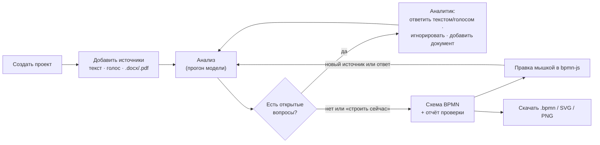
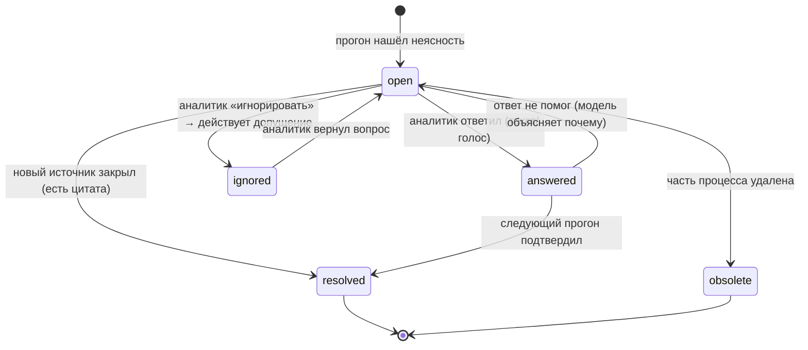
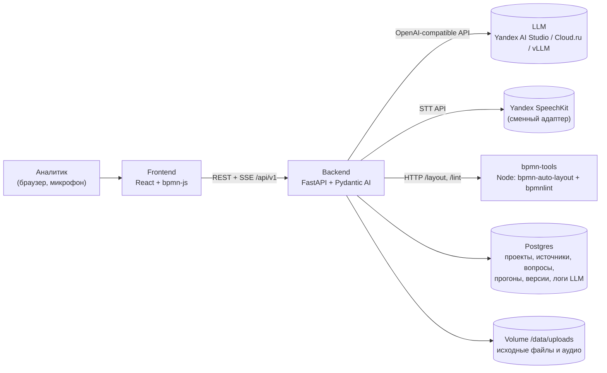
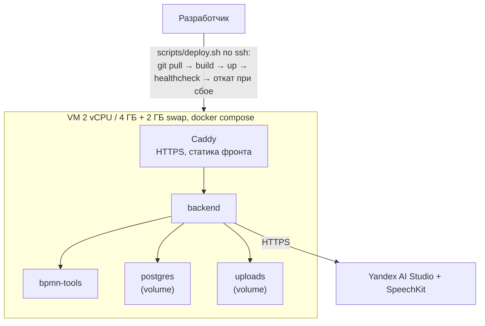
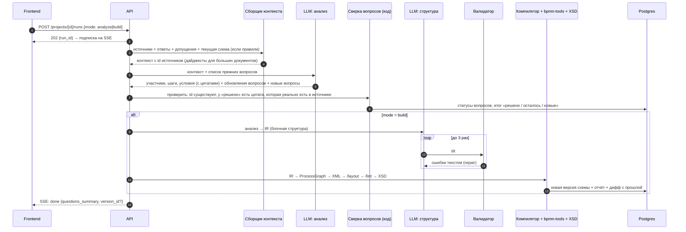
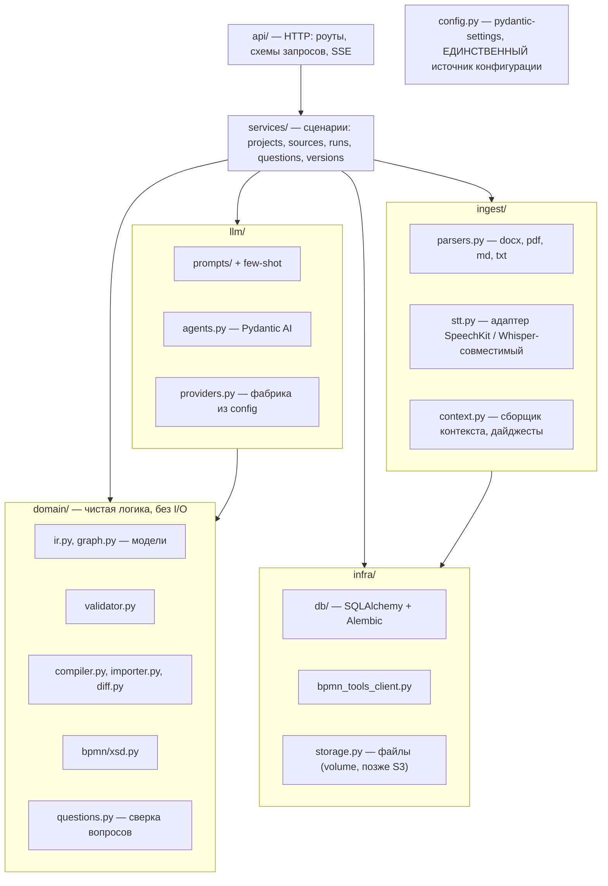
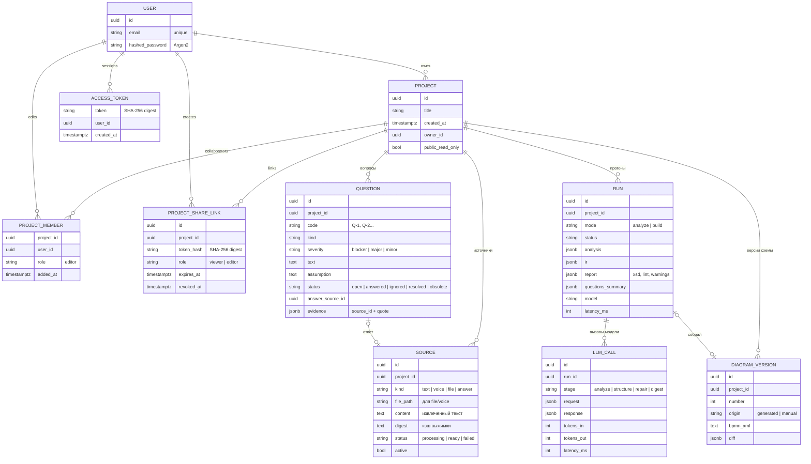
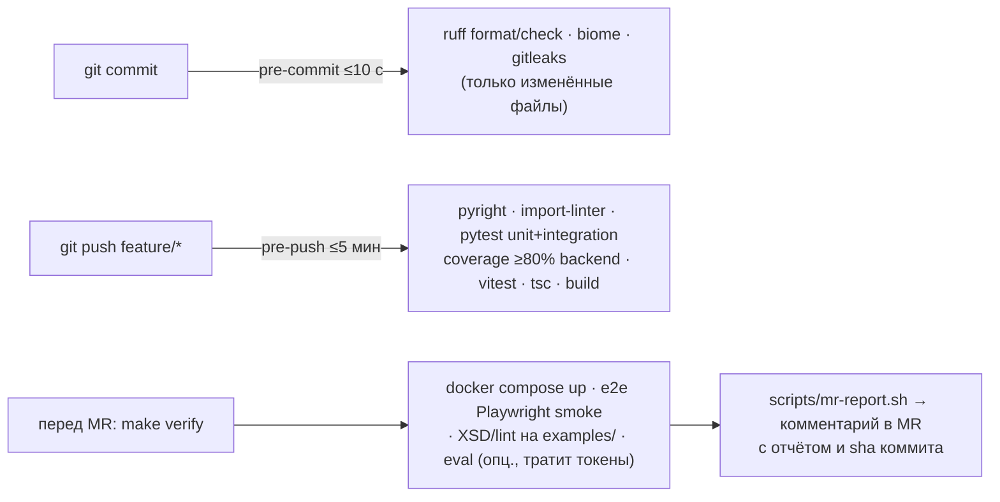

# RFC-0001. Архитектура и план «Архитектора BPMN-диаграмм»

| | |
|---|---|
| Статус | **Принят командой** (2026-10-01) |
| Трек | «Архитектор BPMN-диаграмм», хакатон «ИИ-ассистенты для энергетики» (Интер РАО, Codenrock) |
| Сдача заданий на Codenrock | **до 4 октября 2026, 00:00 МСК**: ссылка на рабочий сервис, презентация, видео |

## 0. TL;DR

- **Продукт.** Каждая схема — это **проект**, как проект в ChatGPT или Claude. Аналитик складывает в него источники: текст, голосовые заметки, документы. Система задаёт уточняющие вопросы («кто согласует бюджет?»). Аналитик отвечает текстом или голосом, игнорирует вопрос или правит схему мышкой. После каждого нового источника модель заново всё проверяет и показывает, какие вопросы закрыты, какие остались и какие появились. На выходе — BPMN 2.0, валидный по XSD, открывается и редактируется в bpmn.io.
- **Главный принцип.** XML пишет не LLM. LLM извлекает структуру (JSON) и формулирует вопросы. Валидация, сборка XML, раскладка схемы и проверка — детерминированный код.
- **Стек:**
  - Backend: FastAPI + Pydantic AI.
  - `bpmn-tools`: Node-сервис с `bpmn-auto-layout` (раскладка) и `bpmnlint` (проверка).
  - Frontend: React + Vite + bpmn-js.
  - БД: Postgres. Всё в Docker Compose.
  - Распознавание речи (STT): Yandex SpeechKit через сменный адаптер.
- **Redis и Kafka не нужны** (§6). VM 2 vCPU / 4 ГБ хватает — проверено замерами (§10).
- **Модели:** любой OpenAI-совместимый API, смена модели строчкой в `.env`. Основной провайдер — Yandex AI Studio.
- **Фундамент качества строим сразу, а не «потом»:** хуки, покрытие ≥80%, скиллы агентов, cleaner. Это делают агенты параллельно с продуктовой работой, и это окупается на всём хакатоне.

## 1. Глоссарий

| Термин | Простыми словами |
|---|---|
| **BPMN 2.0** | Стандарт схем бизнес-процессов. Технически это XML: в одной части логика, в другой — координаты фигур |
| **Pool / Lane (пул / дорожка)** | Пул — организация или процесс. Дорожки — полосы внутри пула, по одной на роль: «Клиент», «Оператор», «Руководитель» |
| **Task (задача)** | Прямоугольник, действие: «Проверить документы» |
| **Event (событие)** | Кружок: старт, конец или промежуточное событие |
| **Gateway (шлюз)** | Ромб, развилка. **XOR** — ровно одна ветка («да/нет»). **AND** — все ветки параллельно |
| **Sequence flow / Message flow** | Сплошная стрелка «что после чего» внутри пула / пунктир между пулами |
| **DI (Diagram Interchange)** | Координаты фигур в BPMN-файле. Без них bpmn.io покажет пустой холст |
| **XSD** | Официальная схема XML от OMG. «Валиден по XSD» = файл формально правильный |
| **bpmn.io / bpmn-js** | Open-source редактор BPMN от Camunda. Встраиваем его к себе на страницу |
| **Проект** | Рабочее пространство одной схемы: источники, вопросы, версии схемы |
| **Источник (source)** | Всё, что аналитик добавил в проект: текст, расшифровка голоса, документ, ответ на вопрос |
| **Вопрос (question)** | То, что модель не поняла или где источники противоречат друг другу. Его можно ответить, проигнорировать (тогда действует предложенное допущение) или он закроется сам после нового источника |
| **Прогон (run)** | Один проход модели по всем источникам проекта: анализ → вопросы → (сборка схемы) |
| **IR (промежуточное представление)** | Наш JSON-формат процесса, который возвращает LLM. Тот самый «свой enriched формат» из обсуждения команды |
| **ProcessGraph** | Внутренний «плоский» граф процесса: узлы + стрелки + дорожки. В него компилируется IR и из него собирается XML |
| **Structured output** | Режим, в котором модель обязана вернуть JSON по заданной схеме |
| **Repair loop** | Валидатор нашёл ошибку → ошибка уходит в модель текстом → модель исправляет. Обычно 2–3 круга |
| **STT (speech-to-text)** | Распознавание речи: голосовая заметка → текст |
| **Eval / golden set** | Набор эталонных текстов с ожидаемыми схемами. По нему меряем качество модели или промпта |
| **Git hook** | Скрипт, который git сам запускает перед коммитом или пушем. У нас он заменяет CI |

## 2. Продукт

**Пользователь** — бизнес-аналитик или бизнес-архитектор в энергокомпании. **Боль:** он часами переносит регламенты, заметки со встреч и устные объяснения коллег в схемы, а потом выясняет у людей, «кто на самом деле согласует».

### 2.1. Ключевой сценарий



Пример:

1. Аналитик создаёт проект «Техприсоединение» и надиктовывает 2 минуты голосом.
2. Модель задаёт 4 вопроса. Среди них: «**Кто согласует бюджет?** (в тексте: „бюджет согласуется“) — допущение: руководитель отдела».
3. Аналитик проваливается в вопрос и отвечает голосом: «бюджет согласуют ребята из финотдела, это есть в документе». Затем загружает `Финансы проекта.docx`.
4. Новый прогон показывает: «✅ Решено: 2 (источник: Финансы проекта.docx, стр. 3) · Осталось: 2 · Новых: 1 (в документе указан срок 10 дней, а в голосовом — 5)».
5. Аналитик игнорирует оставшиеся вопросы (действуют допущения) и жмёт «Построить». Появляется схема с дорожкой «Финансовый отдел».

### 2.2. Правила вопросов

- У каждого вопроса есть **тип**: `missing_actor` (не указан исполнитель), `ambiguous_condition` (неясное условие), `unclear_order` (непонятен порядок), `missing_outcome` (не описан исход), `conflict` (источники противоречат).
- У каждого вопроса есть **важность**: `blocker`, `major` или `minor`.
- У каждого вопроса есть **допущение**: что модель сделает, если вопрос проигнорировать.
- **Схему можно построить в любой момент.** Неотвеченные вопросы превращаются в явные допущения: они видны в отчёте и подсвечены на схеме.
- **Решено** — только с доказательством: модель указывает источник и цитату, а код проверяет, что цитата реально есть в источнике.



### 2.3. Демо-процесс

Основной демо-процесс — **технологическое присоединение к электросетям**. Он публичный: Правила ТП, ПП РФ № 861, раздел II ([КонсультантПлюс](https://www.consultant.ru/document/cons_doc_LAW_51030/4637712f183997da3eb38456496bc4c91b0fef7a/)).

- **Участники:** заявитель, сетевая организация, гарантирующий поставщик.
- **Ход:** заявка → проверка комплектности.
- **Цикл:** при замечаниях — уведомление, и заявитель дополняет документы.
- **XOR:** срок направления договора и ТУ зависит от мощности (до 150 кВт или больше).
- **AND:** стороны параллельно выполняют свои мероприятия по ТУ.
- **Финал:** осмотр, допуск, акт.

Для демонстрации цикла вопросов добавляем второй источник — «заметку со встречи» голосом, которая частично противоречит регламенту.

Запасные процессы:

- вывод оборудования в ремонт (собственник ↔ диспетчерский центр СО ЕЭС);
- наряд-допуск по правилам охраны труда в электроустановках.

### 2.4. Фичи и приоритеты

| Фича | Ценность для жюри | Цена | Приоритет |
|---|---|---|---|
| Проект с источниками (текст) → вопросы → схема | ключевой сценарий, «работа с неоднозначностью» | средняя | **P0** |
| Валидация XSD + bpmnlint с понятным отчётом | надёжность, проверка результата | низкая | **P0** |
| Правка в bpmn-js, сохранение версии, скачивание | обязательное требование | низкая | **P0** |
| Голосовой ввод (SpeechKit) — источник или ответ на вопрос | удобство, «наговорил → схема» | низкая | **P0** |
| Загрузка `.docx` / `.pdf` / `.md` / `.txt` / `.csv` | реальный вход аналитика | низкая | **P0** |
| Перепроверка после нового источника: решено / осталось / новые | экономия времени, объяснимость | средняя | **P0** |
| Трассировка «элемент схемы ↔ цитата из источника» | объяснимость, нет галлюцинаций | низкая | P1 |
| Дифф версий схемы («добавлено 2 задачи, удалена 1») | контроль изменений | средняя | P1 |
| Анимация прохождения токена (`bpmn-js-token-simulation`) | вау-эффект, наглядность | низкая | P1 |
| Eval: таблица «модель × качество» | устойчивость, заменяемость модели | средняя | P1 |
| Справочник ролей и терминов компании | стандартизация названий дорожек | средняя | P2 |

### 2.5. Предложенные идеи и их место в продукте

| Идея | Решение |
|---|---|
| «Наговорил идею → схема» | Ядро продукта: голос как источник и как ответ на вопрос |
| Редактор «как Miro», шаринг | Редактор — это bpmn-js, свой не пишем. Шаринг — ссылка на проект |
| Анимированная схема | Плагин token-simulation (P1) |
| Свой формат с экспортом в XML | Это IR и ProcessGraph (§5.2). После ручной правки источником правды становится XML из редактора |
| Подключение корпоративной базы знаний (Confluence, GitLab, вики) | Ценная часть уже есть — пул документов внутри проекта. Коннекторы к внешним вики не делаем: в корпоративном контуре Интер РАО к ним нет доступа, а разработка распыляет силы |
| План реализации фичи со сроками и оценками | Не делаем. Это управление проектом (диаграмма Ганта), а BPMN описывает **повторяющийся** процесс («как обрабатываем заявку») |

## 3. Команда и как мы работаем

| Роль | Зона | Основные папки |
|---|---|---|
| Фронтенд + архитектура | UI, bpmn-js, сценарий, RFC/ADR | `frontend/`, `docs/` |
| Бэкенд + DevOps | API, БД, деплой, хуки, VM, биллинг Yandex Cloud | `backend/`, `scripts/`, `compose*.yaml` |
| Бэкенд | LLM-пайплайн, промпты, валидатор, eval | `backend/app/llm`, `backend/app/domain`, `evals/` |

Все работают через ИИ-агентов и могут подхватить чужую зону. Чтобы это работало:

- **Задачи** ведём в GitLab Issues. Каждая задача — по шаблону: контекст, ссылки на разделы RFC/ADR, критерии приёмки. Метки: `area::frontend`, `area::backend`, `area::devops`, `area::llm`, `prio::P0..P2`. MR закрывает issue (`Closes #N`).
- **Definition of Done для каждого MR:**
  - тесты зелёные, отчёт `verify` приложен комментарием;
  - при смене контракта перегенерирован OpenAPI;
  - если поменялась архитектура, обновлены диаграммы в `docs/architecture`;
  - если принято решение, заведён ADR;
  - `AGENTS.md` актуален.
- **Скилл `pickup-task`** даёт агенту за минуту всё нужное по задаче: issue, разделы документации, затронутые файлы, команды проверки.
- Прямой push в `main` запрещён (правило Codenrock). Работа идёт в ветках `feature/*`, `fix/*`, `docs/*` через MR.

## 4. Высокоуровневая архитектура (HLD)



**Почему отдельный Node-сервис `bpmn-tools`.** Лучшая раскладка с дорожками (`bpmn-auto-layout` 2.x) и линтер `bpmnlint` есть только на JS. В Python нет живой библиотеки, которая умеет пулы, дорожки и DI. Проверено: `bpmn-auto-layout@2.0.0-alpha.2` на тестовом процессе (2 пула, дорожки, XOR, кириллица) разложил всё, bpmnlint дал 0 ошибок, файл прошёл XSD. Заодно это переиспользуемый компонент — эксперт трека прямо говорил о «повторном использовании компонентов».

### Деплой



## 5. Низкоуровневая архитектура (LLD)

### 5.1. Прогон (run)

Прогон идёт в фоне: несколько документов могут обрабатываться дольше минуты. Это `asyncio`-задача внутри backend со статусом в Postgres. Фронтенд получает прогресс через SSE (поток событий по HTTP). Очередь не нужна: одновременно идёт не больше 2 прогонов (семафор), после рестарта незавершённые прогоны помечаются `failed`. У прогона есть общий срок (`RUN_DEADLINE_SEC`, по умолчанию 10 минут): после него новые запросы к модели не начинаются и прогон завершается ошибкой; событие `done` приходит всегда. Пока прогон идёт, ручное сохранение схемы отвечает `409`, чтобы версия прогона не перекрыла правку.



**Почему два LLM-шага (анализ и структура).** Слабым моделям проще сделать две простые задачи, чем одну сложную. Исследования по text-to-BPMN (BPMN-Chatbot, BPMN Assistant) подтверждают: JSON вместо сырого XML, схема ответа, few-shot примеры и repair по ошибкам валидатора заметно поднимают качество. Чаще всего LLM ошибается в шлюзах: не закрывает ветки, путает XOR и AND, придумывает условия.

**Почему JSON, а не Python-код.** Организаторы предлагают вариант, где LLM пишет Python поверх `DIAGRAM.add_task(...)`. Мы выбираем JSON:

- не нужна песочница для чужого кода (безопасность в корпоративном контуре);
- JSON проверяется Pydantic-схемой;
- работает на любой модели со structured output.

API в стиле `DIAGRAM.*` можно позже выставить как **tools** для режима «правка текстом».

### 5.2. Сборщик контекста

1. Каждый источник при загрузке превращается в текст:
   - `.docx` → `python-docx`;
   - `.pdf` → `pypdf`;
   - `.md` / `.txt` — как есть;
   - аудио → STT. Браузер пишет webm/opus, а SpeechKit принимает только OGG_OPUS, WAV или MP3. Поэтому `ffmpeg` (есть в образе backend) перепаковывает запись в OGG_OPUS mono. Дальше:
     - клип ≤ 30 с и ≤ 1 МБ → STT v1, синхронно;
     - длиннее → v3 `recognizeFileAsync` с байтами в теле запроса (до 60 МБ, Object Storage не нужен), затем опрос `getRecognition`. Обработка — примерно 10 с на минуту аудио.

   Аналитик видит этот текст и может поправить его до отправки.
2. В контекст прогона идут: все источники (с `source_id`), ответы на вопросы, допущения проигнорированных вопросов и **текущая схема**, если аналитик её правил мышкой. Схема передаётся как ProcessGraph текстом, с пометкой «правки аналитика приоритетнее».
3. Бюджет контекста — ~60k токенов: у Qwen3.6 окно 256k, у Alice AI LLM — 128k, запас нужен на ответ. Сейчас он задан в символах (`LLM_CONTEXT_BUDGET_CHARS`): лишний текст обрезается поровну между источниками, а предупреждение попадает в `warnings` прогона. Целевое решение: если источники не влезают, по каждому большому документу один раз строится и кэшируется **дайджест** — выжимка, относящаяся к процессу, со ссылками на цитаты. Векторная БД и RAG не нужны: в проекте единицы документов.

### 5.3. IR — наш формат (пример)

Вход:
> Клиент отправляет заявку. Оператор проверяет комплектность документов. Если документов не хватает, оператор запрашивает их у клиента. Если комплект полный, руководитель согласует заявку, после чего процесс завершается.

Ответ шага «анализ» (упрощённо):

```json
{
  "actors": [{"id": "client", "name": "Клиент"}, {"id": "operator", "name": "Оператор"}, {"id": "head", "name": "Руководитель"}],
  "question_updates": [{"id": "Q-2", "status": "resolved", "evidence": {"source_id": "src-3", "quote": "согласует руководитель"}}],
  "new_questions": [{
    "kind": "missing_outcome", "severity": "major",
    "text": "Что делает клиент после запроса недостающих документов?",
    "assumption": "Клиент досылает документы, и проверка повторяется",
    "about_quote": "оператор запрашивает их у клиента"
  }]
}
```

Ответ шага «структура» (IR):

```json
{
  "title": "Приём заявки",
  "lanes": [{"id": "client", "name": "Клиент"}, {"id": "operator", "name": "Оператор"}, {"id": "head", "name": "Руководитель"}],
  "steps": [
    {"id": "s0", "type": "start", "name": "Заявка подана", "lane": "client"},
    {"id": "t1", "type": "task", "name": "Отправить заявку", "lane": "client",
     "source": {"id": "src-1", "quote": "Клиент отправляет заявку"}},
    {"id": "t2", "type": "task", "name": "Проверить комплектность документов", "lane": "operator",
     "source": {"id": "src-1", "quote": "Оператор проверяет комплектность документов"}},
    {"id": "g1", "type": "xor", "name": "Комплект полный?", "lane": "operator",
     "branches": [
       {"label": "Нет", "steps": [
         {"id": "t3", "type": "task", "name": "Запросить документы у клиента", "lane": "operator",
          "source": {"id": "src-1", "quote": "оператор запрашивает их у клиента"}},
         {"id": "t5", "type": "task", "name": "Дослать документы", "lane": "client", "assumption_of": "Q-4"}
       ], "goto": "t2"},
       {"label": "Да", "steps": [
         {"id": "t4", "type": "task", "name": "Согласовать заявку", "lane": "head",
          "source": {"id": "src-1", "quote": "руководитель согласует заявку"}}
       ]}
     ]},
    {"id": "e1", "type": "end", "name": "Заявка согласована", "lane": "head"}
  ]
}
```

- **Блочная структура** (`branches` внутри шлюза) гарантирует, что каждое ветвление закрыто: компилятор сам ставит шлюз-слияние. `goto` используется для циклов возврата.
- `source` даёт трассировку «элемент ↔ цитата».
- `assumption_of` помечает элементы, построенные на допущении. На схеме они подсвечены.

IR компилируется в **ProcessGraph**: узлы, стрелки, дорожки. Из ProcessGraph собирается XML. Обратный импортёр XML → ProcessGraph нужен, чтобы учитывать ручные правки и считать дифф версий.

### 5.4. Валидатор (детерминированный)

Каждое правило — отдельная функция с юнит-тестом:

- id уникальны, ссылки (`lane`, `goto`, `source.id`, `assumption_of`) существуют;
- ровно один старт и хотя бы один конец;
- каждый шаг достижим от старта, и из него можно дойти до конца;
- у XOR ≥ 2 веток, у каждой есть `label`;
- у AND ≥ 2 веток, и в ветках нет `goto` наружу;
- нет пустых дорожек;
- `quote` действительно встречается в указанном источнике (нечёткое сравнение) — защита от галлюцинаций.

Если после 3 кругов ошибки остались, делаем авто-исправление (например, дорисовываем недостающий конец) и показываем предупреждение. Молча битую схему не отдаём никогда.

### 5.5. Компилятор и проверка XML

- `lxml`, примерно 200–300 строк: `collaboration` → `participant` → `process` → `laneSet/lane` с `flowNodeRef`; `sequenceFlow` с `name` («Да»/«Нет») и `conditionExpression`.
- **Обязательно** `incoming`/`outgoing` у каждого узла. Без них bpmnlint считает узлы оторванными, хотя XSD их пропускает.
- XSD: пять официальных файлов OMG в `backend/app/domain/bpmn/xsd/`. Проверено, что `lxml` и `xmlschema` валидируют результат `bpmn-auto-layout`.
- Ограничение: `bpmn-auto-layout` пересчитывает все координаты. После нового прогона ручная *раскладка* не сохраняется, хотя ручные *правки логики* учитываются через ProcessGraph.

### 5.6. Модули backend



Правило слоёв: `domain` ничего не импортирует из `api`, `infra`, `llm`, `ingest`. Проверяет это `import-linter` в хуке, а не устная договорённость.

### 5.7. Данные



`LLM_CALL` — бесплатная наблюдаемость (лог вызовов модели) вместо Langfuse. Если понадобится UI, поднимем Arize Phoenix одним контейнером.

Для аккаунтов и общего доступа добавлены `USERS`, `ACCESS_TOKENS`, `PROJECT_MEMBERS` и `PROJECT_SHARE_LINKS`. `PROJECTS.owner_id` задаёт владельца; `public_read_only` включён только у демо-проектов из сида (читать их может любой вошедший, менять — никто). В сессии и ссылках проекта хранится только SHA-256 хеш случайного токена, исходный токен ссылки возвращается владельцу один раз. Подробности — в [решении по авторизации и доступу](../adr/0001-auth-and-project-sharing.md).

### 5.8. API

Контракт v1 реализован в mock-бэкенде (#2, `docs/backend/mock.md`); точные схемы — `docs/api/openapi.json`. При `AUTH_ENABLED=true` все маршруты, кроме `/auth/*`, `GET /examples`, `/health` и `/shares/{token}`, требуют входа (`401`). Частые запросы получают `429` с `Retry-After`. Поля — `snake_case`, id — UUID, даты — ISO 8601, ошибки — `{"detail": "…"}` на русском.

| Метод | Путь | Что делает |
|---|---|---|
| POST | `/api/v1/auth/register` · `/auth/session/login` · `/auth/session/logout` | регистрация по email и паролю · вход и выход через cookie-сессию |
| GET | `/api/v1/auth/csrf` · `/auth/me` · `/auth/session` | получить CSRF-токен · профиль (`401` для гостя) · состояние входа `{auth_enabled, user}` (всегда `200`) |
| GET | `/api/v1/projects?cursor=&limit=20&q=` | список проектов: курсорная пагинация, поиск по названию → `{items, next_cursor, total}` |
| POST | `/api/v1/projects` · `/projects/from-example` | создать проект · создать из примера (текст примера — первый источник) |
| GET / PATCH / DELETE | `/api/v1/projects/{id}` | проект целиком: источники, вопросы, последняя версия без XML, активный прогон, сводка вопросов · правка · удаление (`409`, если идёт прогон) |
| POST | `/api/v1/projects/{id}/sources/text` | текст или проверенная расшифровка голоса (`kind: text \| voice`) |
| POST | `/api/v1/projects/{id}/sources/file` | multipart-файл `txt/md/csv/docx/pdf`; `docx/pdf` разбираются в фоне (`processing` → `ready \| failed`) |
| PATCH / DELETE | `/api/v1/sources/{id}` | поправить название или текст, включить/выключить · удалить |
| POST | `/api/v1/transcriptions` | аудио → `{text, duration_sec, language}` (аналитик правит перед отправкой) |
| POST | `/api/v1/projects/{id}/runs` | запустить прогон `{mode: analyze \| build}` → `202 Run` (у `Run` есть `warnings`: например, контекст модели был обрезан); `409`, если прогон уже идёт или нет источников |
| GET | `/api/v1/runs/{id}` · `/runs/{id}/events` | статус прогона · SSE: `stage`, `question`, `summary`, `version`, `error`, `done` |
| GET | `/api/v1/projects/{id}/questions?status=` | вопросы проекта |
| POST | `/api/v1/questions/{id}/answer` | ответ текстом (голос — через `/transcriptions`) → источник `answer` |
| POST | `/api/v1/questions/{id}/ignore` · `/reopen` | принять допущение · вернуть вопрос; недопустимый переход → `409` |
| GET | `/api/v1/projects/{id}/versions` · `/versions/{id}` | версии с диффом и отчётом · версия с XML |
| GET | `/api/v1/versions/{id}/xml` | скачать `.bpmn` (SVG/PNG экспортирует bpmn-js на фронтенде) |
| PUT | `/api/v1/projects/{id}/diagram` | сохранить ручную правку из bpmn-js → новая версия `manual`; `409`, пока идёт прогон; `413`, если схема больше `MAX_DIAGRAM_BYTES` |
| GET / DELETE | `/api/v1/projects/{id}/members` · `/members/{user_id}` | владелец просматривает список редакторов и отзывает доступ |
| POST / GET / DELETE | `/api/v1/projects/{id}/share-links` · `/share-links/{link_id}` | создать, перечислить и отозвать ссылку `viewer` или `editor` (только владелец); срок обязателен: `editor` — 7 дней по умолчанию, до 30; `viewer` — 30 по умолчанию, до 365 |
| GET | `/api/v1/shares/{token}` · `/shares/{token}/versions/{version_id}/xml` | открыть проект и схему по ссылке (XML — вложением); ссылка `viewer` работает без входа, `editor` требует входа |
| POST | `/api/v1/shares/{token}/accept` | принять приглашение редактора после входа в аккаунт |
| GET | `/api/v1/examples` · `/health` | демо-примеры · healthcheck |

- OpenAPI генерирует FastAPI. Он коммитится в `docs/api/openapi.json` (`make openapi`).
- Из него генерируется TS-клиент для фронта (`openapi-typescript`).
- Поэтому контракт не расходится с кодом.

### 5.9. Frontend

Три панели:

- **слева** — источники: добавить текст, записать голос, загрузить файл;
- **в центре** — bpmn-js Modeler;
- **справа** — вопросы. Карточка: важность, цитата, допущение, кнопки «Ответить» (текст или 🎤), «Игнорировать», «Показать на схеме».

Сверху — статус прогона, выбор версии и плашка «решено 2 · осталось 2 · новых 1».

Клик по вопросу открывает его детально: цитаты из источников, подсвеченные элементы схемы, поле ответа с микрофоном. Голос записывается через `MediaRecorder` (webm/ogg-opus) и уходит в `/transcriptions`. Аналитик видит текст, правит и отправляет.

## 6. Стек и решения

| Слой | Выбор | Почему |
|---|---|---|
| Backend | Python 3.12, **FastAPI**, Pydantic v2, uv | Самая задокументированная связка для ИИ-бэкендов, async, OpenAPI из коробки |
| LLM-слой | **Pydantic AI** поверх `openai` SDK | `output_type=IR` + `output_validator` → `ModelRetry(ошибки)` — repair из коробки; провайдер меняется через base_url; встроенный OTel. Запасной вариант попроще — Instructor |
| BPMN | `lxml` (сборка + XSD) + Node `bpmn-tools` (`bpmn-auto-layout@2.0.0-alpha.2` с закреплённой версией, `bpmnlint`) | Живой Python-альтернативы с дорожками нет. Для alpha держим простой запасной раскладчик |
| Документы | `python-docx`, `pypdf` | Лёгкие (проверено: вместе с остальным бэкендом ~180 МБ RAM). `pymupdf` не берём: лицензия AGPL. Сканы без текстового слоя — P2 через Yandex Vision OCR |
| STT | Yandex SpeechKit (v1 sync для коротких клипов, v3 async для длинных) через адаптер `stt.py` + `ffmpeg` | Облако — модель не занимает RAM на VM; 3 минуты аудио ≈ $0.016. OpenAI-совместимого `/audio/transcriptions` у Яндекса нет, поэтому нужен свой адаптер. Запасные варианты — SaluteSpeech или локальный faster-whisper small на отдельной машине |
| Frontend | **React + Vite + TS**, Tailwind + shadcn/ui, TanStack Query, `bpmn-js` Modeler + properties-panel + token-simulation | Лучше всего «вайбкодится», у bpmn-js много примеров под React |
| БД и файлы | Postgres 16, SQLAlchemy 2 + Alembic; файлы — docker volume | Всё состояние проекта в одной БД; S3 — позже, за интерфейсом `storage.py` |
| Прокси | Caddy | HTTPS одной строкой |
| Наблюдаемость | таблица `llm_call`, опционально Arize Phoenix | Langfuse требует 6 контейнеров и ~16 ГБ RAM — перебор |
| **Redis / Kafka** | **не берём** | Нагрузка — единицы запросов в минуту. Фоновые прогоны — `asyncio`-задачи со статусом в Postgres, прогресс через SSE. Redis понадобится, только если backend станет многоэкземплярным |

## 7. Модели

Все провайдеры OpenAI-совместимы. Смена модели — это `.env`:

```env
LLM_BASE_URL=https://ai.api.cloud.yandex.net/v1
LLM_API_KEY=...
LLM_PROJECT=<folder_id>
LLM_MODEL=gpt://<folder_id>/qwen3.6-35b-a3b/latest   # точный формат URI проверяет llm_smoke.py
LLM_OUTPUT_MODE=native        # native (json_schema) | prompted (JSON в тексте)
STT_PROVIDER=yandex
```

| Провайдер | Модели | Комментарий |
|---|---|---|
| **Yandex AI Studio** (основной) | `qwen3.6-35b-a3b`, `aliceai-llm`, `gpt-oss-120b` | В финале будут модели Яндекса. ⚠️ gpt-oss-120b в документации Яндекса доступна **до 30.10.2026** — на ней одной не строимся. ⚠️ `tool_choice` принимает только `auto`/`none` → используем json_schema, а не принудительный tool call |
| Cloud.ru Evolution | gpt-oss-120b, Qwen3.6 | Запасной провайдер |
| Локально (Ollama / vLLM) | Qwen3.6-35B-A3B Q4 (~20 ГБ) | Офлайн-разработка, если хватает памяти |
| OpenRouter | — | С 27.06.2026 не работает для РФ-аккаунтов |

**Первая задача по моделям** — `scripts/llm_smoke.py`. На каждой модели он проверяет json_schema-ответ, tools, латентность и цену на эталонном тексте. Документация Яндекса не говорит, какие модели реально соблюдают json_schema.

**Качество без «сильной модели».** Жюри оценивает не модель, а промптинг, работу с контекстом, проверку и устойчивость. Это и показываем: few-shot, два шага, валидатор + repair, XSD + lint, проверка цитат, eval-таблица «модель × точность».

## 8. Структура репозитория

```
.
├── AGENTS.md            # вход для ИИ-агентов: карта репо, команды, правила (CLAUDE.md импортирует его)
├── README.md            # для жюри: что это, как запустить, примеры, ограничения
├── Makefile             # единые команды: dev, test, check-fast, check, verify, eval, deploy, openapi
├── compose.yaml         # dev
├── compose.prod.yaml    # prod-оверрайды
├── .env.example         # ЕДИНСТВЕННЫЙ шаблон конфигурации
├── lefthook.yml         # git-хуки (замена CI)
├── .gitlab/             # шаблоны issue и MR (чек-лист DoD)
├── backend/             # FastAPI (структура из §5.6) + tests/
├── bpmn-tools/          # Node: /layout, /lint
├── frontend/            # React + bpmn-js
├── examples/            # вход (тексты, аудио, документы) → выход .bpmn/.svg — обязательно для сдачи
├── evals/               # golden set (8–10 публичных регламентов с эталонными схемами + часть датасета PET) + скрипт метрик
├── docs/
│   ├── README.md        # индекс документации
│   ├── glossary.md
│   ├── product/         # пользователь, сценарии, ограничения
│   ├── architecture/    # HLD, LLD (mermaid)
│   ├── adr/             # решения: 0001-json-ir-not-codegen.md, ...
│   ├── rfc/             # этот документ
│   ├── api/openapi.json # генерируется
│   └── conventions.md   # стайлгайд
├── .claude/
│   ├── settings.json    # плагины команды; позже — хуки агента
│   └── skills/          # скиллы проекта (§9.3)
└── scripts/             # verify.sh, deploy.sh, llm_smoke.py, mr-report.sh
```

- Отдельной папки `ai/` нет. Скиллы лежат в `.claude/skills/`, оттуда их находит Claude Code; другие агенты находят их через `AGENTS.md`. Скрипты прогонов — в `scripts/`, эталонные данные — в `evals/`.
- **Промпты** — это код продукта, а не инструмент разработки. Они лежат в `backend/app/llm/prompts/`.
- **Авторизация приложения** — аккаунт email/пароль и серверная cookie-сессия; Caddy Basic Auth может дополнительно закрывать демо-контур. Изменяющие API-запросы из браузера требуют CSRF cookie и заголовок `X-CSRF-Token`.

## 9. Качество без CI

### 9.1. Локальные гейты

Раннеров нет, поэтому проверки запускают git-хуки через **lefthook**: один YAML для Python и JS, проверки идут параллельно.



- **Coverage ≥80%** — на `backend/app/domain`, `services`, `ingest`: там логика. Фронт в основном состоит из bpmn-js, поэтому для него — vitest на свою логику (стор, API-хуки) и smoke-e2e.
- **Тесты с LLM.** Юнит- и интеграционные тесты работают на записанных ответах модели (фикстуры): быстро, бесплатно, детерминированно. Живые модели гоняет только `make eval`.
- **Хуки можно обойти через `--no-verify`.** Поэтому «гарантию зелёного» даёт не хук, а отчёт `mr-report.sh` в MR: ревьюер видит sha и результат. В шаблоне MR — чек-лист DoD.
- **Хуки для агентов.** В `.claude/settings.json` добавим хук: после правок агент запускает `make check-fast` (ruff + типы по изменённым файлам), сразу видит ошибки и не плодит мусор. Хук включаем, когда появится Makefile.

### 9.2. Стайлгайд и защита от «слопа»

| Что | Инструмент |
|---|---|
| Формат и линт Python | ruff (строгий набор правил, включая bandit-правила `S`) |
| Типы | pyright (strict для `domain/`) |
| Архитектурные границы | import-linter |
| Мёртвый код | vulture (py), knip (ts) |
| Копипаста | jscpd |
| Уязвимости и секреты | pip-audit, npm audit, gitleaks, semgrep |
| Формат и линт TS | biome |
| Конфиги | только `config.py` + `.env.example`; хардкод URL и ключей ловит semgrep-правило |

### 9.3. Скиллы агентов (`.claude/skills/`)

| Скилл | Что делает |
|---|---|
| `pickup-task` | Взять issue: собрать контекст (RFC/ADR, затронутые модули, команды), создать ветку, напомнить DoD |
| `verify` | Прогнать все гейты (`make verify`), собрать отчёт и выложить его комментарием в MR |
| `cleaner` | Light / hard уборка кода и документации (ниже) |
| `new-endpoint` | Добавить эндпоинт по слоям: схема → сервис → роут → тесты → OpenAPI → TS-клиент → документация |
| `prompt-eval` | Поменять промпт или few-shot и прогнать golden set; сравнить метрики с прошлым прогоном |
| `e2e-agent` | Агентный e2e: поднять стек, пройти ключевой сценарий в браузере, собрать доказательства |
| `deploy` | Деплой на VM с проверками, healthcheck и откатом — только по явной команде человека |
| `adr` | Оформить решение как ADR или RFC по шаблону и обновить индекс `docs/` |

### 9.4. Скилл `cleaner`

Основа — плагин **`cleaner-agent`** из [MattoYuzuru/yuzuru-skills](https://github.com/MattoYuzuru/yuzuru-skills/tree/main/plugins/cleaner-agent). Плагин подключён в `.claude/settings.json`: Claude Code сам предложит его установить. Вручную:

```text
/plugin marketplace add MattoYuzuru/yuzuru-skills
/plugin install cleaner-agent@yuzuru-engineering
```

Если плагин недоступен, агент читает его `SKILL.md` и `references/` по ссылке и следует той же методике: доказательства перед удалением, сверка документации с кодом. Наш скилл `cleaner` добавляет к ней проектные инструменты и два режима. Работает всегда в отдельной ветке и через MR.

- **light** — автофиксы инструментов (`ruff --fix`, `knip --fix`, удаление неиспользуемого) и тесты. Коммитит только при зелёных проверках.
- **hard** — собирает отчёты vulture, jscpd, semgrep и pyright. Затем агент:
  1. делает рефакторинг: выносит дубли конфигов, объединяет почти одинаковые эндпоинты, чинит найденные баги и уязвимости;
  2. сверяет документацию с кодом: OpenAPI, mermaid-диаграммы в `docs/architecture`, ADR, README, `AGENTS.md`.

  Удаление без доказательств («поиск ничего не нашёл») запрещено.

## 10. Деплой и ресурсы VM

### 10.1. Хватит ли 2 vCPU / 4 ГБ — да

Тяжёлое (LLM, STT) работает в облаке Яндекса, на VM остаются лёгкие сервисы.

| Компонент | RAM | Откуда цифра |
|---|---|---|
| backend (uvicorn, 1–2 воркера: FastAPI, Pydantic AI, lxml, SQLAlchemy, python-docx, pypdf) | ~180 МБ на воркер → ~350 МБ | **замер**: импорт всех библиотек + XSD-валидация |
| bpmn-tools (Node 22) | ~60–100 МБ | **замер**: layout — 55 МБ / 0,08 с, bpmnlint — 89 МБ / 0,4 с |
| Postgres 16 (`shared_buffers=128MB`) | ~100–200 МБ | типичное значение для малой БД |
| Caddy + статика фронта | ~30–50 МБ | типичное значение |
| ОС + Docker | ~400–500 МБ | типичное значение |
| **Итого в работе** | **~1–1,3 ГБ из 4 ГБ** | запас ~2,5 ГБ |
| Пик при сборке (`docker compose build`, `vite build`) | +1–2 ГБ на минуты сборки | поэтому **2 ГБ swap** обязательно |

Сборка фронта на VM: `build.sourcemap=false`, `NODE_OPTIONS=--max-old-space-size=1536`. Если упрётся в память — собираем `dist` локально и копируем на VM.

CPU: прогон почти всё время ждёт ответа API модели, поэтому одновременные 2 прогона и сборка фронта укладываются в 2 vCPU. Не влезет: локальный Whisper или локальная LLM — для них нужна отдельная машина. Поэтому STT и LLM — облачные.

### 10.2. Процесс

1. VM в РФ (Yandex Cloud, рядом с моделями), 2 vCPU / 4 ГБ / 30 ГБ SSD, swap 2 ГБ.
2. `scripts/deploy.sh` по ssh:
   1. `git fetch && git checkout <tag>`;
   2. `docker compose -f compose.yaml -f compose.prod.yaml up -d --build`;
   3. ждём `/health`;
   4. при сбое — откат на предыдущий тег.
3. Деплоим только из `main` после MR.
4. Секреты — только в `.env` на VM, в git их нет.
5. Бэкап: `pg_dump` + архив volume `uploads` перед каждым деплоем.

## 11. Риски

| Риск | Что делаем |
|---|---|
| Модель путает шлюзы, теряет шаги | Два шага, блочный IR, валидатор + repair, few-shot, проверка цитат |
| Модель «решает» вопрос без основания | «Решено» засчитывается только с цитатой, которая реально есть в источнике |
| bpmn-auto-layout 2.x — alpha | Закрепляем версию, держим запасной раскладчик «ранг × полоса дорожки» |
| Модель не держит json_schema | Режим `prompted` + Pydantic-парсинг + repair |
| gpt-oss уходит из Yandex 30.10 | Основные — Qwen3.6 / Alice AI LLM |
| Большие документы не влезают в контекст | Дайджесты источников с кэшем |
| Ручная раскладка теряется после нового прогона | Ограничение MVP, явно в README; логика правок сохраняется через ProcessGraph |
| Не успеть к 4 октября | Фундамент и фичи идут параллельно силами агентов; P0 из §2.4 — минимум для сдачи |

## 12. План

**Фаза 0 — 1–3 октября (сдача на Codenrock до 4.10 00:00 МСК).** Потоки идут параллельно.

| Поток | Состав |
|---|---|
| Фундамент (бэкенд + DevOps, агенты) | каркас репо, compose, Makefile, lefthook (pre-commit **и** pre-push с coverage ≥80%), `.gitlab/` шаблоны, `AGENTS.md`, скиллы (§9.3), `deploy.sh`, VM + swap, ключи Yandex Cloud, `llm_smoke.py` |
| Домен и LLM (бэкенд) | IR, ProcessGraph, валидатор, компилятор, XSD, `bpmn-tools`; анализ + вопросы + структура + repair; few-shot |
| API и данные (бэкенд + DevOps) | проекты, источники (text/file), STT, прогоны + SSE, вопросы, версии, импорт ручной правки |
| Frontend | три панели, bpmn-js, источники, запись голоса, карточки вопросов, плашка «решено/осталось/новые», версии, скачивание |
| Сдача (все) | 3–5 примеров в `examples/` (включая энергетический), README, деплой + ссылка и basic-auth на Codenrock, презентация, видео ≤ 7 мин |

**Фаза 1 — 9–23 октября (доработка с экспертами):** P1 из §2.4 (трассировка, дифф, token-simulation, eval-таблица), правка текстом через tools, Phoenix, полировка UX по отзывам экспертов.

**Фаза 2 — до 3 ноября (финал):** перевод на модели Яндекса, история «как встроить в ИИ-платформу Интер РАО» (OpenAPI, Docker-образ, конфиг провайдера), питч.
