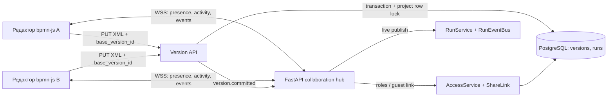

# RFC-0002. Совместная работа в редакторе BPMN в реальном времени

- Статус: реализован в `main` (`9270c1f`), развёрнут на bpmn.space; ограничения проверки перечислены ниже
- Дата: 2026-10-05
- Связано: RFC-0001 §§ 4–6, ADR-0001 (доступы), ADR-0003 (присутствие и история)

## Цель

Участники общего проекта видят, кто в нём находится, где расположен указатель каждого участника,
какой элемент он выбрал и кто запустил долгую операцию. Сохранённые схемы обновляются у участников
без перезагрузки. Права владельца, редактора и наблюдателя остаются такими же, как в текущем шаринге.
Две сборки одной схемы не стартуют одновременно; устаревшее сохранение не может молча затереть
новую версию.

Первая версия использует серверную последовательность полных проверенных BPMN-версий с оптимистической
проверкой базовой версии. Одновременные независимые правки видны сразу после сохранения автора. Если
два редактора сохраняют на основе одной версии, побеждает первая транзакция, вторая получает конфликт
и актуальную версию для синхронизации. Потерянная правка никогда не считается сохранённой. Автоматическое
слияние команд bpmn-js — отдельное расширение после проверки прототипа.

## Что уже есть

- `GET /projects/{id}/presence/events` передаёт по SSE список вошедших пользователей. `PresenceRegistry`
  в `app.state` дедуплицирует вкладки одного аккаунта и удаляет человека при отключении.
- Роли owner/editor/viewer уже проверяются на backend. Гостевой просмотр по ссылке обслуживается отдельно.
- bpmn-js передаёт XML в `onChange`; экран сохраняет его через `PUT /projects/{id}/diagram` как
  неизменяемую версию с автором.
- Частичный уникальный индекс PostgreSQL `uq_runs_active_project` уже запрещает два активных прогона
  одного проекта и возвращает `409`.

Существующий SSE-список аккаунтов остаётся. WebSocket добавляет краткоживущие курсоры и активность,
события версии и трансляцию состояния прогона. Это не дублирует присутствие. Гость с viewer-ссылкой
видит события комнаты, но не считается аккаунтом в списке участников.

Пользовательский список «Сейчас на доске» находится в хедере. Дублирующая зелёная плашка
«N в комнате» на холсте убрана в #15: при одиночной работе она не добавляла информации и
перекрывала мини-карту. Гости по-прежнему видны по курсорам с именами; SSE-список содержит
аккаунты, а не гостевые сессии. Dev/preview proxy Vite передаёт WebSocket вместе с `/api`.

## Область первой поставки

### Входит

1. Двунаправленная WebSocket-комната на проект.
2. Присутствие аккаунтов и guest-viewer сессий; назначенный сервером цвет, курсор в координатах
   BPMN-холста, выбранный элемент и состояние «просмотр/редактирование».
3. Объявление базовой версии, номера последовательности и каждой сохранённой версии.
4. Объявление запуска/хода анализа и сборки, автора операции, итогового статуса и ошибки всем
   участникам комнаты.
5. WebSocket-авторизация через текущую серверную cookie-сессию либо короткоживущий одноразовый билет,
   выданный после проверки гостевой viewer-ссылки.
6. Сверка `base_version_id` при ручном сохранении; устаревшая база даёт `409` с актуальной версией.
7. Локальные проверки минимум с двумя редакторами, viewer, гостевой ссылкой, несколькими вкладками,
   переподключением, отзывом ссылки, параллельным прогоном и конфликтом сохранения.

### Не входит

- Автоматическое слияние офлайн-правок и независимых одновременных действий без конфликтов.
- Глобальный чат, видео и постоянная история движения указателей.
- Масштабирование на несколько процессов backend в этой поставке.

Ограничения должны быть видны в UI. Первая версия обещает совместно наблюдаемую работу с безопасной
фиксацией изменений, но не автоматическое слияние любых конкурентных действий.

## Компоненты и поток данных

WSS обслуживает оперативные сообщения в одном процессе (как текущий SSE-журнал). Истина о схеме и
прогонах остаётся в PostgreSQL. При подключении клиент получает `ready` с текущей головой проекта,
сверяет её с загруженной версией и догружает расхождение обычным API. WebSocket не заменяет REST,
миграции или проверку доступа.

## WebSocket-контракт v1

Endpoint: `/api/v1/projects/{project_id}/collaboration/ws` (Upgrade `websocket`). Клиент получает
одноразовый билет через REST, затем передаёт его в `Sec-WebSocket-Protocol`. До `accept()` сервер
проверяет Origin, одноразовый билет, активный доступ и роль. Неизвестный/чужой проект не раскрывается.
Протокол — JSON с обязательным `type` и `protocol_version: 1`.

### Клиент → сервер

| Тип | Доступ | Поля |
|---|---|---|
| `presence.update` | все участники | `cursor: {x,y} \| null`, `selection: string[]`, `activity: idle\|editing`; редактор дополнительно передаёт временный `drag: {element_ids,start,current,phase}` |
| `ping` | все участники | `sent_at` |
| `diagram.saved` | запрещён клиенту | событие только от сервера: `version_id`, `number`, `actor`, `base_version_id` |

Клиент не сообщает имя, цвет, ID пользователя и роль. Сервер задаёт их по аккаунту/ссылке; цвет берёт
из ограниченной палитры. `selection` содержит только BPMN ID, не более 20. Координаты должны быть
конечными и разумно ограничены.

### Сервер → клиент

| Тип | Смысл |
|---|---|
| `ready` | версия протокола, проект, роль, id/номер текущей версии и revision |
| `presence.snapshot` / `presence.changed` | подключённые аккаунты/сессии, роль, цвет, курсор, выбор, активность |
| `diagram.version` | зафиксированная версия: id, номер, автор, дата, базовая версия |
| `run.changed` | run id, режим, статус, автор, этап, реальный прогресс, итог или ошибка |
| `resync.required` | серверная версия новее локальной; синхронизировать схему и локальный черновик |
| `error` | безопасный код и понятное сообщение, без сырых исключений/секретов |

Источники, промпты, ключи провайдеров, голосовые записи, пароли и токены ссылок не публикуются.
Проценты не имитируются: UI отображает только настоящий прогресс backend.

## Сохранение схемы и конфликты

- `PUT /projects/{id}/diagram` принимает `xml` и `base_version_id` (nullable только до первой схемы).
- В той же транзакции, где строка проекта блокируется и проверяется активный build, сервис сравнивает
  `base_version_id` с текущей головой проекта.
- Устаревшая база возвращает `409` с `code: stale_version`, `head_version_id` и номером; версия не
  создаётся и mutation не считается успешной.
- При совпадении выполняются существующие XML/XSD/security/lint-проверки, создаётся версия с автором;
  только после commit публикуется `diagram.version`.
- Если пришла чужая версия, чистый редактор импортирует её и сохраняет viewport. При неподтверждённой
  локальной правке нельзя импортировать XML молча: показать «Обновить с сервера» и «Скачать черновик».
- Транспортные повторы должны быть идемпотентны по `operation_id`, если такой ID добавляется.
- Версии остаются точками восстановления. Не создавать сотни версий на каждое движение: изменить
  текущий debounce 400 мс на ограниченную фиксацию после паузы/явного действия и добавить rate limit.

## Координация долгих операций

Частичный уникальный индекс `uq_runs_active_project` остаётся окончательным арбитром. Запуск и проверка
активной сборки идут под блокировкой проекта. `RunService` публикует всем участникам устойчиво записанные
в БД события прогона: один инициатор, один статус и общий результат. Проигравшая конкурентная попытка
получает `409` и актуальное состояние прогона. Пока сборка идёт, изменение данных, влияющих на её
контекст, должно быть запрещено либо входной снимок должен быть закреплён и показан пользователям.

## Авторизация и безопасность

- Аккаунт: cookie `arkhitektor_session`, same-origin WSS и allowlist Origin; членство перепроверяется
  периодически и перед изменениями.
- Гость viewer: share URL обменивается на случайный одноразовый ticket с TTL ≤ 60 секунд. Билет
  передаётся в `Sec-WebSocket-Protocol` с отдельным фиксированным протоколом, не в URL, чтобы он не
  попадал в access-логи. Билет привязан к проекту и viewer-роли, в памяти хранится только его хеш,
  использовать его можно один раз.
- Viewer отправляет только присутствие; WS не даёт обходить запреты REST для записи и запусков.
- Остановка общего прогона — `POST /runs/{run_id}/cancel`: сервер проверяет owner/editor, останавливает
  задачу и публикует терминальный статус `cancelled` в SSE и WebSocket. Viewer видит общий ход, но не
  может отменить запуск. Отмена ожидающего очереди прогона тоже освобождает его слот.
- При перемещении фигур редактор рассылает координаты начала/текущую позицию с существующей частотой
  presence-семплов. Остальные временно сдвигают SVG-группу на холсте; XML и версии не меняются на
  каждом кадре. После фиксации новой версии preview очищается; финальная позиция остаётся до 20 секунд,
  если сохранение не произошло.
- Payload ≤ 8 KiB, курсор не чаще 20 раз/сек на соединение, до 20 участников на комнату и 3 соединений
  на пользователя; heartbeat, idle timeout, cleanup при disconnect.
- Отклонять неизвестные поля/типы и неподдерживаемую версию протокола. Тело сообщений и секреты не
  логировать. При отзыве ссылки или членства сокет закрыть при следующей проверке доступа.

## Надёжность и масштабирование

Production сейчас использует один backend-процесс, поэтому краткоживущий in-memory hub достаточен для
комнат, но не долговечен. После рестарта клиенты подключаются заново, получают `ready`, загружают
последнюю версию и статус run через REST. Для нескольких backend-процессов потребуется Redis Pub/Sub
или эквивалент межпроцессной рассылки; это не источник истины — им остаётся PostgreSQL.

WSS проходит через существующий Caddy reverse proxy и TLS, отдельный внешний порт не открываем.
Проверить Upgrade, idle timeout, graceful shutdown и reconnect через compose.

### Частота указателя и рендер

Указатель — временное состояние, поэтому клиент коалесцирует частые `pointermove` до последнего
семпла с частотой около 16,7 Гц и не отправляет накопившиеся кадры после перегрузки сокета. Это
оставляет запас относительно серверного лимита 20 Гц, чтобы колебания таймеров не теряли сообщения.
Полученное присутствие обновляет отдельное клиентское хранилище:
перерисовываются только курсоры и удалённые выделения, а не всё рабочее пространство с bpmn-js.
Положение курсора анимируется CSS `transform`, браузер композитит движение между сетевыми семплами.
Постоянно назначать GPU-слой каждому элементу не следует: состав комнаты ограничен 20 участниками.

### Пул PostgreSQL

Локальные логи при воспроизведении зависания показали исчерпание SQLAlchemy-пула (5 постоянных
соединений и 10 overflow): запросы ждали до 30 секунд, затем возвращали 500, а Caddy — 502. Причина
подтвердилась в долгих захватах соединения на 53 и 88 секунд: авторизация FastAPI Users открывала
SQLAlchemy-сессию в зависимости со сроком жизни всего HTTP-запроса. Для SSE ответ оставался открытым,
пока клиент слушал поток, поэтому сессия и соединение пула жили вместе с ним. Вкладки с открытой
доской постепенно исчерпывали пул.

Для двух SSE-маршрутов проверка cookie теперь выполняется отдельной короткой сессией: она закрывается
до отправки первого события, а доступ к проекту проверяется отдельно. В контрольном прогоне открытый
presence-поток жил дольше 6 секунд; восемь следующих запросов к проектам вернули 200, предупреждений
о долгом захвате пула не было. Пул остаётся ограниченным: 10 постоянных + до 10 временных соединений
на worker, ожидание до 5 секунд. Время удержания от 5 секунд логируется без SQL и пользовательских
данных. Бесконечный overflow запрещён, чтобы не переносить перегрузку на сам сервер БД.

## Этапы

1. **Спецификация и backend foundation:** hub, протокол, авторизация аккаунтов и гостевых билетов,
   WebSocket endpoint, ограничения, REST revision contract, схемы БД только при необходимости,
   unit/integration/security tests.
2. **Backend broadcast:** новая версия и события run рассылаются после commit; начальный snapshot,
   reconnect, resync и обновлённый OpenAPI.
3. **Frontend presence:** люди и цветные курсоры, имена, selection/activity; read-only поведение,
   offline/error/reconnect.
4. **Frontend synchronization:** новая версия без перезагрузки, защита локального черновика, общий
   прогресс run и понятное отображение конфликта.
5. **Локальное hardening:** два browser-context, E2E, миграции upgrade/downgrade, contract-check,
   безопасность и испытание 20 участников. Merge и deploy — только по отдельному согласию.

### Текущий статус реализации

- Этапы 1–4 реализованы в этой локальной ветке: backend-контракт и WebSocket, проверки членства и
  гостевой viewer-ссылки, трансляция ручных/сгенерированных версий и событий run, frontend-присутствие,
  курсоры, selection, resync и защита локального черновика.
- Для курсоров клиентская частота ограничена примерно 16,7 Гц; обновления указателя вынесены из состояния всего
  `DiagramPanel`, а очередь сокета ограничена, чтобы не воспроизводить устаревшие движения.
- При первом локальном воспроизведении backend выбил прежний пул PostgreSQL и отдавал 500/502;
  причиной была request-scoped DB-сессия в авторизации SSE. Потоковая авторизация переведена на
  короткую сессию; настройки пула ограничены и включено диагностирование длительных checkout.
- Новые таблицы и миграции не нужны: комнаты/билеты эфемерны, версия и run уже хранятся в PostgreSQL.
- Этап 5: `make check`, PostgreSQL-интеграция и Playwright-сценарий двух независимых браузерных
  сессий прошли. E2E проверяет гостевой viewer, общую комнату, курсор и выделение элемента.
  Проверка 20 одновременных участников ещё не проводилась. Перед слиянием остаётся ручная проверка
  интерфейса и подтверждение пользователя.
- После проверки пользователем добавлены API-команда отмены общего прогона и статус `cancelled`;
  владелец/редактор могут остановить процесс из любой своей вкладки, viewer получает `403`.
  Прогон, ожидающий semaphore, тоже переводится в финальный статус без старта.
- Добавлен ephemeral `drag` в `presence.update`: наблюдатели видят промежуточное перемещение BPMN-фигуры
  до сохранения. Финальный preview удерживается до новой версии (или максимум 20 секунд) и не создаёт
  дополнительных XML-версий на каждый кадр.

## Критерии готовности локального релиза

- Owner/editor/accepted viewer/guest viewer соединяются только с разрешённым проектом; чужой аккаунт,
  просроченная или отозванная ссылка не подключается.
- Два аккаунта без обновления страницы видят присутствие, курсор, выбор, подключение/уход.
- Owner/editor может отменить общий прогон с другого аккаунта; viewer получает `403`. Все вкладки
  получают единое состояние `cancelled`, включая запуск, ожидающий семафор.
- Редактор и viewer-ссылка видят промежуточное движение выбранной BPMN-фигуры до отпускания мыши;
  новая версия сохраняется только обычным механизмом после паузы, а не на каждый кадр.
- Viewer виден редакторам, но не может выполнить mutation по WS или REST.
- Новая версия и её автор становятся видимы участникам; две записи от одной базы не затирают друг друга,
  вторая получает конфликт и безопасную синхронизацию.
- Конкурентные сборки дают один run; всем показаны один инициатор и общий ход.
- Reconnect восстанавливает последнюю версию и статус run; отключённый WebSocket не ломает обычный REST.
- `make up`, миграции, `make check` и E2E проходят локально. Ничего не отправлено в main/production.

## Следующее техническое исследование: слияние команд

Безконфликтная одновременная работа требует учесть команды bpmn-js, undo/redo, geometry, properties,
lanes, sequence flows и moddle. Сливать BPMN XML текстовым CRDT нельзя. Отдельный PoC сравнит серверно
упорядоченные команды с конфликтами на общих элементах, CRDT-представление BPMN-графа с конвертацией
в XML и временные блокировки элементов. До выбора и проверки стратегии v1 честно обнаруживает конфликт
и защищает данные, но может попросить синхронизировать локальную базу после чужого сохранения.
