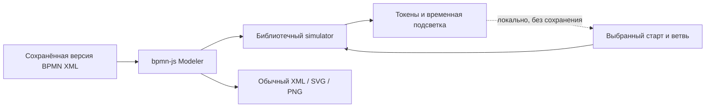

# RFC-0003. Воспроизведение BPMN и бизнес-время

- Дата: 2026-10-06
- Статус: воспроизведение реализовано и локально проверено в #16; модель бизнес-времени предложена в #17
- Связано: [RFC-0001](0001-architecture.md) §2.4, §5.3–5.5, [ADR-0005](../adr/0005-process-playback.md), GitLab #5, #16, [#17](https://git.codenrock.com/codenrock/ii-assistenty/podayte-tokenov-pzhpzh/arkhitektor-bpmn-diagramm/-/issues/17)

## Зачем это бизнесу

Аналитик проверяет не только вид схемы, но и поведение: какой путь выбран, какие согласования идут
одновременно, на каком событии процесс ожидает продолжения. Это помогает обнаружить ошибку порядка,
недостающий исход и зависшее согласование до передачи процесса на автоматизацию.

«Таймлайн процесса» в текущем UI означает воспроизведение движения токенов. Скорость ×1/×2 относится
к экранной анимации. Она не означает, что согласование длится минуту или что вычислен срок заявки.
Расчёт длительностей — отдельная модель с подтверждёнными исходными данными.

## Что уже есть в коде

Редактор подключает `bpmn-js-token-simulation`. Библиотека исполняет семантику шлюзов и событий,
показывает движение по sequence flow, допускает ожидание внешнего события и несколько экземпляров.
Наша интеграция до #16 включала режим, но не запускала выбранный старт; пользователь видел
управление скоростью без движущегося процесса.

Backend сохраняет полный XML каждой версии, а LLM возвращает JSON. Рабочий генератор
`llm/openai_compatible.py` и `domain/bpmn/linear.py` пока компилирует список шагов в линейную цепочку.
Полноценный IR/ProcessGraph со шлюзами остаётся задачей #5. Вручную созданные и импортированные
BPMN со шлюзами уже доступны редактору и воспроизведению; их поддержка не означает, что LLM умеет
генерировать такой граф.

## Первый этап: воспроизведение без новой серверной модели

В #16 интеграция запускает единственный допустимый старт сразу, а для нескольких стартов предлагает
выбрать событие. Параллельный шлюз создаёт несколько токенов, соединяющий AND ожидает каждый вход.
XOR проходит по выбранной ветви. Цикл повторяет путь; первый EndEvent не обязательно завершает
весь экземпляр, если в другой ветви ещё есть токены. Catch event и receiveTask могут ожидать
внешнего сигнала: UI показывает ожидание и доступное действие.

Стартовые события не образуют неявный параллельный шлюз. Два старта обычно обозначают разные
способы начать экземпляр. Чтобы показать два независимых процесса, нужен отдельный выбор/запуск
экземпляров; нельзя автоматически нажать все старты и объявить получившуюся картину одним сценарием.

Воспроизведение локально для вкладки. Оно не отправляет `onChange`, не создаёт BPMN-версию и
не транслируется коллегам как редактирование. Смена XML останавливает прежний прогон. Экспорт
остаётся обычной схемой без токенов, временных цветов и состояния паузы. Проверяется импорт и
экспорт стандартным bpmn-js, XSD и bpmnlint.



## Второй этап: параметры бизнес-времени — предложение

### Контракт задачи

Параметры привязаны к конкретному BPMN-элементу в конкретной версии. Минимальный DTO:

```json
{
  "schema_version": 1,
  "element_id": "Task_ApproveFinance",
  "duration_seconds": 7200,
  "time_basis": "elapsed",
  "origin": "source",
  "evidence": { "source_id": "uuid", "quote": "Согласование занимает два часа" }
}
```

`duration_seconds` — неотрицательное целое с документированным верхним пределом. Отсутствующее
значение означает «длительность неизвестна», а не ноль. `origin`: `source` (проверенная цитата),
`manual` (аналитик задал явно), `assumption` (явное допущение). Для `source` сервер проверяет цитату
по исходнику. Выдуманное моделью число без доказательства не становится фактом.

Первый выпуск поддерживает прошедшее время (`elapsed`), не рабочие дни. Фразы «до трёх рабочих
дней», SLA и длительность исполнения — разные величины. Их нельзя автоматически превращать в
259200 секунд. Календарь с часовым поясом, выходными, праздниками и рабочими окнами требует
отдельного контракта. Диапазон времени можно добавить отдельной версией схемы: его нельзя
подменять случайным значением, выдавая случайный сценарий за прогноз.

### Сценарий исполнения

Сценарий описывает входы симуляции, а граф остаётся BPMN:

- выбранный старт и процесс;
- исходящие потоки для XOR; несколько выбранных потоков для OR;
- число итераций для ограниченных циклов;
- внешний сигнал и момент его подачи для ожидающего события;
- ручные значения длительностей с явным приоритетом над извлечёнными.

Нет выбора на XOR — UI ждёт пользователя. Условия из XML не исполняются как JavaScript и не
запускаются в произвольном интерпретаторе. Выбор — сценарный параметр, пока нет отдельно принятого
безопасного движка выражений. Неограниченный цикл прерывается по лимиту переходов/времени с
диагностикой «Лимит сценария», а не со статусом «Завершено».

### Расчёт

Для последовательных операций: `T = sum(duration_i)`. Для участка AND от разветвления до
соединения: `T = max(T_branch_i)`, поскольку ветви идут одновременно. После join продолжается
общая последовательность. XOR учитывает только выбранный путь. В цикле время зависит от числа
повторов. При неизвестной длительности или неподанном внешнем сигнале итог остаётся неполным;
можно показать известный нижний предел и назвать неопределённую операцию.

Пример: бухгалтерия — 2 ч, экономист — 5 ч, после совместного согласования оформление — 1 ч.
AND занимает 5 ч, весь участок — 6 ч. Складывать 2 + 5 + 1 и получать 8 ч неверно.
Два независимых старта учитываются как разные экземпляры, а не как ветви одной заявки.

Порядок событий задаётся дискретными отметками модельного времени. Экранные интервалы сжимаются
для удобства просмотра; рядом явно показывается модельное время. Существующий simulator остаётся
источником семантики переходов. Прежде чем встраивать длительности в его ActivityBehavior,
нужен небольшой прототип на установленной версии и тест join с разными длительностями ветвей.
Плоский обход списка задач для расчёта не подходит.

## Переносимые метаданные и XML

Для будущего этапа предлагается `bpmn:extensionElements` с версией схемы и собственным namespace
`https://bpmn.space/schema/process-timing/1.0`. Это штатная точка расширения BPMN; граф, имена,
дорожки и DI остаются стандартными. Временные токены и состояние запуска в неё не записываются.

```xml
<bpmn:task id="Task_ApproveFinance" name="Согласовать в бухгалтерии">
  <bpmn:extensionElements>
    <arch:Timing schemaVersion="1" durationSeconds="7200"
                 timeBasis="elapsed" origin="manual" />
  </bpmn:extensionElements>
</bpmn:task>
```

Namespace `arch` объявляется на `definitions`. Компилятор создаёт XML из проверенного JSON;
модель не пишет XML. Frontend получает moddle descriptor и сохраняет типизированное расширение
при обычном редактировании/экспорте. Backend сейчас отклоняет чужие namespace в `ensure_safe_xml`:
добавление расширения требует отдельной строгой проверки названия, размещения, атрибутов,
диапазона чисел и версии. Нельзя просто разрешить любые элементы собственного namespace.

Сторонний просмотрщик должен открыть стандартную диаграмму и может проигнорировать расширение.
Сохранение неизвестных расширений зависит от редактора. Для каждого заявленного редактора нужен
roundtrip-тест; без него сохранность метаданных после чужого save не обещается. При потере или
неподдерживаемой версии расширения наше приложение открывает саму схему и показывает отсутствие
параметров, без выдуманного восстановления.

Сравнение вариантов:

| Хранение | Открытие BPMN | Перенос параметров | Решение |
|---|---|---|---|
| Только БД/sidecar | обычный XML | параметры не путешествуют с XML | подходит для временных прогонов, не для экспортируемых настроек |
| JSON в `bpmn:documentation` | стандартное поле, часто сохраняется | машинный JSON виден как документация | запасной вариант, смешивает описание процесса и настройки |
| Типизированные `extensionElements` | стандартная точка расширения | сохранность проверяется по редакторам | предлагается для версии 1 |

## Обновление после ответа на вопрос

Ответ сохраняется источником со статусом вопроса `answered`. Только следующий анализ/сборка
перепроверяет доказательства и создаёт новые параметры/версию. В UI «Решённые» содержит уже
отвеченные вопросы с подписью ожидания анализа; это не изменение доменного `resolved`.

Ручное значение не перезаписывается моделью молча. Новый противоречащий источник создаёт вопрос
и предлагает выбрать актуальное значение. Идентификаторы элементов должны иметь устойчивый
смысл при обновлении графа. Сейчас генератор повторно использует `Task_1…N`: переносить параметры
старого `Task_1` в новую схему по одному ID нельзя. Нужен механизм сопоставления шагов, подтверждённый
трассировкой/IR, и явное сообщение о параметрах, которые сопоставить не удалось.

Сценарий исполнения привязан к версии. Если поток удалён, выбранная ветвь инвалидируется; новый
запуск ждёт выбора. Undo/redo ручного изменения параметров работает через команды bpmn-js, а
контроль `base_version_id` продолжает защищать совместные сохранения.

## Проверки и оценка сложности

Для #16: линейный процесс, XOR, AND с join, цикл, несколько стартов, ожидание события, pause/replay,
обе темы, reduced motion, read-only и отсутствие записи версии при проигрывании. XML/экспорт
проверяются отдельно от визуального эффекта.

Для второго этапа: сериализация/валидация metadata, roundtrip нашим и обычным bpmn-js,
XSD/bpmnlint, неизвестная версия, неверные/слишком большие числа, отсутствие duration,
разные времена параллельных ветвей, лимит цикла, обновление по проверенной цитате, ручной
приоритет и изменение ID между версиями. Расчёт по рабочему календарю отдельно не заявляется.

Оценка для разработчика, уже знакомого с проектом, до реализации прототипа:

| Объём | Оценка | Основной риск |
|---|---|---|
| Довести существующее воспроизведение и UX | 1–2 рабочих дня | интеграция управления и видимость SVG-анимации |
| Простые duration + metadata + извлечение + расчёт заданного пути | 3–5 рабочих дней | неизвестное время, сопоставление версий и roundtrip |
| Полноценная генерация IR с XOR/AND/циклами (#5) | 5–10 рабочих дней | корректность графа, layout и сохранение ручных изменений |
| Рабочие календари, распределения, статистический прогноз | требует отдельной оценки | источник данных и семантика времени |

Это инженерная оценка, а не измеренный срок. Второй этап имеет отдельные критерии приёмки и
не считается готовым по факту появления движущегося токена.

## Первичные источники

- [bpmn-js-token-simulation](https://github.com/bpmn-io/bpmn-js-token-simulation)
- [API управления и трассировки](https://github.com/bpmn-io/bpmn-js-token-simulation/blob/main/docs/simulation-support/README.md)
- [Объяснение целей token simulation](https://bpmn.io/blog/posts/2023-the-case-for-bpmn-token-simulation)
- [BPMN 2.0.2 и официальные XSD](https://www.omg.org/spec/BPMN/2.0.2)
